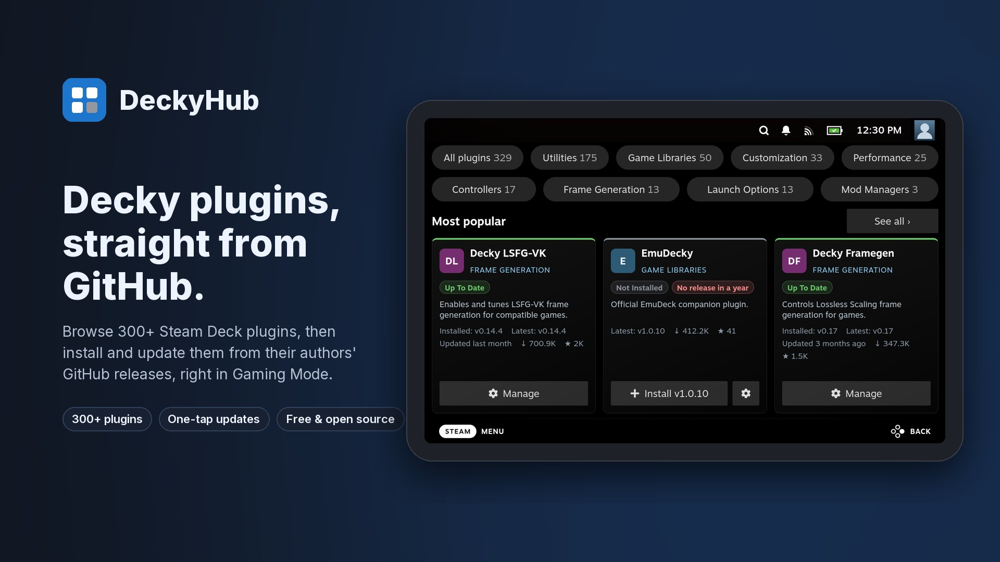
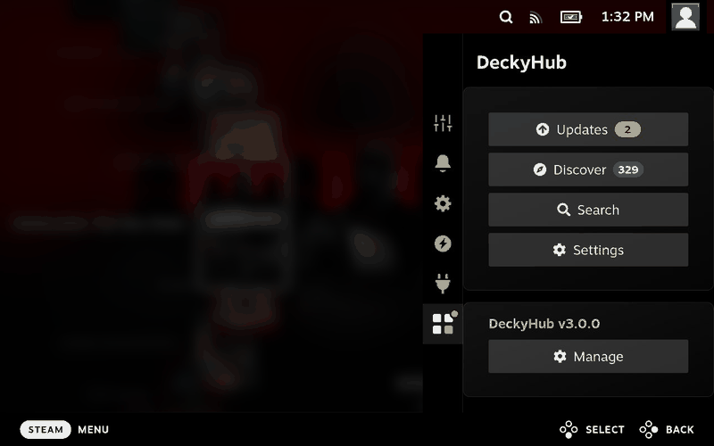
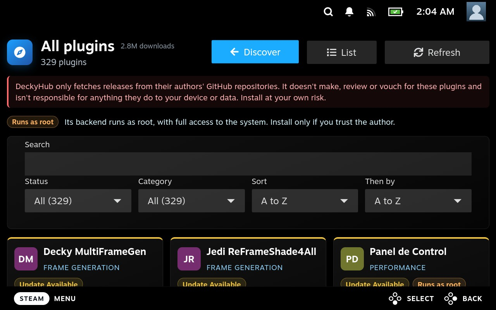
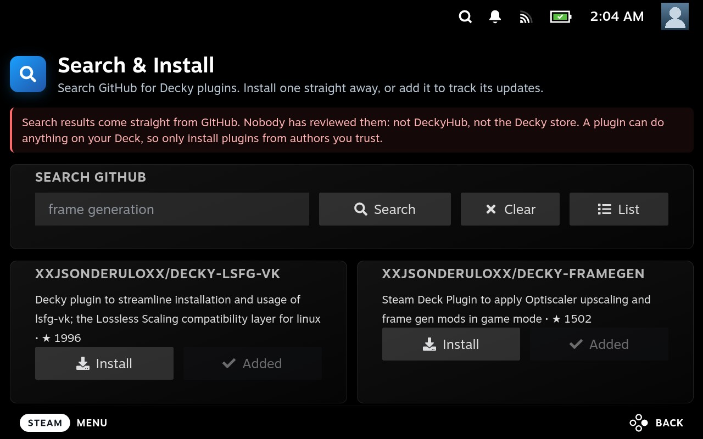
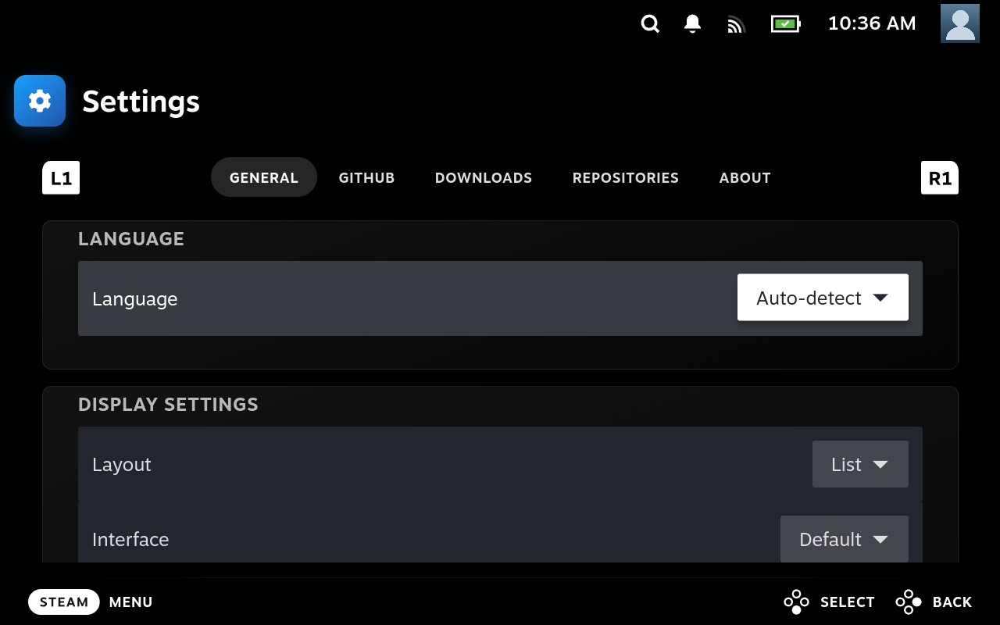

# DeckyHub

**Your Steam Deck's plugin store — right inside Gaming Mode.**

Find, install and update Decky Loader plugins with your controller — from DeckyHub's plugin list, or any plugin on GitHub.

[**Download**](https://github.com/mazillka/deckyhub-plugin/releases/latest) · [Website](https://mazillka.github.io/deckyhub-plugin/) · [Plugin catalog](https://mazillka.github.io/deckyhub-registry/) · [Install guide](#installing-deckyhub) · [Report an issue](https://github.com/mazillka/deckyhub-plugin/issues)

<table>
<tr>
<td align="center"> <b>Quick Access</b></td>
<td align="center"> <b>Updates</b></td>
<td align="center"> <b>Manage</b></td>
</tr>
<tr>
<td align="center"> <b>All plugins</b></td>
<td align="center"> <b>Search</b></td>
<td align="center"> <b>Settings</b></td>
</tr>
</table>

> [!CAUTION]
> **DeckyHub only fetches releases from their authors' GitHub repositories. It doesn't make, review or vouch for these plugins and isn't responsible for anything they do to your device or data. Install at your own risk.**

Tired of tabbing out to Desktop Mode, hunting through GitHub releases, and manually downloading ZIPs every time a plugin updates? DeckyHub brings plugin discovery and updates straight to your controller. Browse a catalog of over 300 Steam Deck plugins, search GitHub for any other Decky plugin and install it on the spot, and get notified the moment an update drops — all without leaving your couch. It's the first and last plugin you'll ever install from a ZIP.

> **A note on how this is made.** Most of DeckyHub's code was written with the help of AI tools (Claude and Codex). That doesn't mean it ships untested — every release is verified on real hardware before it goes out. I'm telling you this upfront so you know exactly what you're installing and how it got built.

## Why you'll like it

- **Any plugin on GitHub, one search away** — **Search & Install** finds Decky plugins that aren't in any store and installs them right from Gaming Mode. No Desktop Mode, no browser, no Developer Mode URL pasting.
- **Never miss an update** — DeckyHub checks your installed plugins against their latest GitHub releases and pings you with a toast the moment something new is available.
- **Built for the couch** — full gamepad navigation, color-coded status at a glance, and one-tap downloads designed for Gaming Mode, not a desktop browser squeezed onto a small screen.
- **You stay in control** — DeckyHub never installs or runs anything on its own. Nothing touches your system until you say so, and installs go through Decky Loader's own installer and confirmation dialog (see [Manage](#manage)).

## What it does

- **Discover** — browse DeckyHub's list of Steam Deck plugins/tools, filter by search or installed status, and see release info at a glance, color-coded by status.
- **[Search & Install](#search--install)** — search GitHub for Decky plugins and install one in a tap, or add it to track its updates.
- **Updates** — see which of your tracked, installed tools have a newer release available and what each one brings, and update the Decky plugins among them in one go with **Update All**. DeckyHub checks in the background every few hours, so the dot on its icon and a toast tell you when new updates show up, and each card says **Installing…** until Decky finishes, then a toast confirms it.
- **Settings** — in tabs (**L1** / **R1** switch between them): **General** picks the language and adjusts the display (**Grid** or **List**, **Default** or **Compact** density, items per row, haptics, whether DeckyHub has its own tab in Quick Access, and which Manage-window buttons to hide); **GitHub** takes an optional personal access token to raise the API rate limit (typed, or loaded from a text file in Downloads); **Downloads** shows the download folder and the **Overwrite Existing** toggle; **Repositories** removes tracked repositories, exports and imports your list, and adds other people's app lists under **Custom Registries**; **Logs** has **Export Logs** for bug reports; **About** says what DeckyHub is and credits the catalogs it builds on. Per-repository release-channel overrides live behind each app's **Manage** button on Discover/Updates instead.
- **Quick Access Menu** — DeckyHub has its own tab (the four-square DeckyHub icon, with a dot when updates are waiting) in the Quick Access tab strip, next to Decky's, and still opens from Decky's plugin list too. It shows **Discover**, **Search** and **Settings**, plus **Updates** with a count whenever updates are waiting. Below them: DeckyHub's own version and update check, and a **Cleanup** section (shown when the download folder has files) that empties it after confirmation.

DeckyHub never installs or runs anything automatically. **Download ZIP** saves a release, which you install yourself via Decky's settings → Developer → Install Plugin from ZIP. For one-tap install, update and uninstall, see [Manage](#manage).

## The plugin list

No setup, no configuration — the plugin list shows up in Discover the moment you install DeckyHub. It lives in [mazillka/deckyhub-registry](https://github.com/mazillka/deckyhub-registry) and refreshes every time DeckyHub starts, so new apps show up without a DeckyHub update. DeckyHub keeps the last list it downloaded for offline use; a fresh install needs to reach GitHub once.

**Where the plugins come from:**

- **Suggested:** plugins people suggest through the registry's issues and pull requests.
- **[Decky Extended Plugins](https://decky-extended-plugins.beallio.com/)** by [beallio](https://github.com/beallio): a community catalog of the Decky store plus community plugins, with a [security audit](https://decky-extended-plugins.beallio.com/audit).
- **[Decky Plugins Explorer](https://safetzahirovic.github.io/decky-plugins-explorer/)** by [SafetZahirovic](https://github.com/SafetZahirovic): a nightly crawl of every public GitHub repository with a Decky `plugin.json`.

A daily job checks both catalogs, plus its own search of GitHub for repositories tagged or named like Decky plugins, for plugins that aren't listed yet, skips ones that look unfinished (brand new, nobody using them yet, a placeholder version), and opens a pull request with the ones that qualify. Every plugin, however it was found, has to have a stable GitHub release with exactly one plugin ZIP whose `plugin.json` name matches. These are automatic checks for a working release: nobody reviews the plugins themselves, for safety or anything else; the [catalog](https://mazillka.github.io/deckyhub-registry/) and Discover flag plugins that run as root, haven't had a release in a year, or got a warning from the [security audit](https://decky-extended-plugins.beallio.com/audit).

- **Browse it:** the [plugin catalog](https://mazillka.github.io/deckyhub-registry/) lists every plugin, searchable and by category, with downloads and stars.
- **Suggest a plugin:** open an [issue](https://github.com/mazillka/deckyhub-registry/issues/new) or a pull request in the registry repository.
- **Want more?** Find any other Decky plugin on GitHub with **[Search & Install](#search--install)**.

## Installing DeckyHub

1. Make sure [Decky Loader](https://decky.xyz/) is installed.
2. Download the latest `DeckyHub-v*.zip` from the [Releases page](https://github.com/mazillka/deckyhub-plugin/releases).
3. In Gaming Mode, open the Quick Access Menu → Decky → settings (gear icon). Turn on **Developer mode** under General if it's off, then go to **Developer** → **Install Plugin from ZIP** and select the downloaded file.
4. Open the Quick Access Menu and pick DeckyHub's four-square icon in the tab strip (or Decky → **DeckyHub**).

DeckyHub is the first and last plugin you'll ever install from a ZIP: from then on it installs and updates your other plugins, and itself, right from Gaming Mode.

## Using DeckyHub

### Controller buttons

DeckyHub uses the standard Steam Deck controls, plus extra shortcuts on every **Install** / **Update** button (on Discover and Updates cards, on **Search** results, in the [Manage](#manage) window, and for DeckyHub's own update):

| Button | What it does |
| --- | --- |
| **X** | Download that release's ZIP to `/home/deck/Downloads/deckyhub` instead of installing it. Not shown when **Download ZIP** is hidden in Settings. |
| **Y** | Show the release notes (what that release changes) without installing anything. |
| **Menu** (☰) | Open the plugin's GitHub page. Not on DeckyHub's own update. |

Steam's footer shows these actions for whichever button is focused.

### Discover

Discover opens on three shelves, **Most popular**, **Recently updated** and **New in DeckyHub**, under a row of category chips with how many plugins each holds. Tap a chip, or **See all** on a shelf, to browse the whole list: as a compact list of every plugin (the default), or as a **Grid** of cards a page at a time (**L1** / **R1** turn the page). **Updates** and **Search** have the same **Grid** / **List** switch, and DeckyHub remembers your choice. The first time, a short welcome above the shelves says what DeckyHub does and how to stay safe.

Browse the list or search it by name, repository, category or description, and open **Filters** to filter by **Status** (All, Installed, or Not Installed) and **Category**, and **Sort** A to Z, Z to A, Most downloaded, Most stars, Recently updated, or Recently added (newest additions to the list first; plugins with an update always come first), with **Then by** ordering plugins the first sort leaves tied. Every **Status** and **Category** option shows how many plugins it would list. Each card is color-coded (green once it's up to date, yellow when an update is available, red on an error) so you can spot what needs attention at a glance, and says **Checking…** while its latest release is still being looked up. Listed plugins also show their all-time downloads, GitHub stars and when they were last updated, plus a **Runs as root** badge when the plugin's backend runs as root (full access to the system), **No release in a year** when it may be abandoned, and **Fork** on a fork that carries a plugin on after its original stopped. Warnings from Decky Extended Plugins' automated [security audit](https://decky-extended-plugins.beallio.com/audit) of the release you'd install sit beside them: **Reads private data**, **Changes system startup**, **Code not in its repo**, **Hidden code**, **Skips HTTPS checks**, **Runs downloaded scripts**, **Known vulnerabilities**, or **Blocked by audit** (not recommended for installation). **More** on the notice at the top of Discover explains each one; a warning isn't proof of harm, and no warning isn't proof of safety. Those numbers and warnings come from the registry, refreshed every hour; the page header shows the total downloads. A card set to the pre-release **Channel** says so; stable is the default and isn't labelled. Tap **Manage** on any card to pick a channel and version, then download the release asset you want.

### Search & Install

Not every Decky plugin is in the Decky store or DeckyHub's list. Open **Search** from the Quick Access Menu, type what you're after, and DeckyHub looks it up on GitHub, right from Gaming Mode.

- **Only Decky plugins** — results are limited to repositories that are actually Decky plugins, so awesome-lists, guides and unrelated projects don't get in the way.
- **Install** — adds the repository to your tracked list and hands its latest release to Decky Loader's own installer, behind the usual confirmation. From then on it shows up in Discover with update checks, like any listed plugin.
- **Add** (the **+** beside Install) — only tracks the repository, so you can look at it in Discover and install it later. Results already in DeckyHub say **In DeckyHub**.
- **Y** on a result's **Install** shows that release's notes, and **X** downloads its ZIP instead.

> [!WARNING]
> Search results come straight from GitHub and nobody has reviewed them: not DeckyHub, not the Decky store. A plugin can do anything on your Deck, so only install plugins from authors you trust.

Tracked repositories are listed in **Settings** → **Repositories**, where you can remove them or export and import the list.

### Updates

Shows every tracked tool that's installed and has a newer release available, along with its installed and latest version. Update a plugin from its [Manage](#manage) window, or, when more than one Decky plugin is waiting, tap **Update All** to hand them all to Decky Loader's installer behind a single confirmation. Plugins that need a fresh install instead of an in-place update (currently Unifideck) are left out of **Update All**; update those from their Manage window. The **Updates** button in the Quick Access Menu shows how many updates are waiting.

### Manage

Tap **Manage** on any card in Discover or Updates to:

- pick the release **channel** and a specific **version**. **Stable** shows only stable releases; **Pre-release** shows every release, newest first, so a stable release that comes out after the last pre-release is still offered;
- **Download ZIP**, open the **Release Page**, or **Check for Updates** for that app;
- for a Decky plugin, **Install** (not installed yet) or **Update** (the selected version is newer than the installed one). DeckyHub downloads the release ZIP (with a progress window, then a spinner until Decky is ready) and hands it to Decky Loader's own installer, the same one the Decky Store uses. Decky asks you to confirm and installs it, verifying the SHA-256 checksum GitHub publishes for the ZIP. Older releases (files uploaded before mid-2025) have no checksum and Decky installs them without that check;
- for an installed Decky plugin, **Uninstall**, which asks you to confirm and then removes the plugin and its settings through Decky Loader.

### Downloads

All downloads are saved to `/home/deck/Downloads/deckyhub`. **Cleanup** → **Empty Folder** in the Quick Access Menu clears that folder after confirmation. Starting a download opens a progress dialog with a **Cancel** button; once it finishes, the same dialog shows where the ZIP was saved and how to install it. If a download is interrupted, no partial file is left behind.

When GitHub provides a checksum for a release asset, DeckyHub always verifies it before keeping the download. By default, downloading a file again overwrites the previous copy; turn off **Overwrite Existing** in Settings if you'd rather keep both.

### Repositories

Repositories is a tab in **Settings**. Add a repository from **Search** with the **+** beside a result's **Install** (results already in DeckyHub say **In DeckyHub** instead). Export your custom repositories to `DeckyHub-repositories.json` in `/home/deck/Downloads` to back them up or share them, or import that file back in. Any repository you've added can be removed again here; the plugins in DeckyHub's own list stay available and can't be removed. Prefer a bigger screen? The [Registry Editor](https://mazillka.github.io/deckyhub-registry/editor.html) is a browser-based tool for building or editing a repository list file before importing it.

To switch a tracked app between stable and pre-release releases, use its [Manage](#manage) window.

**Registry Channel**, in DeckyHub's own **Manage** window (Quick Access → DeckyHub → **Manage**), picks which version of DeckyHub's own plugin list you see. **Stable** (the default) is what everyone gets. **Pre-release** shows plugins and list changes that are still being tested, and Updates and Discover say **Pre-release registry** while it's on; if that list can't be loaded, DeckyHub uses the stable one. Switching reloads the list straight away.

Under **Custom Registries**, add someone else's app list by its GitHub `owner/repo` (DeckyHub reads its `registry/apps.json`) or any HTTPS `.json` URL. Its apps join Discover alongside DeckyHub's own; up to 10 registries are allowed, and **Refresh registries** downloads them all again. An added registry can only add apps: it can't change or replace one DeckyHub already lists, including the plugins you have installed.

### Keeping DeckyHub itself updated

The Quick Access Menu shows the installed version (**DeckyHub vX.Y.Z**) and checks for a newer DeckyHub release in the background, with a notification the first time one appears; a note names the new version and an **Update** button installs it straight away, like an app card's. **Manage** opens DeckyHub's update window, where you pick a channel (**Stable releases**, or **Pre-releases** for every release) and a version, then:

- **Update to / Reinstall / Downgrade to vX.Y.Z** — downloads that release (with a progress window) and hands it to Decky Loader's own installer (the same one the Decky Store uses), which verifies its SHA-256 checksum and installs it in place. Only releases with a published checksum are offered.
- **Download ZIP** — the classic path: saves the release ZIP to `/home/deck/Downloads/deckyhub`, which you then install yourself via Decky's settings → Developer → Install Plugin from ZIP.

If automatic update isn't available for some reason (e.g. running inside an older Decky Loader build), fall back to Download ZIP.

## Good to know

- DeckyHub talks to GitHub without needing you to log in. Release info for DeckyHub's list comes from one file the registry refreshes every hour, so browsing doesn't use up GitHub's public rate limit (60 requests/hour); searching and repositories you added yourself still ask GitHub directly, so very heavy use may hit it — if it does, the error names it as a rate limit and says roughly how long to wait, rather than just a raw status code. Add a personal access token in **Settings → GitHub** (no scopes needed — it only reads public repos and releases) to raise that to 5,000/hour; the token stays on your device and is only ever sent to `api.github.com`.
- Release information is cached for 30 minutes, so opening the same app's Manage window or the DeckyHub update modal again shortly after won't always show something new. Every "Check for Updates" and "Refresh" button bypasses this and fetches fresh release info, though a brand-new release can take up to an hour to reach the plugin list's release file.
- Downloads only ever happen over HTTPS.

## Disclaimer

Not affiliated with Valve or the Decky Loader project. DeckyHub is a discovery and download tool: plugin information comes from public GitHub repositories, and every plugin belongs to its own authors. DeckyHub doesn't review, own or endorse any third-party plugin or its content, and isn't responsible for what one does. Plugins are installed at your own risk, so look at a plugin's repository before you install it, especially one found through Search.

## License

GPL-3.0-or-later — see [LICENSE.md](LICENSE.md).

## Getting help

Found a bug or have an idea? Open an issue on the [GitHub repository](https://github.com/mazillka/deckyhub-plugin/issues) with a description of what happened; attaching the ZIP from **Export Logs** (**Settings** → **Logs**) helps, and it never contains your GitHub token. Feedback and suggestions are always welcome.

Want to build DeckyHub from source or contribute a change? See [CONTRIBUTING.md](CONTRIBUTING.md).
