

# DeckyHub

**Your Decky plugin hub — right inside Gaming Mode.**

Find, install and update Decky Loader plugins with your controller — from DeckyHub's plugin list, or any plugin on GitHub.

**English** · [Українська](README.uk.md)

 

[**Download**](https://github.com/mazillka/deckyhub-plugin/releases/latest) · [Website](https://deckyhub.com/) · [Release notes](https://deckyhub.com/releases.html) · [Plugin catalog](https://deckyhub.com/plugins/) · [Install guide](#installing-deckyhub) · [Report an issue](https://github.com/mazillka/deckyhub-plugin/issues)

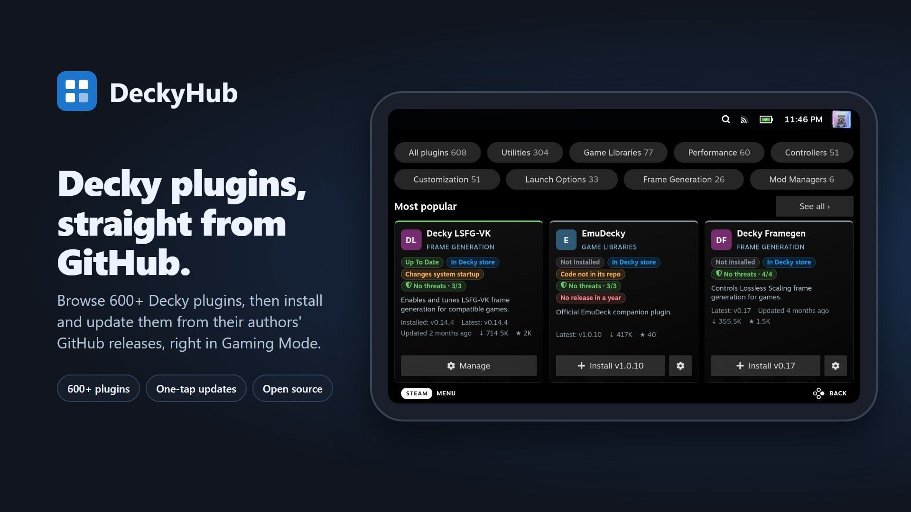

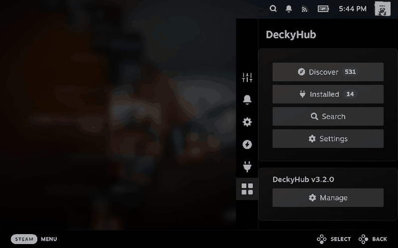

<table>
<tr>
<td align="center">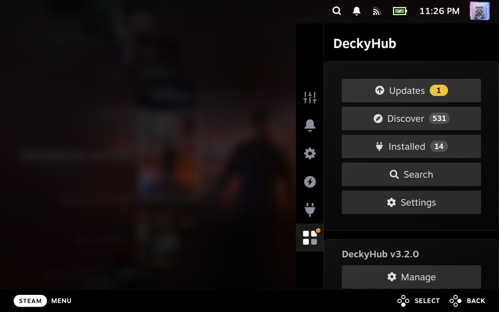 <b>Quick Access</b></td>
<td align="center">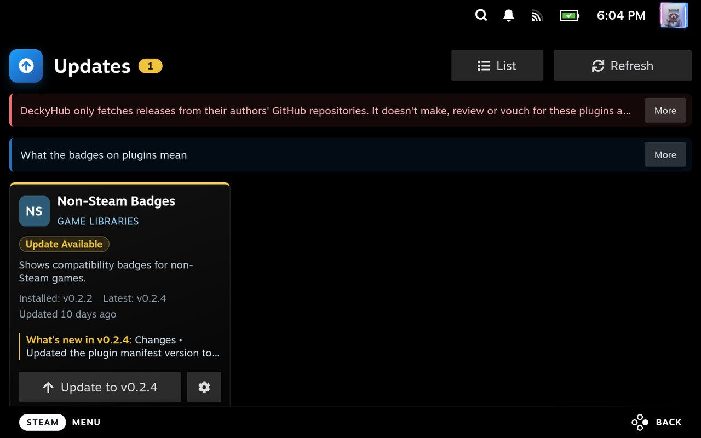 <b>Updates</b></td>
<td align="center">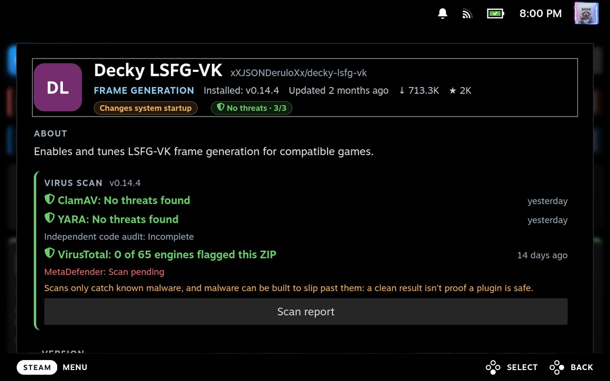 <b>Manage</b></td>
</tr>
<tr>
<td align="center">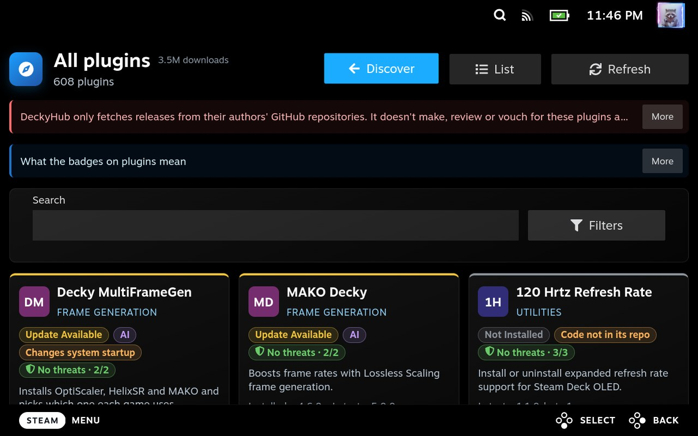 <b>All plugins</b></td>
<td align="center">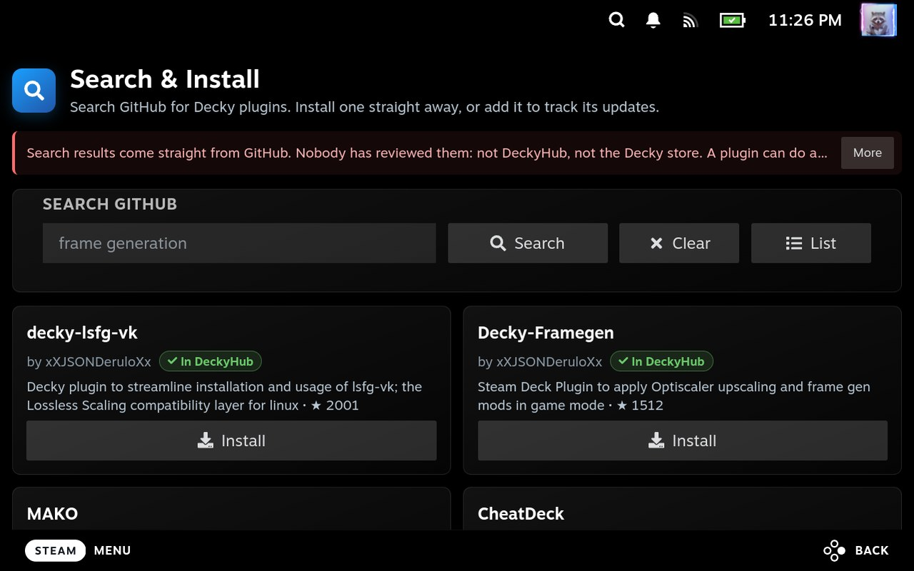 <b>Search</b></td>
<td align="center">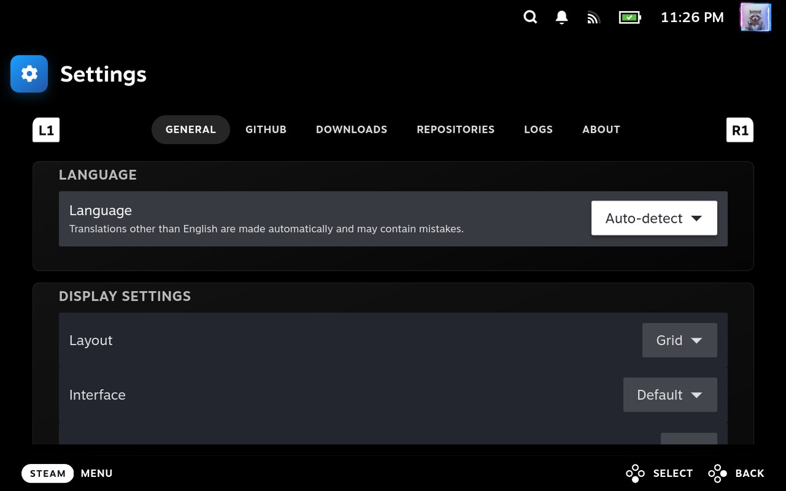 <b>Settings</b></td>
</tr>
<tr>
<td align="center">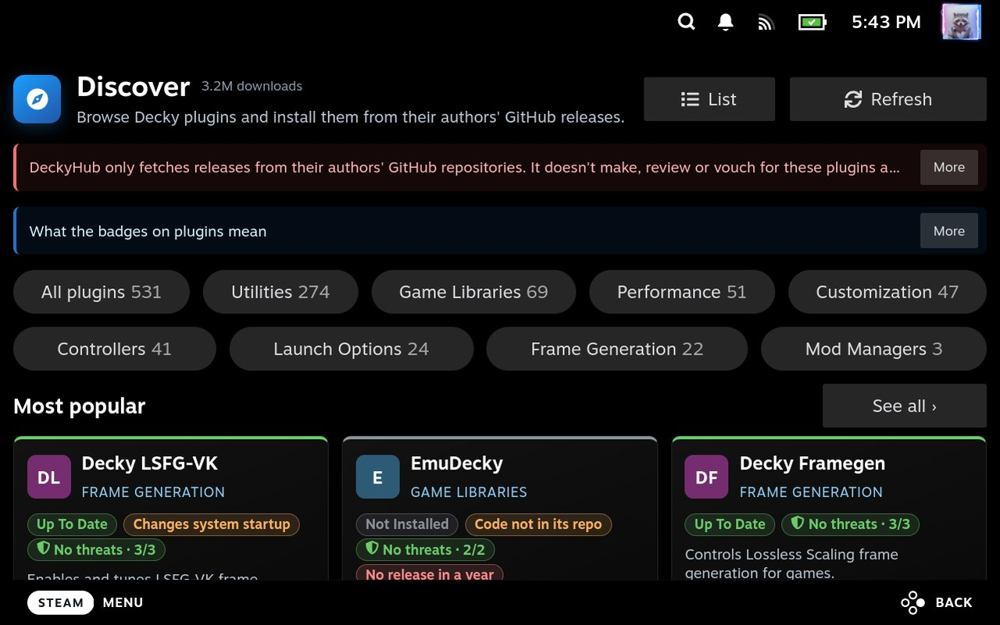 <b>Discover</b></td>
<td align="center">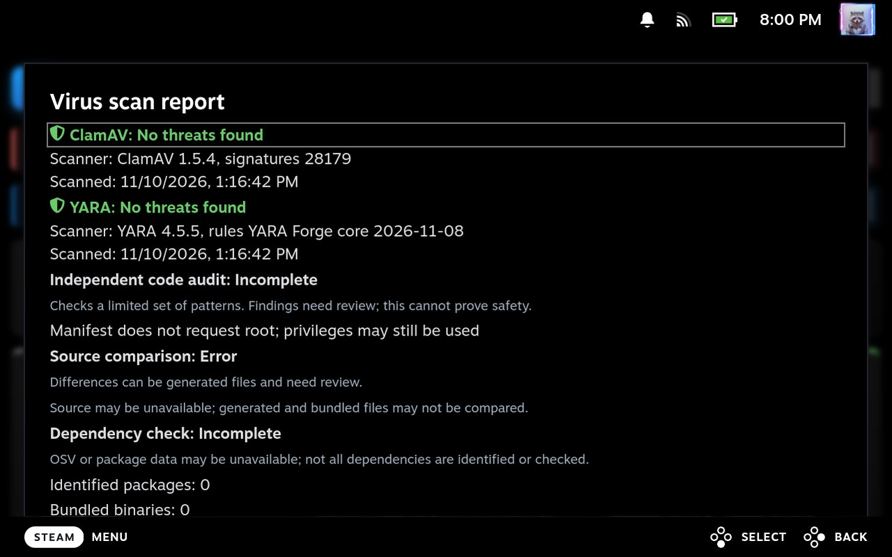 <b>Virus scan report</b></td>
<td align="center">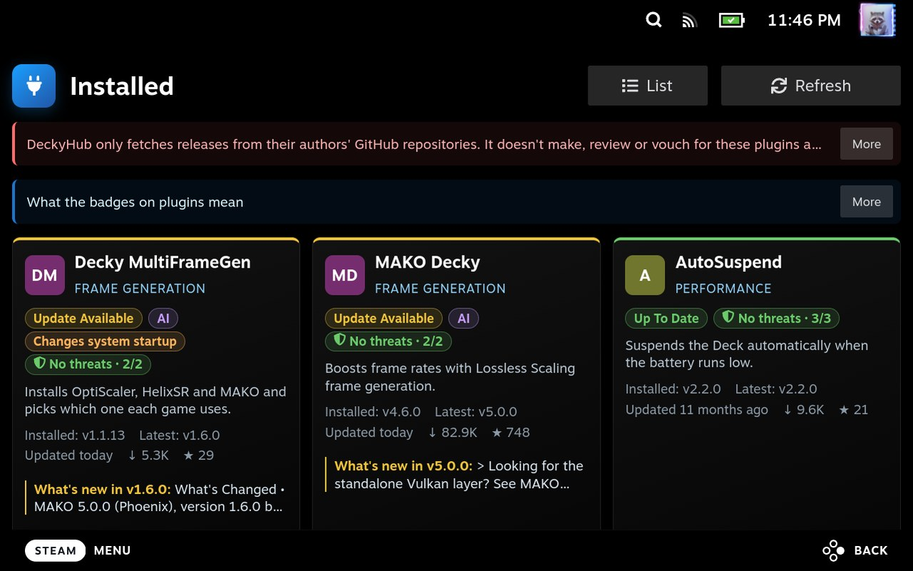 <b>Installed</b></td>
</tr>
</table>

> [!CAUTION]
> **DeckyHub only fetches releases from their authors' GitHub repositories. It doesn't make, review or vouch for these plugins and isn't responsible for anything they do to your device or data. Install at your own risk.**

Tired of tabbing out to Desktop Mode, hunting through GitHub releases, and manually downloading ZIPs every time a plugin updates? DeckyHub brings plugin discovery and updates straight to your controller. Browse a catalog of over 500 Decky plugins, search GitHub for any other Decky plugin and install it on the spot, and get notified when an update drops — all without leaving your couch. It's the first and last plugin you'll ever install from a ZIP.

> **A note on how this is made.** Most of DeckyHub's code was written with the help of AI tools (Claude and Codex). That doesn't mean it ships untested — every release is verified on real hardware before it goes out. I'm telling you this upfront so you know exactly what you're installing and how it got built.

**Contents:** [Why you'll like it](#why-youll-like-it) · [What it does](#what-it-does) · [The plugin list](#the-plugin-list) · [Requirements](#requirements) · [Installing](#installing-deckyhub) · [Using DeckyHub](#using-deckyhub) · [Uninstalling](#uninstalling-deckyhub) · [Troubleshooting](#troubleshooting) · [Quality](#how-deckyhub-controls-quality) · [Privacy](#privacy) · [Disclaimer](#disclaimer) · [Getting help](#getting-help)

## Why you'll like it

- **Any plugin on GitHub, one search away** — **Search & Install** finds Decky plugins that aren't in the Decky store or DeckyHub's list and installs them right from Gaming Mode. No Desktop Mode, no browser, no Developer Mode URL pasting.
- **Never miss an update** — DeckyHub checks your installed plugins against their latest GitHub releases every few hours and pings you with a toast when something new is available.
- **Built for the couch** — full gamepad navigation, color-coded status at a glance, and one-tap downloads designed for Gaming Mode, not a desktop browser squeezed onto a small screen.
- **You stay in control** — DeckyHub never installs or runs anything on its own. Nothing touches your system until you say so (a browser you mark as **Trusted** under [Remote Install](#remote-install-experimental) is the one exception, and you choose it), and installs go through Decky Loader's own installer and confirmation dialog (see [Manage](#manage)).

## What it does

- **[Discover](#discover)** — browse DeckyHub's list of Decky plugins/tools, filter by search or installed status, and see release info at a glance, color-coded by status.
- **[Search & Install](#search--install)** — search GitHub for Decky plugins and install one in a tap, or add it to track its updates.
- **[Updates](#updates)** — see which of your tracked, installed tools have a newer release available and what each one brings, and update the Decky plugins among them in one go with **Update All**. DeckyHub checks in the background every few hours, so the dot on its icon and a toast tell you when new updates show up, and each card says **Installing…** until Decky finishes, then a toast confirms it.
- **[Settings](#settings)** — language, display, an optional GitHub token, downloads, your tracked repositories and custom registries, and log export.
- **Quick Access Menu** — DeckyHub opens from Decky's plugin list. Turn on **Settings → General → DeckyHub tab in Quick Access** (off by default) to also give it its own tab (the four-square DeckyHub icon, with a dot when updates are waiting) in the Quick Access tab strip, next to Decky's. It is off by default because of a Decky Loader bug that repeats plugin tab icons in the Quick Access strip ([decky-loader#1014](https://github.com/SteamDeckHomebrew/decky-loader/issues/1014)); this will change once it is fixed. It shows **Discover**, **Search** and **Settings**, plus **Updates** with a count whenever updates are waiting. Below them: DeckyHub's own version and update check, and a **Cleanup** section (shown when the download folder has files) that empties it after confirmation.

If you'd rather install a plugin yourself, **Download ZIP** saves the release instead, and you install it the same way as DeckyHub itself (see [Option 2: Manual ZIP](#option-2-manual-zip)).

## The plugin list

No setup, no configuration — the plugin list shows up in Discover the moment you install DeckyHub. It lives in [mazillka/deckyhub-registry](https://github.com/mazillka/deckyhub-registry) and refreshes every time DeckyHub starts, so new apps show up without a DeckyHub update. DeckyHub keeps the last list it downloaded for offline use; a fresh install needs to reach GitHub once.

**Where the plugins come from:**

- **Suggested:** plugins people suggest through the registry's issues and pull requests.
- **[Decky Extended Plugins](https://decky-extended-plugins.beallio.com/)** by [beallio](https://github.com/beallio): a community catalog of the Decky store plus community plugins, with a [security audit](https://decky-extended-plugins.beallio.com/audit).
- **[Decky Plugins Explorer](https://safetzahirovic.github.io/decky-plugins-explorer/)** by [SafetZahirovic](https://github.com/SafetZahirovic): a nightly crawl of every public GitHub repository with a Decky `plugin.json`.

A daily job checks both catalogs, plus its own search of GitHub for repositories tagged or named like Decky plugins, for plugins that aren't listed yet, skips ones that look unfinished (brand new, nobody using them yet, a placeholder version), and opens a pull request with the ones that qualify. Every plugin, however it was found, has to have a stable GitHub release with exactly one plugin ZIP whose `plugin.json` name matches. These are automatic checks for a working release: nobody reviews the plugins themselves, for safety or anything else; the [catalog](https://deckyhub.com/plugins/) and Discover flag plugins that run as root, haven't had a release in a year, or got a warning from the [security audit](https://decky-extended-plugins.beallio.com/audit) (see [Badges](#badges)).

- **Credit:** the Decky store download counts shown for plugins come from the [Decky plugin store](https://plugins.deckbrew.xyz/plugins) (plugins.deckbrew.xyz).
- **Browse it:** the [plugin catalog](https://deckyhub.com/plugins/) lists every plugin, searchable and by category, with downloads and stars.
- **Suggest a plugin:** open an [issue](https://github.com/mazillka/deckyhub-registry/issues/new) or a pull request in the registry repository.
- **Want more?** Find any other Decky plugin on GitHub with **[Search & Install](#search--install)**.

## Requirements

- Any device with [Decky Loader](https://decky.xyz/) 3.x installed.
- An internet connection that can reach GitHub. No GitHub account is needed.

## Installing DeckyHub

DeckyHub isn't on the official Decky Loader store, and won't be: the Decky team [declined it](https://github.com/SteamDeckHomebrew/decky-plugin-database/issues/1182) because it installs plugins they haven't reviewed and most of its code was written with AI tools. Install it one of the ways below instead.

There are two ways to install DeckyHub. Pick one:

| | **Desktop installer** (recommended) | **Manual ZIP** |
| --- | --- | --- |
| Where | Desktop Mode | Gaming Mode |
| Decky Loader | Checked, and installed if it's missing | Must already be installed |
| Admin password | Needed | Not needed |
| What you do | Download one file and follow the steps it shows | Download the ZIP and add it in Decky's developer settings, or paste a link |
| Decky Loader setup | None: Decky Loader and DeckyHub are set up in one go | You install Decky Loader first |

Afterward, DeckyHub can install and update plugins from Gaming Mode.

### Option 1: Desktop installer (recommended)

One download sets up **both Decky Loader and DeckyHub**: it checks for [Decky Loader](https://decky.xyz/) first and installs it if your device doesn't have it yet, then installs DeckyHub. That saves you installing Decky Loader separately, and the extra steps and commands that takes. Prefer not to use it? [Option 2](#option-2-manual-zip) needs no password.

1. Switch to Desktop Mode (**Steam** → **Power** → **Switch to Desktop**).
2. The shortcut `Install-DeckyHub.desktop` has to be **on the Desktop**. Put it there in one of two ways: <!-- choose --> **Download it:** download [`Install-DeckyHub.desktop`](https://github.com/mazillka/deckyhub-plugin/releases/latest/download/Install-DeckyHub.desktop), then open **Downloads** in Dolphin and drag it onto the Desktop (or cut and paste it). If your browser saved it as `Install-DeckyHub.desktop.download` (Firefox does that for shortcut files), rename it to `Install-DeckyHub.desktop` first. <!-- or --> **Or use Konsole:** open **Konsole** and run this command, which saves it on the Desktop under the right name: `curl -fsSL -o ~/Desktop/Install-DeckyHub.desktop https://github.com/mazillka/deckyhub-plugin/releases/latest/download/Install-DeckyHub.desktop && chmod +x ~/Desktop/Install-DeckyHub.desktop`
3. Double-click **Install DeckyHub** on the Desktop and choose **Continue** (or **Execute**) when asked.
4. Read the overview. It lists every step, with Decky Loader first (checked, or installed if it's missing) and DeckyHub only after it, and says why the admin password is needed. Then choose **Install** (or **Update** or **Reinstall**, when DeckyHub is already there). The installer doesn't collect, save or send any information about you or your device; it only downloads files from GitHub. It checks that GitHub is reachable, then asks for your device's admin password (the one you set for Desktop Mode, not your Steam password). If you've never set one, it offers a temporary one and removes it when it's done, like Decky Loader's own installer.
5. Optionally look at a few hand-picked plugins, one at a time: skip is the default, and you add plugins at your own risk (see "Optional plugins" below).
6. Follow the progress window ("Step 3 of 5: …") until the finish message lists what was done and what to do next. If it reports an error, follow the instructions in the message.
7. Return to Gaming Mode and pick DeckyHub's four-square icon in the Quick Access Menu.

What it does: first it checks that Decky Loader is installed, and if it isn't, runs [Decky Loader's official installer](https://github.com/SteamDeckHomebrew/decky-installer). Only then does it download that release's `DeckyHub-v*.zip` from GitHub, check its SHA-256 against the one the installer was made with (and stop if they differ), put it in Decky's plugins folder and restart Decky. The password is needed because installing and restarting Decky Loader change the device itself. The script is [`installer/install-deckyhub.sh`](installer/install-deckyhub.sh); each release attaches it filled in with its own version and checksum, and scans it for malware like the ZIP.

Optional plugins: after the overview, the installer shows a few hand-picked plugins (frame generation, themes and more) **one at a time**. Each card has its version, notes (AI-assisted, runs as root, audit warnings), stars and downloads, and clickable links to its GitHub repository and its page on deckyhub.com with its security scans. **Skip** is the default button, so nothing is added unless you choose **Add this plugin**, and the installer says DeckyHub isn't responsible for what you install: you add plugins at your own risk. The installer doesn't install them: it saves your picks, and the first time you open DeckyHub it lists them again and installs them, with the usual confirmation, only if you agree. Skip it and nothing is saved.

<table>
<tr>
<td align="center">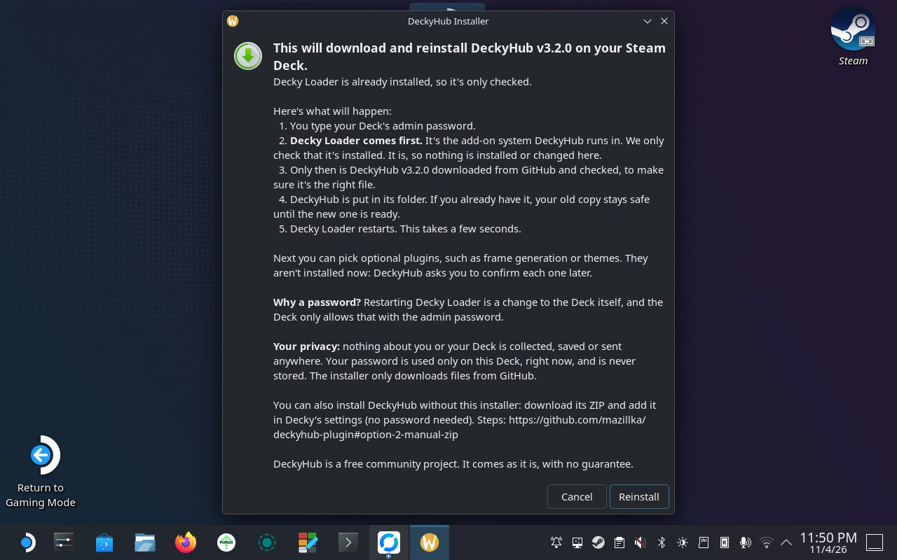 <b>Overview</b></td>
<td align="center">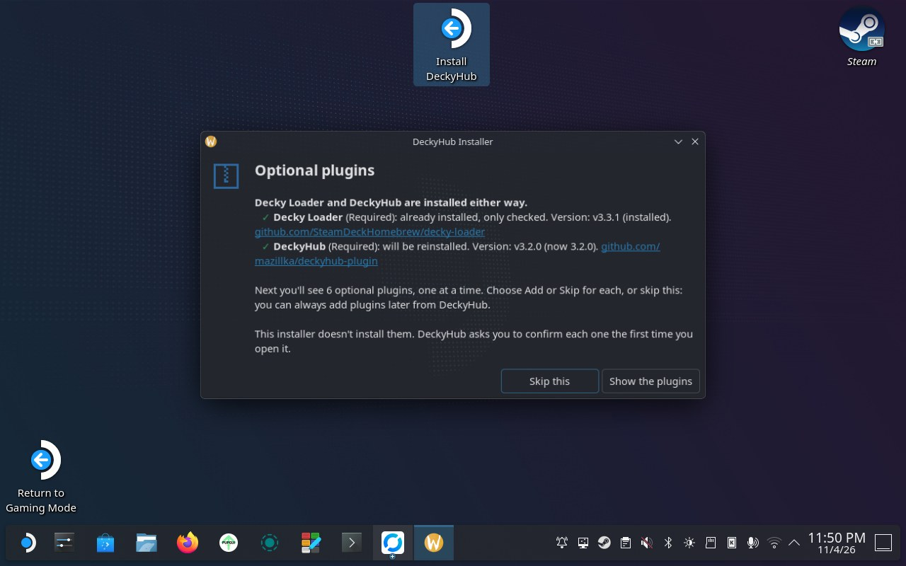 <b>Optional plugins</b></td>
<td align="center">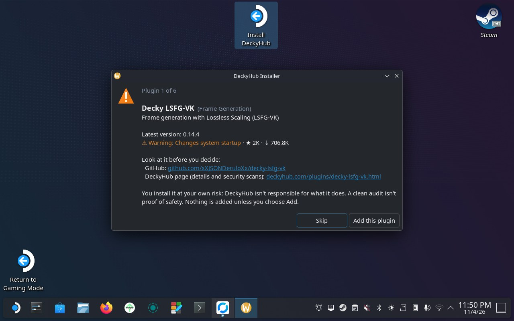 <b>A plugin's card</b></td>
</tr>
<tr>
<td align="center">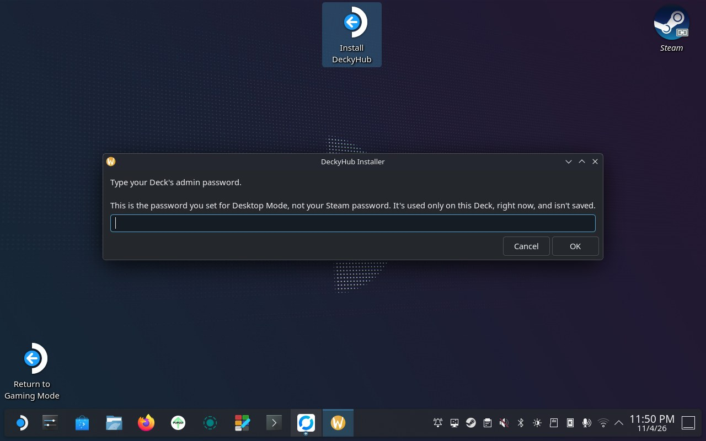 <b>Password</b></td>
<td align="center">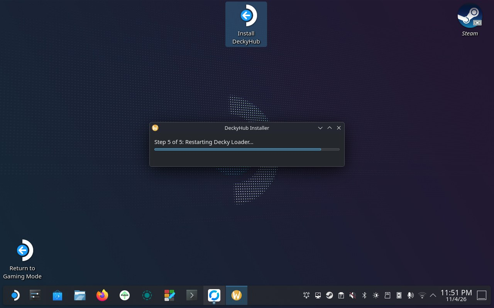 <b>Progress</b></td>
<td align="center">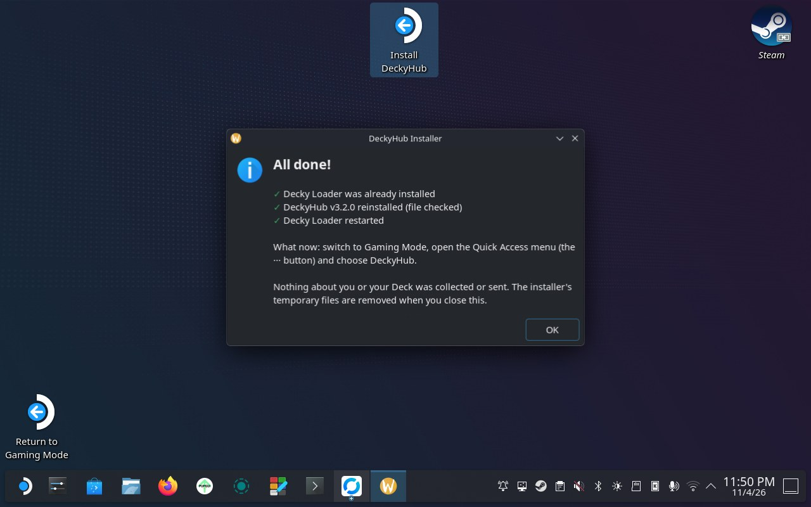 <b>All done</b></td>
</tr>
</table>

### Option 2: Manual ZIP

Decky Loader must already be installed. No admin password is needed.

1. Download the latest `DeckyHub-v*.zip` from the [Releases page](https://github.com/mazillka/deckyhub-plugin/releases).
2. In Gaming Mode, open the Quick Access Menu → Decky → settings (gear icon). Turn on **Developer mode** under General if it's off, then go to **Developer** → **Install Plugin from ZIP** and select the downloaded file.
3. Pick DeckyHub's four-square icon in the Quick Access Menu (or Decky → **DeckyHub**).

#### Alternative: install the ZIP from a URL

If Decky Loader is already installed:

1. Open the Quick Access Menu → **Decky** → settings (gear icon), and turn on **Developer mode** under **General** if it's off.
2. Go to **Developer** → **Install Plugin from URL** and enter this link, which always points to the newest DeckyHub release:

   `https://github.com/mazillka/deckyhub-plugin/releases/latest/download/DeckyHub.zip`

   

   Scan the QR code to have the link on your phone while you type it.
3. Pick DeckyHub's four-square icon in the Quick Access Menu (or Decky → **DeckyHub**).

## Using DeckyHub

### Controller buttons

DeckyHub uses Steam's standard controller controls, plus extra shortcuts on every **Install** / **Update** button (on Discover and Updates cards, on **Search** results, in the [Manage](#manage) window, and for DeckyHub's own update):

| Button | What it does |
| --- | --- |
| **X** | Download that release's ZIP to `~/Downloads/deckyhub` instead of installing it. Not shown when **Download ZIP** is hidden in Settings. |
| **Y** | Show the release notes (what that release changes) without installing anything. |
| **Menu** (☰) | Open the plugin's GitHub page. Not on DeckyHub's own update. |

Steam's footer shows these actions for whichever button is focused.

### Discover

Discover opens on three shelves, **Most popular**, **Recently updated** and **New in DeckyHub**, under a row of category chips with how many plugins each holds. Tap a chip, or **See all** on a shelf, to browse the whole list: as a compact list of every plugin (the default), or as a **Grid** of cards a page at a time (**L1** / **R1** turn the page). **Updates** and **Search** have the same **Grid** / **List** switch, and DeckyHub remembers your choice. The first time, a short welcome above the shelves says what DeckyHub does and how to stay safe.

Each card is color-coded (green once it's up to date, yellow when an update is available, red on an error) so you can spot what needs attention at a glance, and says **Checking…** while its latest release is still being looked up. Listed plugins also show their all-time downloads, GitHub stars and when they were last updated; the page header shows the total downloads. A card set to the pre-release **Channel** says so; stable is the default and isn't labelled. Tap **Manage** on any card to pick a channel and version, then download the release asset you want.

#### Search, filters and sorting

Search the list by name, repository, category or description, and open **Filters** to narrow it:

- **Status:** All, Installed, or Not Installed.
- **Category:** any of the list's categories.
- **Sort:** A to Z, Z to A, Most downloaded, Most stars, Recently updated, or Recently added (newest additions to the list first). Plugins with an update always come first, and **Then by** orders plugins the first sort leaves tied.

Every **Status** and **Category** option shows how many plugins it would list.

#### Badges

Cards can carry these badges. **More** on the "What the badges on plugins mean" notice at the top of Discover explains them in the app too.

| Badge | What it means |
| --- | --- |
| **Runs as root** | Its backend runs as root, with full access to the system. Install only if you trust the author. |
| **No release in a year** | No new release for over a year, so it may be abandoned. |
| **Fork** | A fork that carries a plugin on after its original stopped. DeckyHub lists it only while it's the active one. |
| **AI** | Its repository has instructions for AI coding assistants (`CLAUDE.md`, `AGENTS.md`, `.cursorrules`, `.github/copilot-instructions.md` and similar), or its README says it's made with AI ("vibe-coded", "100% AI", "built with Claude Code" and similar), so it's likely developed with AI help. It says nothing about quality or safety, and no badge doesn't mean no AI was used. |
| **In Decky store** | The [Decky store](https://plugins.deckbrew.xyz/plugins) lists a plugin with this name. The store names no repository, so the match is by name: check that it is the same project. Hover the badge for the store's download count, a different number from the GitHub downloads shown on the card. The count comes from the [Decky plugin store](https://plugins.deckbrew.xyz/plugins). A plugin whose author asked to be distributed only through the store is still listed, but DeckyHub offers no GitHub download for it. |
| **Pre-release only** | It has no stable release, so DeckyHub offers its pre-releases, which may be unfinished, and its Manage window hides the Stable channel. |
| **No description** | Its author hasn't said what it does. Check its repository before installing. |
| **No threats** / **Threat found** / **Not fully scanned** | The virus scans of the release you'd install (ClamAV and YARA; the badge shows the worse of the two): nothing found, something flagged (it may be a false positive; open **Manage** for the report and decide), or it couldn't scan all of it (**Manage** says why). No badge until it's been scanned. The registry also looks up each public ZIP on MetaDefender by SHA-256 and uploads it there if it has no report. New, pending, failed, or unsupported scans may not have a result yet. The scans only catch known malware and can be evaded, so a clean scan isn't proof of safety. |

**DeckyHub is not the Decky store, and nobody reviews these plugins.** A clean scan only means no known malware was found.

The selected ZIP's scan report also includes DeckyHub's independent automated audit, separate from ClamAV, YARA and the community audit below. It checks selected code patterns and whether the manifest requests root, compares eligible files with the repository's current release-tag source, and inventories identifiable packages and binaries. Known vulnerabilities in identified package versions are checked using OSV; package names and versions are sent to that service. Generated files, bundled code and binaries may not be comparable or identifiable, and a source match does not prove the ZIP was built from it. Findings need review and may not indicate harm; no root request does not rule out privileged behavior. Incomplete, failed, missing or unmatched reports cannot establish what was checked, and even completed checks cannot prove a plugin is safe.

These warnings come from Decky Extended Plugins' automated [security audit](https://decky-extended-plugins.beallio.com/audit) of the release you'd install. Routine findings like `sudo`, `mount` or `systemctl` aren't shown. A warning isn't proof of harm, and no warning isn't proof of safety.

| Warning | What the audit found |
| --- | --- |
| **Blocked by audit** | Malware or a broken archive. Not recommended for installation. |
| **Reads private data** | It reads Steam login data, SSH keys or secrets from the environment. |
| **Changes system startup** | It edits shell profiles, preloads libraries, loads kernel modules or adds device rules, which keep working outside Decky. |
| **Code not in its repo** | The release has scripts or programs that aren't in its GitHub source, so you can't read what they do. |
| **Hidden code** | It contains encoded or packed code that's hard to read. |
| **Skips HTTPS checks** | It turns off certificate checks, so what it downloads could be tampered with. |
| **Runs downloaded scripts** | It downloads a script and runs it straight away. |
| **Known vulnerabilities** | It bundles libraries with published security flaws. |

A warning about a newer pre-release is labelled **Pre-release:**. Download counts, stars and warnings come from the registry, refreshed every hour.

### Search & Install

Not every Decky plugin is in the Decky store or DeckyHub's list. Open **Search** from the Quick Access Menu, type what you're after, and DeckyHub looks it up on GitHub, right from Gaming Mode.

- **Only Decky plugins** — results are limited to repositories that are actually Decky plugins, so awesome-lists, guides and unrelated projects don't get in the way.
- **Install** — adds the repository to your tracked list and hands its latest release to Decky Loader's own installer, behind the usual confirmation. From then on it shows up in Discover with update checks, like any listed plugin.
- **Add** (the **+** beside Install) — only tracks the repository, so you can look at it in Discover and install it later. Results already in DeckyHub say **In DeckyHub**.
- **Y** on a result's **Install** shows that release's notes, and **X** downloads its ZIP instead.

> [!WARNING]
> Search results come straight from GitHub and nobody has reviewed them: not DeckyHub, not the Decky store. A plugin can do anything on your device, so only install plugins from authors you trust.

Tracked repositories are listed in **Settings** → **Repositories**, where you can remove them or export and import the list.

### Updates

Shows every tracked tool that's installed and has a newer release available, along with its installed and latest version. Update a plugin from its [Manage](#manage) window, or, when more than one Decky plugin is waiting, tap **Update All** to hand them all to Decky Loader's installer behind a single confirmation. A few plugins can't be updated in place because of a Decky Loader bug: **Update All** leaves them out, and their Manage window explains that DeckyHub removes the installed version before Decky installs the new one. The **Updates** button in the Quick Access Menu shows how many updates are waiting.

### Manage

Tap **Manage** on any card in Discover or Updates to:

- pick the release **channel** and a specific **version**. **Stable** shows only stable releases; **Pre-release** shows every release, newest first, so a stable release that comes out after the last pre-release is still offered;
- **Download ZIP**, open the **Release Page**, or **Check for Updates** for that app;
- for a Decky plugin, **Install** (not installed yet) or **Update** (the selected version is newer than the installed one). DeckyHub downloads the release ZIP (with a progress window, then a spinner until Decky is ready) and hands it to Decky Loader's own installer, the same one the Decky store uses. Decky asks you to confirm and installs it, verifying the SHA-256 checksum GitHub publishes for the ZIP. Older releases (files uploaded before mid-2025) have no checksum and Decky installs them without that check;
- for an installed Decky plugin, **Pin at vX**: DeckyHub stops offering updates for it (it shows **Pinned**, and **Update All** and the update count leave it out) until you press **Unpin**. Use it for a plugin that a newer release broke. A pin only hides updates: you can still install any version yourself. **Skip vX** is the lighter option, which hides just one release;
- for an installed Decky plugin, **Uninstall**, which asks you to confirm and then removes the plugin and its settings through Decky Loader;
- check the **Virus scan** of the selected version's ZIP: **No threats found**, **Threat found** (with what was matched), or **Couldn't be scanned** (with the reason), or **Not scanned yet**, and when it was scanned. Each scanner gets its own line: **ClamAV** and **YARA**. **Scan report** shows the full report: the file, its SHA-256, each scanner's version, signatures or rules, and date. **VirusTotal** opens [VirusTotal](https://www.virustotal.com/)'s page for the ZIP's SHA-256 in Steam's browser; nothing is uploaded from your device. DeckyHub's registry sends VirusTotal the plugin ZIPs it hasn't seen yet, so a new release can take a while to get results. **Copy ZIP link** puts the ZIP's download link on the clipboard, and **Scan link on VirusTotal** copies it too and opens VirusTotal's URL scan page to paste it into (VirusTotal mainly rates the link itself, so it may not check what's inside the ZIP). The scan never stops you installing: read the report and decide for yourself. DeckyHub's registry [scans every plugin ZIP it offers](https://github.com/mazillka/deckyhub-registry#repositories) every few hours with [ClamAV](https://www.clamav.net/), an open-source antivirus, and the files inside it with [YARA](https://virustotal.github.io/yara/) and [YARA Forge](https://github.com/YARAHQ/yara-forge)'s community rules, many written for Linux malware, so a brand-new release may not have a report yet. A clean scan isn't proof of safety.

### Settings

Settings is split into tabs; **L1** / **R1** switch between them.

| Tab | What's in it |
| --- | --- |
| **General** | The language, and the display: **Grid** or **List**, **Default** or **Compact** density, items per row, haptics, whether DeckyHub has its own tab in Quick Access (off by default), and which Manage-window buttons to hide. |
| **GitHub** | An optional personal access token that raises GitHub's rate limit (see [Troubleshooting](#troubleshooting)). Type it, or load it from a text file in Downloads. Builds with GitHub sign-in set up also have **Sign in with GitHub**: DeckyHub shows a short code, you open `github.com/login/device` on any device (a QR code is there for your phone), enter it and approve, and DeckyHub saves the token it gets, with no token to create or copy. That token asks for no permissions: it only reads public data and lifts the rate limit. Revoke it any time under GitHub's Settings → Applications. |
| **Downloads** | The download folder and the **Overwrite Existing** toggle (see [Downloads](#downloads)). |
| **Repositories** | Your tracked repositories, export and import, and **Custom Registries** (see [Repositories](#repositories)). |
| **Logs** | **Backups** and **Export Logs**, for bug reports. **Backups**: before DeckyHub updates, reinstalls or removes a Decky plugin, it saves a copy of that plugin's settings (the folder Decky keeps under `settings/`; Decky deletes it when a plugin is removed). The last 5 per plugin are kept in DeckyHub's own settings folder. Here you can **Restore** one (the settings it replaces are backed up first, so a restore can be undone; reload the plugin afterwards) or remove it, and turn the automatic backup off. Settings over 50 MB are not backed up. **Leftover plugin files**: **Look for leftovers** lists the `settings`, `data` and `logs` folders Decky keeps for plugins that are no longer installed (plugins removed by hand, failed uninstalls), with their size and when they last changed. Nothing is picked for you: tick what to remove and confirm. A plugin's settings are backed up first, so a wrong pick can be restored from **Backups**. DeckyHub's own folders, installed plugins' folders and links are never touched. |
| **About** | What DeckyHub is, and the catalogs it builds on. |

DeckyHub comes in English, Ukrainian, Russian, Spanish, German, French, Portuguese (Brazil and Portugal), Italian, Polish, Turkish, Dutch, Czech, Japanese, Korean, and Chinese (Simplified and Traditional). Translations other than English are made automatically, so they may have mistakes; corrections are welcome.

A tracked app's release channel isn't set here: use its [Manage](#manage) window.

### Downloads

All downloads are saved to `~/Downloads/deckyhub`. **Cleanup** → **Empty Folder** in the Quick Access Menu clears that folder after confirmation. Starting a download opens a progress dialog with a **Cancel** button; once it finishes, the same dialog shows where the ZIP was saved and how to install it. If a download is interrupted, no partial file is left behind.

When GitHub provides a checksum for a release asset, DeckyHub always verifies it before keeping the download. By default, downloading a file again overwrites the previous copy; turn off **Overwrite Existing** in Settings if you'd rather keep both.

### Repositories

Repositories is a tab in **Settings**. Add a repository from **Search** with the **+** beside a result's **Install** (results already in DeckyHub say **In DeckyHub** instead). Export your custom repositories to `DeckyHub-repositories.json` in `~/Downloads` to back them up or share them, or import that file back in. Any repository you've added can be removed again here; the plugins in DeckyHub's own list stay available and can't be removed. Prefer a bigger screen? The [Registry Editor](https://deckyhub.com/contribute/editor.html) is a browser-based tool for building or editing a repository list file before importing it.

Under **Custom Registries**, add someone else's app list by its GitHub `owner/repo` (DeckyHub reads its `registry/apps.json`) or any HTTPS `.json` URL. Its apps join Discover alongside DeckyHub's own; up to 10 registries are allowed, and **Refresh registries** downloads them all again. An added registry can only add apps: it can't change or replace one DeckyHub already lists, including the plugins you have installed.

Under **Plugin packs**, **Export my plugins as a pack** saves a small `.json` file listing the Decky plugins you have installed (the ones DeckyHub can tie to a GitHub repository; never DeckyHub itself) to your Downloads folder. Send it to a friend, or keep it to set up another device. **Import a pack** picks such a file: DeckyHub adds any repository it doesn't know as a custom one, then shows the plugins you don't have yet, with their badges and the usual notice, and offers to install them in one go. A pack holds repository names only (no code, no links to fetch, no settings), importing installs nothing by itself, and Decky Loader still asks you to confirm.

### Remote Install (experimental)

Install, update or uninstall plugins on your device from a computer or phone on the same network, without picking up the device.

- **Experimental:** it is new and only in DeckyHub's pre-releases for now, so expect rough edges.
- **Fully local:** your browser talks straight to your device over your own network. Nothing goes through a server, and nothing is collected or sent anywhere.
- **You need:** DeckyHub on your device, a second device on the same network, and **Chrome, Edge or another Chromium browser** on it (Firefox and Safari can't make this kind of connection yet).

#### Pair a browser

You do this once per browser.

1. On your device, open DeckyHub's Quick Access tab and turn on **Remote access** under **Remote control**. A QR code appears.
2. Scan the QR code with your phone, or choose **Copy pairing link** and open the link on your computer. It opens the [Paired devices](https://deckyhub.com/develop/paired-devices/) page. Allow local network access if the browser asks.
3. Back on your device, **Approve** the browser under **Pairing requests**.

<table><tr>
<td align="center">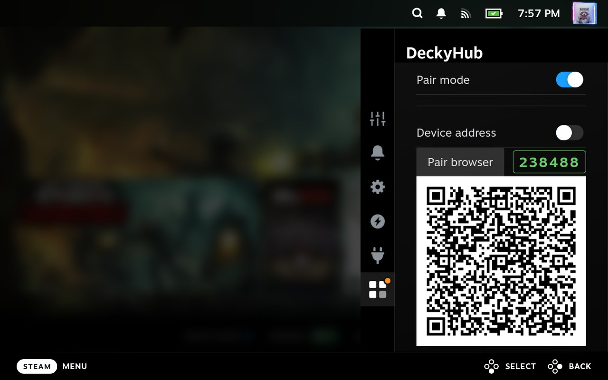 Step 1: Remote access on, with the QR code</td><td align="center">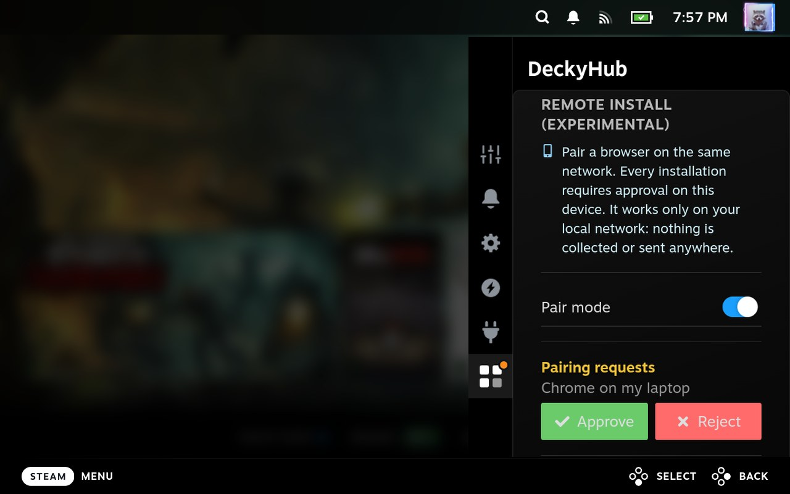 Step 3: approve the browser</td>
</tr></table>

The pairing is kept after a restart, a reload or turning Remote access off. A browser you haven't used for 30 days is forgotten.

#### Send a plugin to your device

1. In the paired browser, open a plugin's page on [deckyhub.com](https://deckyhub.com/develop/plugins/).
2. Under **Send to device**, pick your device and press **Send**. Only devices the browser can reach right now are listed, so keep **Remote access** on.
3. On your device, the request appears at the top of the Remote Install section. Press **Approve**, then confirm Decky Loader's own install prompt.

<table><tr>
<td align="center">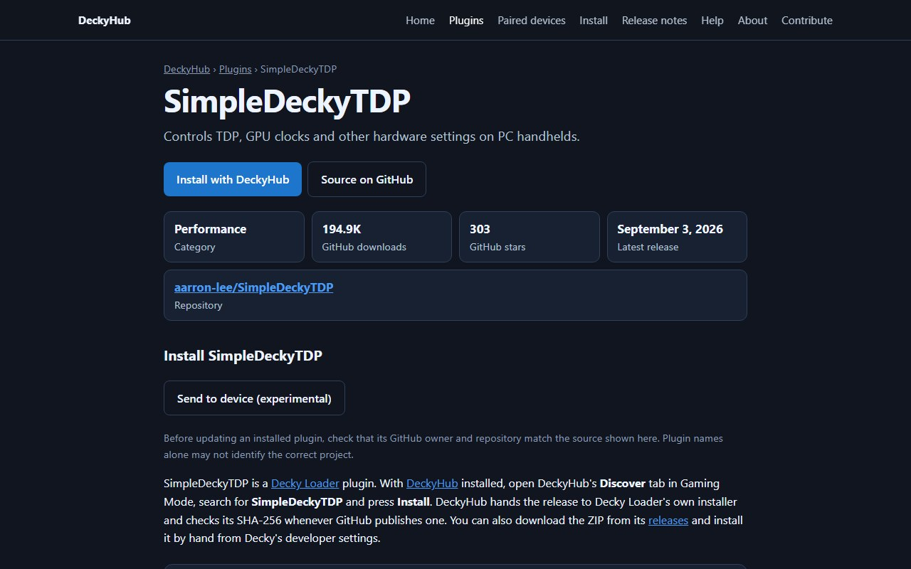 Step 2: pick your device and press Send</td><td align="center">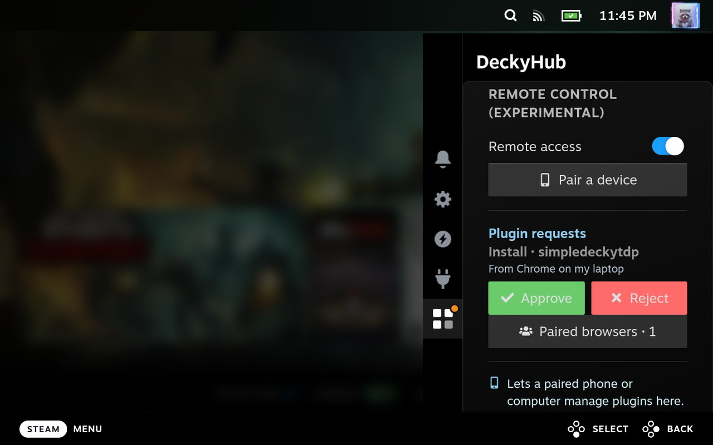 Step 3: approve the request</td>
</tr></table>

A request that isn't approved within two minutes expires. Send it again if that happens.

#### Manage installed plugins

1. Open [Paired devices](https://deckyhub.com/develop/paired-devices/) in the paired browser and pick your device. Its installed plugins are listed.
2. Press **Update** or **Uninstall** next to a plugin, or **Browse plugins to install** to add one.
3. Approve the request on your device, as above.

<table><tr>
<td align="center">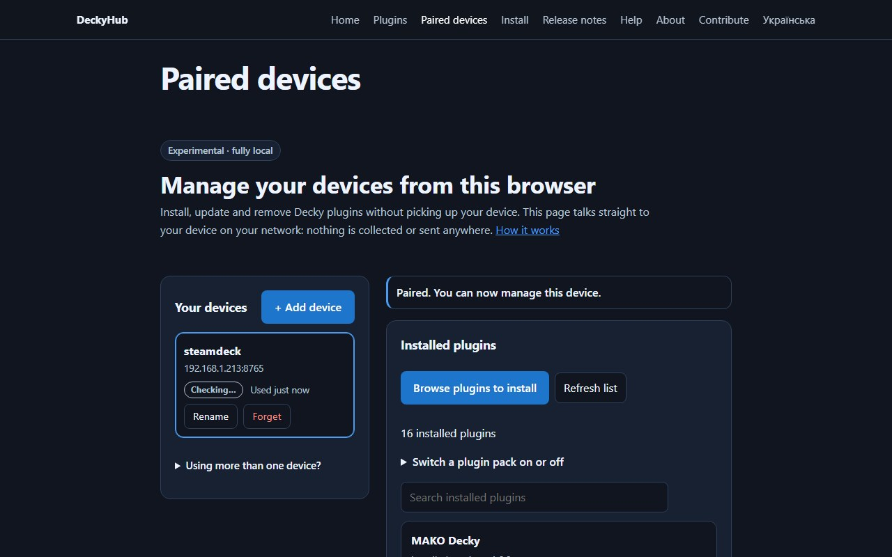 Your device and its installed plugins</td>
</tr></table>

Install and update work for plugins DeckyHub can match to its list. Uninstall works for any installed plugin whose name is unique. DeckyHub itself can only be managed on the device.

#### Trusted browsers

Turn on **Trusted** next to a paired browser and its requests run without asking: no approval in DeckyHub, and DeckyHub confirms Decky Loader's install prompt for you. It can only be switched on from the device itself, after a warning. Plugins can run with full access to your device, so only trust a browser you control. Turn **Trusted** off to go back to approving every request.

#### Stop using it

- **One browser:** remove it under **Paired browsers** on your device, and press **Forget device** on the Paired devices page.
- **Everything:** turn **Remote access** off. Nothing listens on your network while it's off.

#### If it doesn't work

- **The device isn't listed, or the browser can't connect:** check that **Remote access** is on and the device is awake (it stops listening when it sleeps), that both are on the same Wi-Fi (not mobile data, a guest network or a VPN: turn mobile data off while you pair), that the browser may use the local network (in Chrome: Settings, Site settings, Local network, deckyhub.com set to Allow), and that your router's "AP isolation" / "client isolation" is off for this network. To tell the network from the browser, open `https://the-device-address:8765/` in the same browser: "refused to connect" at once means the network is fine, a long wait means the browser can't reach the device. When pairing fails the page shows technical details with a Copy button; add them, and DeckyHub's log (Settings, Logs, Export: it lists each connection a browser tried), to a bug report.
- **It worked before and stopped:** your router may have given the device a new address. Open the Quick Access tab to see it, or pair again.
- **Remote Install isn't supported on this system:** the device's Decky Loader runs a Python version DeckyHub has no network library for. Nothing else in DeckyHub is affected.
- **The browser says it needs Chrome or Edge:** open the page in a Chromium browser.

How it stays safe: the connection is encrypted and pinned to your device's own certificate, and a request can only name a plugin or a release, never a file or a command.

### Keeping DeckyHub itself updated

The Quick Access Menu shows the installed version (**DeckyHub vX.Y.Z**) and checks for a newer DeckyHub release in the background, with a notification the first time one appears; a note names the new version and an **Update** button installs it straight away, like an app card's. **Manage** opens DeckyHub's update window, where you pick a channel (**Stable releases**, or **Pre-releases** for every release) and a version, then:

- **Update to / Reinstall / Downgrade to vX.Y.Z** — downloads that release (with a progress window) and hands it to Decky Loader's own installer (the same one the Decky store uses), which verifies its SHA-256 checksum and installs it in place. Only releases with a published checksum are offered.
- **Download ZIP** — the classic path: saves the release ZIP to `~/Downloads/deckyhub`, which you then install yourself (see [Option 2: Manual ZIP](#option-2-manual-zip)).

The update window also shows the selected release's **Virus scan** report. Every DeckyHub release is scanned with ClamAV before it's published; the result is stated in its release notes and its scan report is attached to the [release](https://github.com/mazillka/deckyhub-plugin/releases); its Python and TypeScript code is checked by GitHub [CodeQL](https://github.com/mazillka/deckyhub-plugin/actions/workflows/codeql.yml) on every change.

**Registry Channel**, in DeckyHub's own **Manage** window (Quick Access → DeckyHub → **Manage**), picks which version of DeckyHub's own plugin list you see. **Stable** (the default) is what everyone gets. **Pre-release** shows plugins and list changes that are still being tested, and Updates and Discover say **Pre-release registry** while it's on; if that list can't be loaded, DeckyHub uses the stable one. Switching reloads the list straight away.

## Uninstalling DeckyHub

Open Decky's settings (gear icon) → **Plugins**, open the menu next to **DeckyHub** and choose **Uninstall**. Decky removes DeckyHub together with its settings and cached lists. Plugins you installed through DeckyHub stay installed.

Files DeckyHub saved to Downloads aren't removed: release ZIPs in `~/Downloads/deckyhub`, and any exported repository lists or log ZIPs in `~/Downloads`. Use **Cleanup** → **Empty Folder** before uninstalling, or delete them in Desktop Mode.

## Troubleshooting

- **"Rate limit" errors.** DeckyHub talks to GitHub without needing you to log in. Release info for DeckyHub's list comes from one file the registry refreshes every hour, so browsing doesn't use up GitHub's public rate limit (60 requests/hour). Searching and repositories you added yourself still ask GitHub directly, so very heavy use may hit it; the error then says roughly how long to wait. To raise the limit to 5,000/hour, add a personal access token in **Settings → GitHub** (no scopes needed; see [Privacy](#privacy) for where it goes).
- **A new release doesn't show up.** Release information is cached for 30 minutes. Every **Check for Updates** and **Refresh** button skips the cache, though a brand-new release can take up to an hour to reach the plugin list's release file.
- **Discover is empty on a fresh install.** DeckyHub needs to reach GitHub once to download the plugin list; after that it works offline from the last copy.
- **Install, Update or DeckyHub's own update doesn't work.** On an older Decky Loader build, one-tap installs may not be available. Use **Download ZIP** and install it from Decky's Developer settings (see [Option 2: Manual ZIP](#option-2-manual-zip)), or update Decky Loader.
- **Anything else.** Open an issue (see [Getting help](#getting-help)) and attach the ZIP from **Export Logs**.

Downloads only ever happen over HTTPS.

## How DeckyHub controls quality

DeckyHub installs software on your Deck, so every change, every release and every listed plugin goes through checks before it reaches you. All of it is open, in this repository and in [mazillka/deckyhub-registry](https://github.com/mazillka/deckyhub-registry).

**Every change, before it's merged.** `develop` and `main` are protected: nothing is pushed to them directly, and a pull request merges only when these pass (the browser tests are skipped when a change touches only Markdown or the website's `docs/` and `promo/` folders):

| Check | What it covers |
| --- | --- |
| Backend tests (Python's built-in `unittest`) | Downloads, SHA-256 checks, HTTPS-only redirects, the settings file, registry parsing, and the Desktop installer run as root against stand-ins |
| Frontend unit tests | Version comparison, release-notes cleanup, the cache, and every language's placeholders |
| Browser tests (over a hundred Playwright tests in four parallel shards) | DeckyHub's real UI in a Gaming Mode mock: browsing, installing, updating, virus scan reports, Skip this version, known issues, Settings and controller focus |
| Type check | The whole TypeScript frontend (`tsc`) |
| [CodeQL](https://github.com/mazillka/deckyhub-plugin/actions/workflows/codeql.yml) | GitHub's security analysis of the Python and TypeScript code |
| Dependency review and Dependabot | Dependencies with known vulnerabilities are flagged, and security updates arrive as pull requests |

**Every release.** Pre-releases (`-rc`) come first, and a stable release is a reviewed pull request from `develop` into `main`. The release workflow refuses a tag that doesn't match `package.json`, runs every test again and builds the ZIP with a read-only token. The ZIP is scanned with ClamAV, VirusTotal and MetaDefender before it's published, and the Desktop installer right after; the verdicts go into the release notes and the badges at the top of this page. Before a stable release, it's tried on a real Steam Deck: `devtools/deck/` deploys the build over Steam's debugger, drives Gaming Mode with the D-pad and takes screenshots.

**Every listed plugin.** Each change to the plugin list is checked against GitHub: the release and its ZIP exist, and entries don't clash. A ZIP whose version doesn't match its release tag is flagged so its author can fix it. Each plugin's newest ZIPs are scanned with ClamAV and YARA a few times a day, and checked by VirusTotal and MetaDefender (each gets the ZIP uploaded if it hasn't seen it yet), and [Decky Extended Plugins' audit](https://decky-extended-plugins.beallio.com/audit) warnings show on its card. Every plugin's results are on its page on [deckyhub.com](https://deckyhub.com/plugins/), and [Known issues](https://deckyhub.com/plugins/known-issues.html) lists every plugin with a finding. Scans and warnings inform and never block. The scans are signature-based: they only catch malware someone has already found and written a rule for, and malware can be built to get past them, so a clean scan isn't proof of safety. Only the [Decky plugin store](https://plugins.deckbrew.xyz/) reviews plugins by hand; DeckyHub's checks are a step up from downloading a ZIP straight from GitHub, not a replacement for that review.

**Safe by design.** Nothing installs without your tap: Install, Update and Uninstall go through Decky Loader's own installer. Downloads are HTTPS only, from the selected repository's GitHub releases, with SHA-256 checked whenever GitHub publishes one. The backend uses only Python's standard library, so no third-party packages run on your Deck.

## Privacy

DeckyHub has no account, analytics or telemetry, and sends nothing to its author or to any server of its own.

- **What it connects to:** only GitHub — `raw.githubusercontent.com` and `github.com` for the plugin list, release info, virus scan reports and downloads, and `api.github.com` for search and repositories that aren't in the list — plus the HTTPS address of any custom registry you add. GitHub sees these requests as it would any browser's (your IP address and which repositories are looked up), under [GitHub's privacy statement](https://docs.github.com/site-policy/privacy-policies/github-general-privacy-statement). Links such as a plugin's repository or the audit page open only when you tap them.
- **What stays on your device:** your settings, tracked repositories, custom registries and the cached plugin list and release info. The settings file is readable only by your user.
- **Your GitHub token** is optional, needs no scopes, is only ever sent to `api.github.com`, and is never written to the logs.
- **Logs** never leave the device on their own. **Export Logs** saves a ZIP to your Downloads folder with what DeckyHub did and any errors (repository names, file paths, versions); you decide whether to attach it to an issue.

## Disclaimer

Not affiliated with Valve or the Decky Loader project. DeckyHub is a discovery and download tool: plugin information comes from public GitHub repositories, and every plugin belongs to its own authors. DeckyHub doesn't review, own or endorse any third-party plugin or its content, and isn't responsible for what one does. Plugins are installed at your own risk, so look at a plugin's repository before you install it, especially one found through Search.

## License

Copyright © 2026 Andrii Shevchuk-Yuhanets ([mazillka](https://github.com/mazillka)).

GPL-3.0-or-later — see [LICENSE.md](LICENSE.md).

## Media Coverage

- [Steam Deck HQ — DeckyHub Offers An Easy Way To Get Plugins That Aren't On The Official Store](https://steamdeckhq.com/news/deckyhub-offers-an-easy-way-to-get-plugins-that-arent-on-the-official-store/)
- [Steam Deck HQ — DeckyHub Adds Virus Scans And More Transparency On Its Plugin Store](https://steamdeckhq.com/news/deckyhub-adds-virus-scans-more-transparency/)

More coverage: https://deckyhub.com/press. These are independent publications; DeckyHub isn't affiliated with them.

## Getting help

Found a bug or have an idea? Open an issue on the [GitHub repository](https://github.com/mazillka/deckyhub-plugin/issues) with a description of what happened; attaching the ZIP from **Export Logs** (**Settings** → **Logs**) helps. Feedback and suggestions are always welcome.

Want to build DeckyHub from source or contribute a change? See [CONTRIBUTING.md](CONTRIBUTING.md). Everyone taking part follows the [Code of Conduct](CODE_OF_CONDUCT.md).
