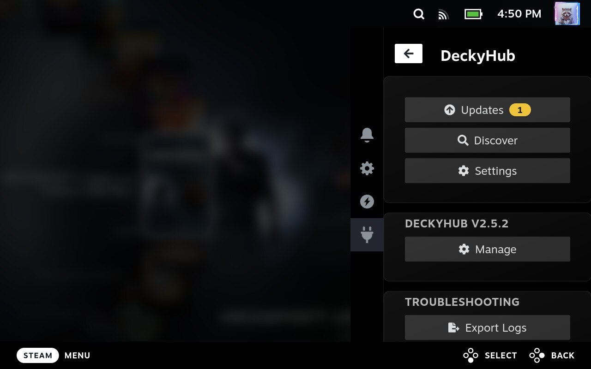
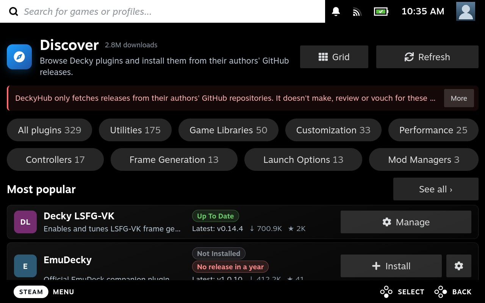
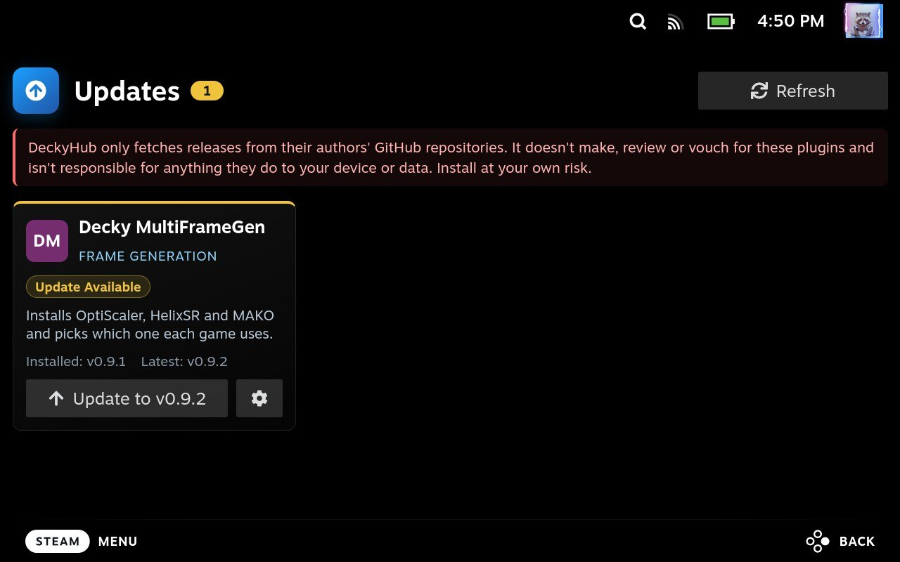
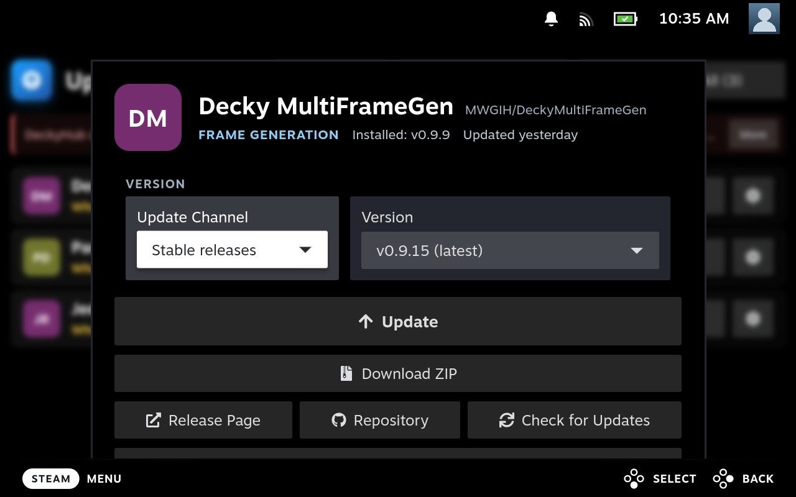

# DeckyHub

### Menu

### Discover

### Updates

### Manage

**Your Steam Deck's plugin store — right inside Gaming Mode.** · [Website](https://mazillka.github.io/deckyhub-plugin/)

> [!CAUTION]
> **DeckyHub only fetches releases from their authors' GitHub repositories. It doesn't make, review or vouch for these plugins and isn't responsible for anything they do to your device or data. Install at your own risk.**

Tired of tabbing out to Desktop Mode, hunting through GitHub releases, and manually downloading ZIPs every time a plugin updates? DeckyHub brings plugin discovery and updates straight to your controller. Browse a curated catalog of the best Steam Deck tools, track any GitHub repo you want, and get notified the moment an update drops — all without leaving your couch.

> **A note on how this is made.** Most of DeckyHub's code was written with the help of AI tools (Claude and Codex). That doesn't mean it ships untested — every release is verified on real hardware before it goes out. I'm telling you this upfront so you know exactly what you're installing and how it got built.

## Why you'll like it

- **Never miss an update** — DeckyHub checks your installed plugins against their latest GitHub releases and pings you with a toast the moment something new is available.
- **No more zip-hunting** — search, download, and see exactly which release asset you need without opening a browser.
- **Built for the couch** — full gamepad navigation, color-coded status at a glance, and one-tap downloads designed for Gaming Mode, not a desktop browser squeezed onto a small screen.
- **You stay in control** — DeckyHub never installs or runs anything on its own. Nothing touches your system until you say so, and installs go through Decky Loader's own installer and confirmation dialog (see [Manage](#manage)).

## What it does

- **Discover** — browse a curated list of Steam Deck plugins/tools, filter by search or installed status, and see release info at a glance, color-coded by status.
- **Updates** — see which of your tracked, installed tools have a newer release available, and update the Decky plugins among them in one go with **Update All**. You'll also get a toast notification when new updates show up.
- **Repositories** — search GitHub, add or remove tracked repositories, and export/import your list. **Custom Registries** adds other people's app lists. Per-repository release-channel overrides live behind each app's **Manage** button on Discover/Updates instead.
- **Settings** — shows the DeckyHub download folder and the **Overwrite Existing** toggle, lets you add an optional GitHub personal access token to raise the API rate limit, picks the language, and adjusts the display: **Default** or **Compact** density, items per row (1–3) in the app grid, and which Manage-window buttons to hide.
- **Quick Access Menu** — links to the pages above (with a count of waiting updates), plus DeckyHub's own update check, a **Cleanup** section that empties the download folder after confirmation, and **Export Logs** for bug reports.

DeckyHub never installs or runs anything automatically. **Download ZIP** saves a release, which you install yourself via Decky's settings → Developer → Install Plugin from ZIP. For one-tap install, update and uninstall, see [Manage](#manage).

## Bundled repositories

No setup, no configuration — these show up in Discover the moment you install DeckyHub:

| Tool | Category | Repository |
| --- | --- | --- |
| MAKO Decky | Frame Generation | [eugeniosegala/MAKO](https://github.com/eugeniosegala/MAKO) |
| Decky LSFG-VK | Frame Generation | [xXJSONDeruloXx/decky-lsfg-vk](https://github.com/xXJSONDeruloXx/decky-lsfg-vk) |
| Unifideck | Game Libraries | [mubaraknumann/unifideck](https://github.com/mubaraknumann/unifideck) |
| Decky Framegen | Frame Generation | [xXJSONDeruloXx/Decky-Framegen](https://github.com/xXJSONDeruloXx/Decky-Framegen) |
| Nexus Mods | Mod Managers | [RedRanger14/decky-nexus](https://github.com/RedRanger14/decky-nexus) |
| Decky Proton Launch | Launch Options | [moi952/decky-proton-launch](https://github.com/moi952/decky-proton-launch) |
| Launch Options | Launch Options | [Wurielle/decky-launch-options](https://github.com/Wurielle/decky-launch-options) |
| Non-Steam Badges | Game Libraries | [sebet/decky-nonsteam-badges](https://github.com/sebet/decky-nonsteam-badges) |
| Decky-Undervolt | Performance | [totallynotbakadestroyer/Decky-Undervolt](https://github.com/totallynotbakadestroyer/Decky-Undervolt) |
| ProtonDB Badges | Game Libraries | [bschelst/protondb-decky](https://github.com/bschelst/protondb-decky) |
| CSS Loader | Customization | [DeckThemes/SDH-CssLoader](https://github.com/DeckThemes/SDH-CssLoader) |
| Deck as Controller | Controllers | [jmedina21/deck-as-controller](https://github.com/jmedina21/deck-as-controller) |
| BGFX | Frame Generation | [andrewmd5/decky-bgfx](https://github.com/andrewmd5/decky-bgfx) |
| ThemeHub | Customization | [Kaal31/benderthemes](https://github.com/Kaal31/benderthemes) |
| Spindeck | Customization | [justinca92/spindeck](https://github.com/justinca92/spindeck) |
| Game Glance | Customization | [michpalm/game-glance](https://github.com/michpalm/game-glance) |
| Decky MultiFrameGen | Frame Generation | [MWGIH/DeckyMultiFrameGen](https://github.com/MWGIH/DeckyMultiFrameGen) |
| Finally Achievement Plugin | Customization | [otisabiburada/finally-achievement-plugin](https://github.com/otisabiburada/finally-achievement-plugin) |
| Glance Library | Customization | [shak18/game-glance](https://github.com/shak18/game-glance) |

The list lives in [mazillka/deckyhub-registry](https://github.com/mazillka/deckyhub-registry) and refreshes when DeckyHub starts, so new apps show up without a DeckyHub update. Know a plugin that belongs here? Open an issue or pull request there.

Want more? Add any other GitHub repository from **Repositories** in seconds.

## Installing DeckyHub

1. Make sure [Decky Loader](https://decky.xyz/) is installed.
2. Download the latest `DeckyHub-v*.zip` from the [Releases page](https://github.com/mazillka/deckyhub-plugin/releases).
3. In Gaming Mode, open the Quick Access Menu → Decky → settings (gear icon). Turn on **Developer mode** under General if it's off, then go to **Developer** → **Install Plugin from ZIP** and select the downloaded file.
4. Open Quick Access Menu → Decky → **DeckyHub**.

## Using DeckyHub

### Discover

Browse the bundled list or search it by name, repository, category or description, and filter by **Status** — All, Installed, or Not Installed. Each card is color-coded (green once it's up to date, yellow when an update is available, red on an error) so you can spot what needs attention at a glance, and says **Checking…** while its latest release is still being looked up. A card set to the pre-release **Channel** says so; stable is the default and isn't labelled. Tap **Manage** on any card to pick a channel and version, then download the release asset you want.

To track a repository that isn't in the curated list, go to **Repositories**, search for it, and add it — it'll show up in Discover from then on.

### Updates

Shows every tracked tool that's installed and has a newer release available, along with its installed and latest version. Update a plugin from its [Manage](#manage) window, or, when more than one Decky plugin is waiting, tap **Update All** to hand them all to Decky Loader's installer behind a single confirmation. Plugins that need a fresh install instead of an in-place update (currently Unifideck) are left out of **Update All**; update those from their Manage window. The **Updates** button in the Quick Access Menu shows how many updates are waiting.

### Manage

Tap **Manage** on any card in Discover or Updates to:

- pick the release **channel** and a specific **version**. **Stable** shows only stable releases; **Pre-release** shows every release, newest first, so a stable release that comes out after the last pre-release is still offered;
- **Download ZIP**, open the **Release Page**, or **Check for Updates** for that app;
- for a Decky plugin, **Install** (not installed yet) or **Update** (the selected version is newer than the installed one). This hands the release ZIP to Decky Loader's own installer, the same one the Decky Store uses. Decky asks you to confirm and installs it, verifying the SHA-256 checksum GitHub publishes for the ZIP. Older releases (files uploaded before mid-2025) have no checksum and Decky installs them without that check;
- for an installed Decky plugin, **Uninstall**, which asks you to confirm and then removes the plugin and its settings through Decky Loader.

### Downloads

All downloads are saved to `/home/deck/Downloads/deckyhub`. **Cleanup** → **Empty Folder** in the Quick Access Menu clears that folder after confirmation. Starting a download opens a progress dialog with a **Cancel** button; once it finishes, the same dialog shows where the ZIP was saved and how to install it. If a download is interrupted, no partial file is left behind.

When GitHub provides a checksum for a release asset, DeckyHub always verifies it before keeping the download. By default, downloading a file again overwrites the previous copy; turn off **Overwrite Existing** in Settings if you'd rather keep both.

### Repositories

Search GitHub for a repository and tap **Add** (repositories you already track show **Already Added** instead, so you can tell at a glance). Results page five at a time. Export your custom repositories to `DeckyHub-repositories.json` in `/home/deck/Downloads` to back them up or share them, or import that file back in. Any repository you've added can be removed again here; the curated repositories that ship with DeckyHub stay available and can't be removed. Prefer a bigger screen? The [Registry Editor](https://mazillka.github.io/deckyhub-plugin/editor.html) is a browser-based tool for building or editing a repository list file before importing it.

To switch a tracked app between stable and pre-release releases, use its [Manage](#manage) window.

Under **Custom Registries**, add someone else's app list by its GitHub `owner/repo` (DeckyHub reads its `registry/apps.json`) or any HTTPS `.json` URL. Its apps join Discover alongside the bundled ones; up to 10 registries are allowed, and **Refresh registries** downloads them all again. An added registry can only add apps: it can't change or replace one DeckyHub already lists, including the plugins you have installed.

### Keeping DeckyHub itself updated

The Quick Access Menu shows the installed version (**Current - vX.Y.Z**) and checks for a newer DeckyHub release in the background, with a notification the first time one appears; an **Update to vX.Y.Z** button then installs it straight away, like an app card's. **Manage** opens DeckyHub's update window, where you pick a channel (**Stable releases**, or **Pre-releases** for every release) and a version, then:

- **Update to / Reinstall / Downgrade to vX.Y.Z** — hands that release to Decky Loader's own installer (the same one the Decky Store uses), which downloads it, verifies its SHA-256 checksum, and installs it in place. Only releases with a published checksum are offered.
- **Download ZIP** — the classic path: saves the release ZIP to `/home/deck/Downloads/deckyhub`, which you then install yourself via Decky's settings → Developer → Install Plugin from ZIP.

If automatic update isn't available for some reason (e.g. running inside an older Decky Loader build), fall back to Download ZIP.

## Good to know

- DeckyHub talks to GitHub without needing you to log in, so very heavy use in a short time may still hit GitHub's public rate limit (60 requests/hour) — if it does, the error names it as a rate limit and says roughly how long to wait, rather than just a raw status code. Add a personal access token in **Settings → GitHub Access** (no scopes needed — it only reads public repos and releases) to raise that to 5,000/hour; the token stays on your device and is only ever sent to `api.github.com`.
- Release information is cached for 30 minutes, so opening the same app's Manage window or the DeckyHub update modal again shortly after won't always show something new. Every "Check for Updates" and "Refresh" button bypasses this and asks GitHub directly.
- Downloads only ever happen over HTTPS.

## Disclaimer

DeckyHub is only a discovery and download tool. All rights to the plugins and tools listed in its registry belong to their respective authors; DeckyHub does not own, endorse, or take responsibility for any third-party repository or its content.

## License

GPL-3.0-or-later — see [LICENSE.md](LICENSE.md).

## Getting help

Found a bug or have an idea? Open an issue on the [GitHub repository](https://github.com/mazillka/deckyhub-plugin/issues) with a description of what happened; attaching the ZIP from **Export Logs** (Quick Access Menu → Troubleshooting) helps, and it never contains your GitHub token. Feedback and suggestions are always welcome.

Want to build DeckyHub from source or contribute a change? See [CONTRIBUTING.md](CONTRIBUTING.md).
