

# DeckyHub

**Your Decky plugin hub — right inside Gaming Mode.**

Find, install and update Decky Loader plugins with your controller — from DeckyHub's plugin list, or any plugin on GitHub.

**English** · [Українська](README.uk.md)

 

[**Download**](https://github.com/mazillka/deckyhub-plugin/releases/latest) · [Website](https://deckyhub.com/) · [Release notes](https://deckyhub.com/releases.html) · [Plugin catalog](https://deckyhub.com/plugins/) · [Install guide](#installing-deckyhub) · [Report an issue](https://github.com/mazillka/deckyhub-plugin/issues)

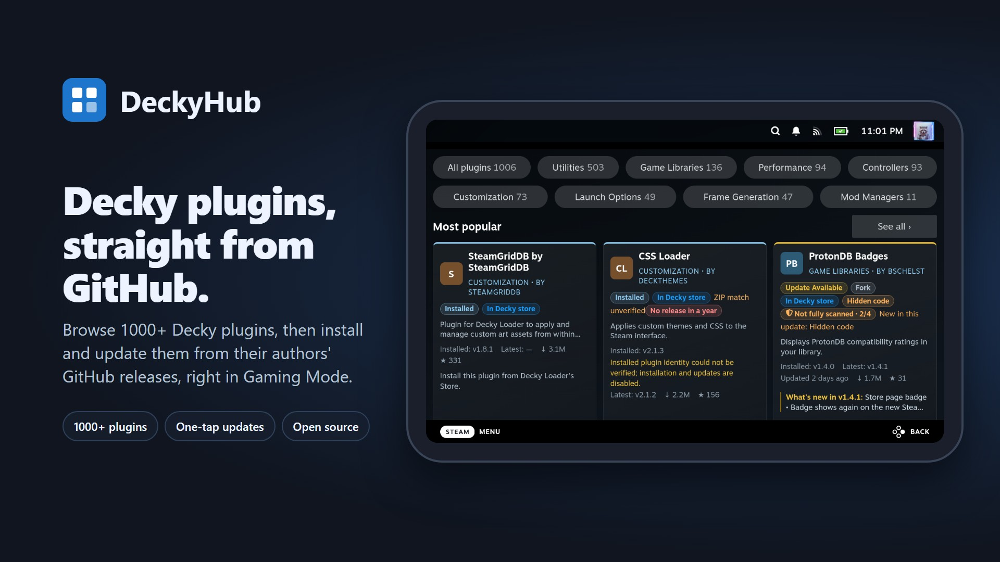

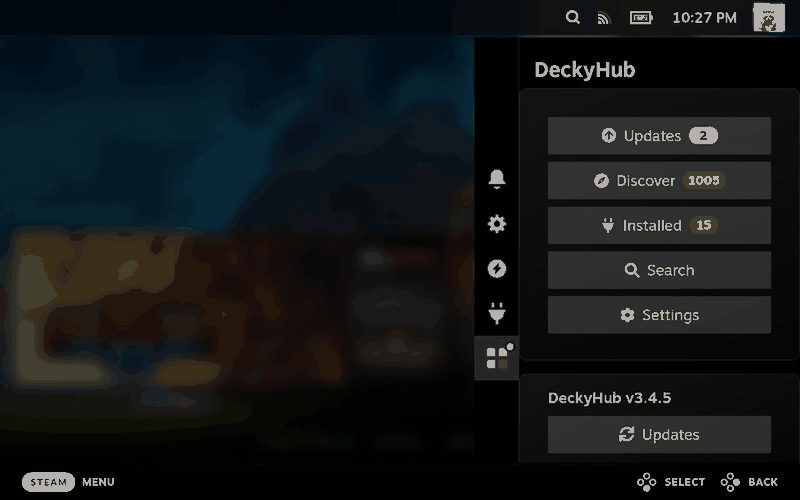

<table>
<tr>
<td align="center">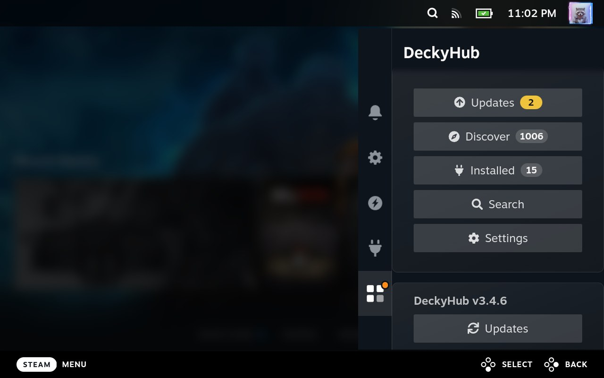 <b>Quick Access</b></td>
<td align="center">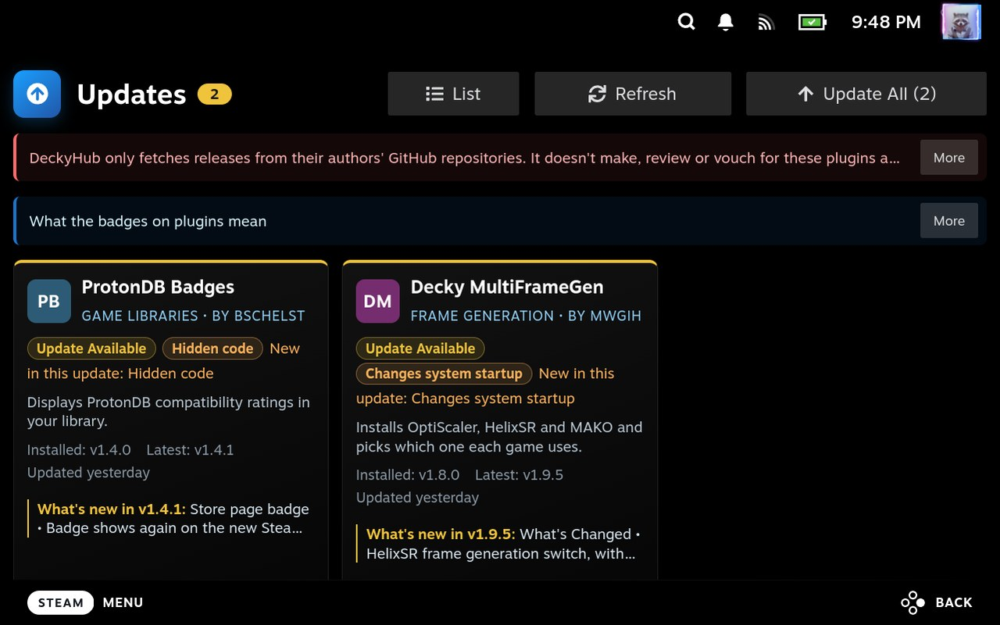 <b>Updates</b></td>
<td align="center">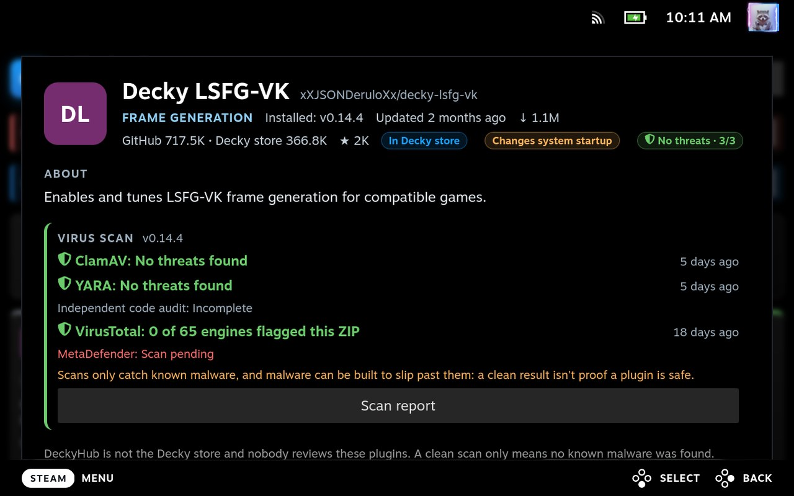 <b>Manage</b></td>
</tr>
<tr>
<td align="center">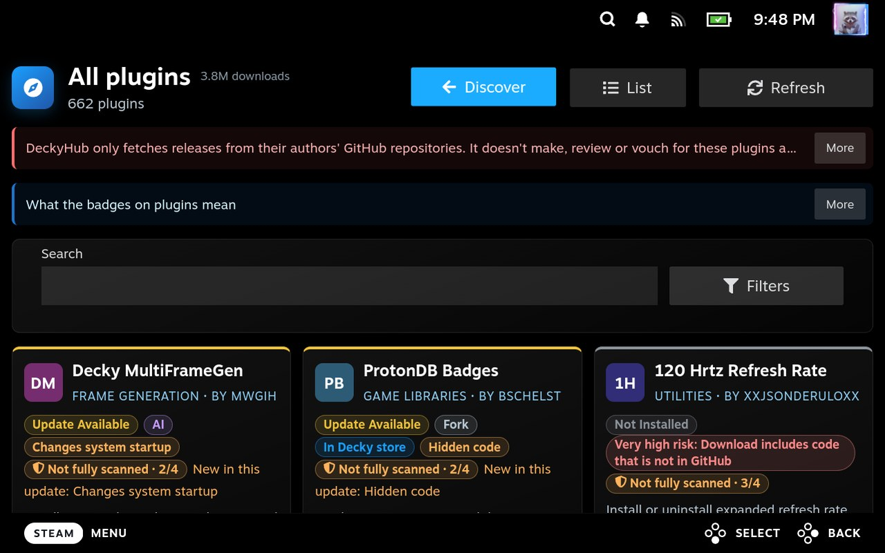 <b>All plugins</b></td>
<td align="center">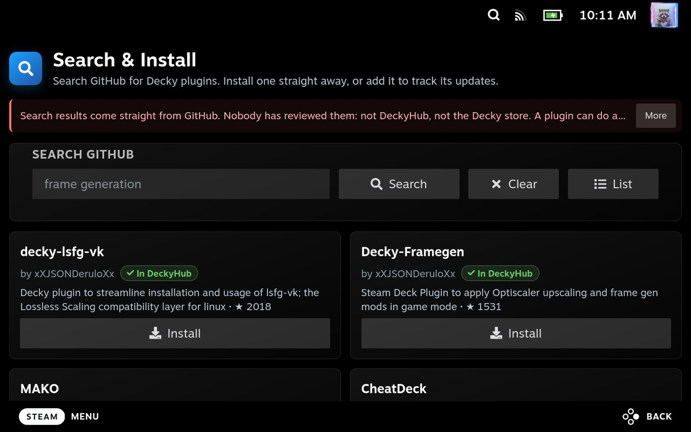 <b>Search</b></td>
<td align="center">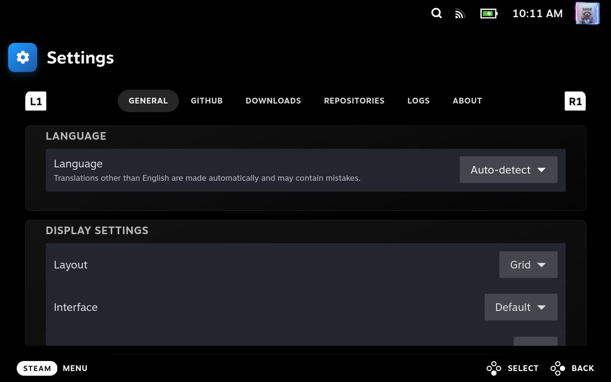 <b>Settings</b></td>
</tr>
<tr>
<td align="center">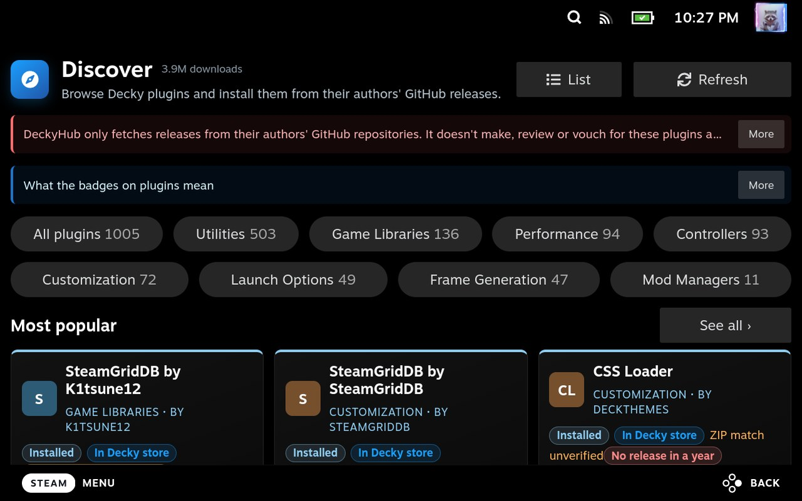 <b>Discover</b></td>
<td align="center">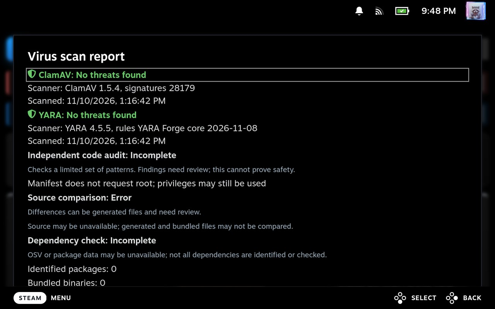 <b>Virus scan report</b></td>
<td align="center">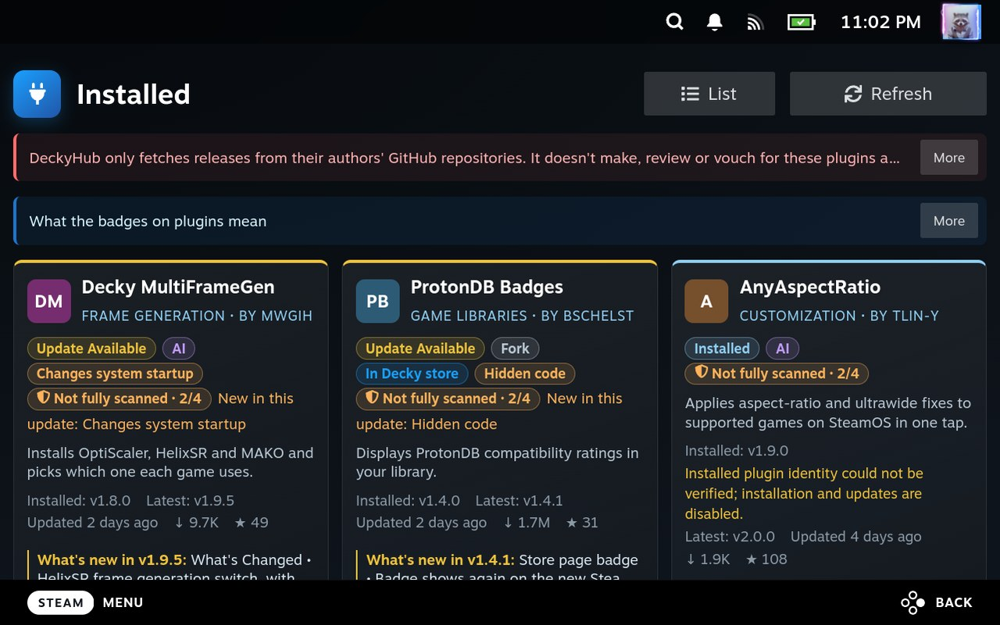 <b>Installed</b></td>
</tr>
</table>

> [!CAUTION]
> **DeckyHub only fetches releases from their authors' GitHub repositories. It doesn't make, review or vouch for these plugins and isn't responsible for anything they do to your device or data. Install at your own risk.**

Tired of tabbing out to Desktop Mode, hunting through GitHub releases, and manually downloading ZIPs every time a plugin updates? DeckyHub brings plugin discovery and updates straight to your controller. Browse a catalog of over 1,000 Decky plugins, search GitHub for any other Decky plugin and install it on the spot, and get notified when an update drops — all without leaving your couch. It's the first and last plugin you'll ever install from a ZIP.

> **A note on how this is made.** Most of DeckyHub's code was written with the help of AI tools (Claude and Codex). That doesn't mean it ships untested — every release is verified on real hardware before it goes out. I'm telling you this upfront so you know exactly what you're installing and how it got built.

**Contents:** [Why you'll like it](#why-youll-like-it) · [What it does](#what-it-does) · [The plugin list](#the-plugin-list) · [Requirements](#requirements) · [Installing](#installing-deckyhub) · [Using DeckyHub](#using-deckyhub) · [Uninstalling](#uninstalling-deckyhub) · [Troubleshooting](#troubleshooting) · [Quality](https://deckyhub.com/about.html#how-deckyhub-controls-quality) · [Privacy](#privacy) · [Disclaimer](#disclaimer) · [Getting help](#getting-help)

## Why you'll like it

- **Any plugin on GitHub, one search away** — **Search & Install** finds Decky plugins that aren't in the Decky store or DeckyHub's list and installs them right from Gaming Mode. No Desktop Mode, no browser, no Developer Mode URL pasting.
- **Never miss an update** — DeckyHub checks your installed plugins against their latest GitHub releases every few hours and pings you with a toast when something new is available.
- **Built for the couch** — full gamepad navigation, color-coded status at a glance, and one-tap downloads designed for Gaming Mode, not a desktop browser squeezed onto a small screen.
- **You stay in control** — DeckyHub never installs or runs anything on its own. Nothing touches your system until you say so (a browser you mark as **Trusted** under [Remote Install](https://deckyhub.com/guide.html#remote-install-experimental) is the one exception, and you choose it), and installs go through Decky Loader's own installer and confirmation dialog (see [Manage](https://deckyhub.com/guide.html#manage)).

## What it does

- **[Discover](https://deckyhub.com/guide.html#discover)** — browse DeckyHub's list of Decky plugins/tools, filter by search or installed status, and see release info at a glance, color-coded by status.
- **[Search & Install](https://deckyhub.com/guide.html#search--install)** — search GitHub for Decky plugins and install one in a tap, or add it to track its updates.
- **[Updates](https://deckyhub.com/guide.html#updates)** — see which of your tracked, installed tools have a newer release available and what each one brings, and update the Decky plugins among them in one go with **Update All**. DeckyHub checks in the background every few hours, so the dot on its icon and a toast tell you when new updates show up, and each card says **Installing…** until Decky finishes, then a toast confirms it.
- **[Settings](https://deckyhub.com/guide.html#settings)** — language, display, an optional GitHub token, downloads, your tracked repositories and custom registries, and log export.
- **Quick Access Menu** — DeckyHub has its own tab (the four-square DeckyHub icon, with a dot when updates are waiting) in the Quick Access tab strip, next to Decky's, and also opens from Decky's plugin list. Turn it off with **Settings → General → DeckyHub tab in Quick Access**. If Decky Loader repeats plugin tab icons in the strip ([decky-loader#1014](https://github.com/SteamDeckHomebrew/decky-loader/issues/1014)), turn the tab off. It shows **Discover**, **Search** and **Settings**, plus **Updates** with a count whenever updates are waiting. Below them: DeckyHub's own version and update check, and a **Cleanup** section (shown when the download folder has files) that empties it after confirmation.

If you'd rather install a plugin yourself, **Download ZIP** saves the release instead, and you install it the same way as DeckyHub itself (see [Option 2: Manual ZIP](#option-2-manual-zip)).

## The plugin list

No setup, no configuration — the plugin list shows up in Discover the moment you install DeckyHub. It lives in [mazillka/deckyhub-registry](https://github.com/mazillka/deckyhub-registry) and refreshes every time DeckyHub starts, so new apps show up without a DeckyHub update. DeckyHub keeps the last list it downloaded for offline use; a fresh install needs to reach GitHub once.

**Where the plugins come from:**

- **Suggested:** plugins people suggest through the registry's issues and pull requests.
- **[Decky Extended Plugins](https://decky-extended-plugins.beallio.com/)** by [beallio](https://github.com/beallio): a community catalog of the Decky store plus community plugins, with a [security audit](https://decky-extended-plugins.beallio.com/audit).
- **[Decky Plugins Explorer](https://safetzahirovic.github.io/decky-plugins-explorer/)** by [SafetZahirovic](https://github.com/SafetZahirovic): a nightly crawl of every public GitHub repository with a Decky `plugin.json`.

A daily job checks both catalogs, plus its own search of GitHub for repositories tagged or named like Decky plugins, for plugins that aren't listed yet, skips ones that look unfinished (brand new, nobody using them yet, a placeholder version), and opens a pull request with the ones that qualify. Every plugin, however it was found, has to have a stable GitHub release with exactly one plugin ZIP whose `plugin.json` name matches. These are automatic checks for a working release: nobody reviews the plugins themselves, for safety or anything else; the [catalog](https://deckyhub.com/plugins/) and Discover flag plugins that run as root, haven't had a release in a year, or got a warning from the [security audit](https://decky-extended-plugins.beallio.com/audit) (see [Badges](https://deckyhub.com/guide.html#badges)).

- **Credit:** the Decky store download counts shown for plugins come from the [Decky plugin store](https://plugins.deckbrew.xyz/plugins) (plugins.deckbrew.xyz).
- **Browse it:** the [plugin catalog](https://deckyhub.com/plugins/) lists every plugin, searchable and by category, with downloads and stars.
- **Suggest a plugin:** open an [issue](https://github.com/mazillka/deckyhub-registry/issues/new) or a pull request in the registry repository.
- **Want more?** Find any other Decky plugin on GitHub with **[Search & Install](https://deckyhub.com/guide.html#search--install)**.

## Requirements

- Any device with [Decky Loader](https://decky.xyz/) 3.x installed.
- An internet connection that can reach GitHub. No GitHub account is needed.

## Installing DeckyHub

DeckyHub isn't on the official Decky Loader store, and won't be: the Decky team [declined it](https://github.com/SteamDeckHomebrew/decky-plugin-database/issues/1182) because it installs plugins they haven't reviewed and most of its code was written with AI tools. Install it one of the ways below instead.

There are two ways to install DeckyHub. Pick one:

| | **Desktop installer** (recommended) | **Manual ZIP** |
| --- | --- | --- |
| Where | Desktop Mode | Gaming Mode |
| Decky Loader | Checked, and installed if it's missing | Must already be installed |
| Admin password | Needed | Not needed |
| What you do | Download one file and follow the steps it shows | Download the ZIP and add it in Decky's developer settings, or paste a link |
| Decky Loader setup | None: Decky Loader and DeckyHub are set up in one go | You install Decky Loader first |

Afterward, DeckyHub can install and update plugins from Gaming Mode.

### Option 1: Desktop installer (recommended)

One download sets up **both Decky Loader and DeckyHub**: it checks for [Decky Loader](https://decky.xyz/) first and installs it if your device doesn't have it yet (stable, or a pre-release if you choose it), then installs DeckyHub. That saves you installing Decky Loader separately, and the extra steps and commands that takes. Prefer not to use it? [Option 2](#option-2-manual-zip) needs no password.

1. Switch to Desktop Mode (**Steam** → **Power** → **Switch to Desktop**).
2. The shortcut `Install-DeckyHub.desktop` has to be **on the Desktop**. Put it there in one of two ways: <!-- choose --> **Download it:** download [`Install-DeckyHub.desktop`](https://github.com/mazillka/deckyhub-plugin/releases/latest/download/Install-DeckyHub.desktop), then open **Downloads** in Dolphin and drag it onto the Desktop (or cut and paste it). If your browser saved it as `Install-DeckyHub.desktop.download` (Firefox does that for shortcut files), rename it to `Install-DeckyHub.desktop` first. <!-- or --> **Or use Konsole:** open **Konsole** and run this command, which saves it on the Desktop under the right name: `curl -fsSL -o ~/Desktop/Install-DeckyHub.desktop https://github.com/mazillka/deckyhub-plugin/releases/latest/download/Install-DeckyHub.desktop && chmod +x ~/Desktop/Install-DeckyHub.desktop`
3. Double-click **Install DeckyHub** on the Desktop and choose **Continue** (or **Execute**) when asked.
4. Read the overview. It lists every step, with Decky Loader first (checked, or installed if it's missing) and DeckyHub only after it, and says why the admin password is needed. Then choose **Install** (or **Update** or **Reinstall**, when DeckyHub is already there). The installer doesn't collect, save or send any information about you or your device; it only downloads files from GitHub. It checks that GitHub is reachable. If Decky Loader isn't installed yet, it asks which one to install: **Stable** (the default) or **Pre-release**, a test version that can be unstable or work only with Steam's beta (when there's no newer test version, you get the stable one). If Decky Loader is already there, you aren't asked and it isn't changed. Then the installer asks for your device's admin password (the one you set for Desktop Mode, not your Steam password). If you've never set one, it offers a temporary one and removes it when it's done, like Decky Loader's own installer.
5. Optionally look at a few hand-picked plugins, one at a time: skip is the default, and you add plugins at your own risk (see "Optional plugins" below).
6. Follow the progress window ("Step 3 of 5: …") until the finish message lists what was done and what to do next. If it reports an error, follow the instructions in the message.
7. Return to Gaming Mode and pick DeckyHub's four-square icon in the Quick Access Menu.

What it does: first it checks that Decky Loader is installed, and if it isn't, runs [Decky Loader's official installer](https://github.com/SteamDeckHomebrew/decky-installer) (its stable script, or its pre-release one if you chose **Pre-release**). Only then does it download that release's `DeckyHub-v*.zip` from GitHub, check its SHA-256 against the one the installer was made with (and stop if they differ), put it in Decky's plugins folder and restart Decky. The password is needed because installing and restarting Decky Loader change the device itself. The script is [`installer/install-deckyhub.sh`](installer/install-deckyhub.sh); each release attaches it filled in with its own version and checksum, and scans it for malware like the ZIP.

Optional plugins: after the overview, the installer shows a few hand-picked plugins (frame generation, themes and more) **one at a time**. Each card has its version, notes (AI-assisted, runs as root, audit warnings), stars and downloads, and clickable links to its GitHub repository and its page on deckyhub.com with its security scans. **Skip** is the default button, so nothing is added unless you choose **Add this plugin**, and the installer says DeckyHub isn't responsible for what you install: you add plugins at your own risk. The installer doesn't install them: it saves your picks, and the first time you open DeckyHub it lists them again and installs them, with the usual confirmation, only if you agree. Skip it and nothing is saved.

<table>
<tr>
<td align="center">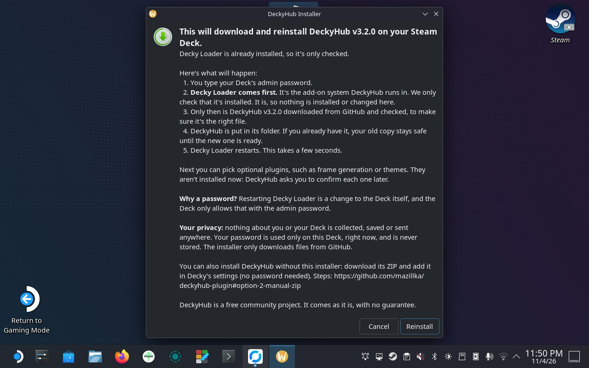 <b>Overview</b></td>
<td align="center">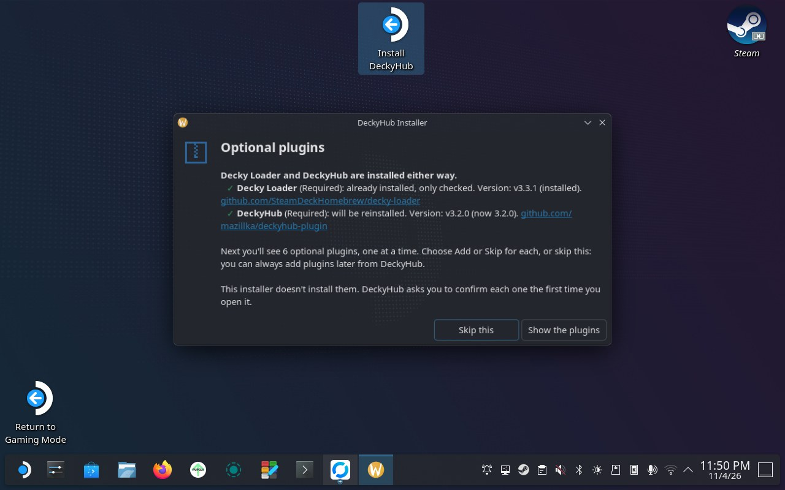 <b>Optional plugins</b></td>
<td align="center">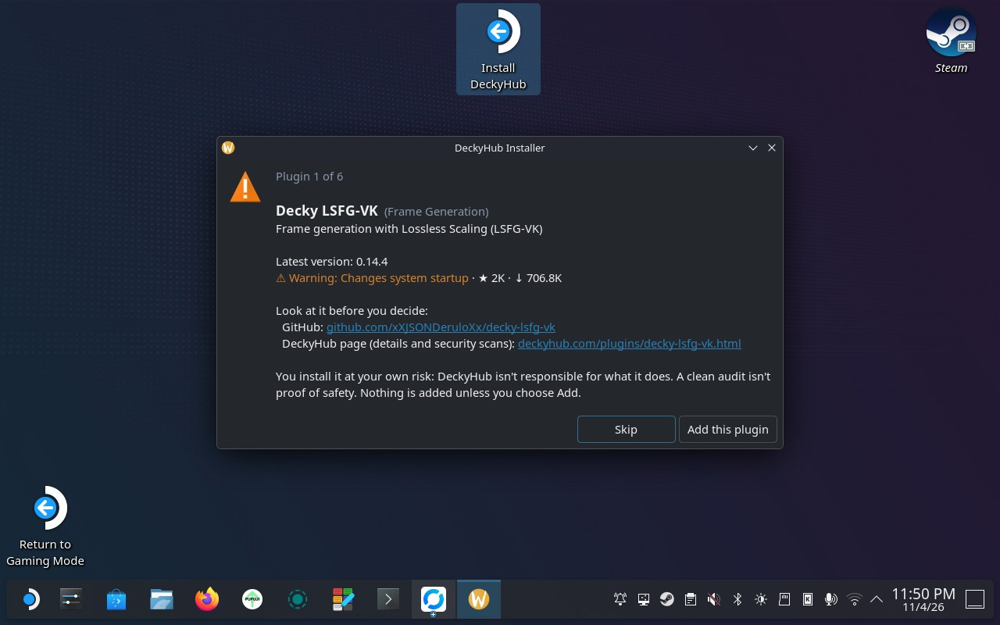 <b>A plugin's card</b></td>
</tr>
<tr>
<td align="center">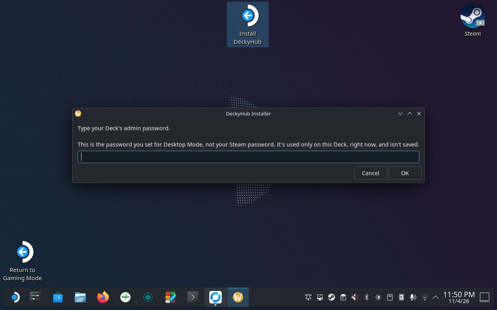 <b>Password</b></td>
<td align="center">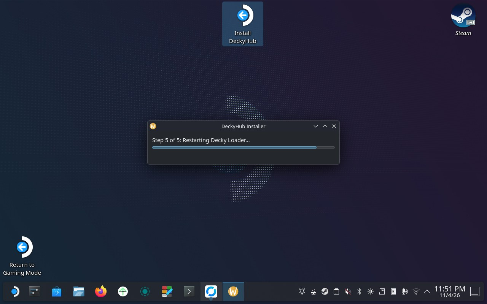 <b>Progress</b></td>
<td align="center">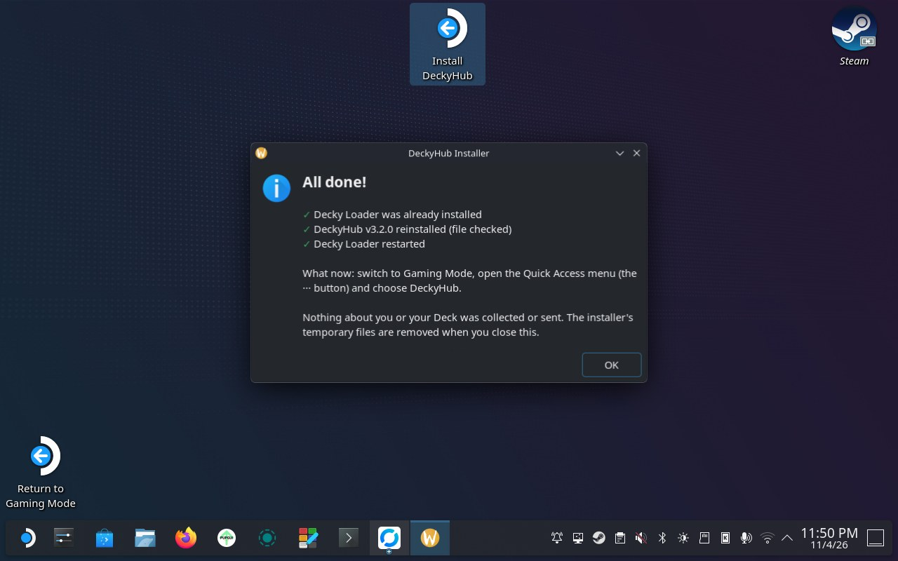 <b>All done</b></td>
</tr>
</table>

### Option 2: Manual ZIP

Decky Loader must already be installed. No admin password is needed.

1. Download the latest `DeckyHub-v*.zip` from the [Releases page](https://github.com/mazillka/deckyhub-plugin/releases).
2. In Gaming Mode, open the Quick Access Menu → Decky → settings (gear icon). Turn on **Developer mode** under General if it's off, then go to **Developer** → **Install Plugin from ZIP** and select the downloaded file.
3. Pick DeckyHub's four-square icon in the Quick Access Menu (or Decky → **DeckyHub**).

#### Alternative: install the ZIP from a URL

If Decky Loader is already installed:

1. Open the Quick Access Menu → **Decky** → settings (gear icon), and turn on **Developer mode** under **General** if it's off.
2. Go to **Developer** → **Install Plugin from URL** and enter this link, which always points to the newest DeckyHub release:

   `https://github.com/mazillka/deckyhub-plugin/releases/latest/download/DeckyHub.zip`

   

   Scan the QR code to have the link on your phone while you type it.
3. Pick DeckyHub's four-square icon in the Quick Access Menu (or Decky → **DeckyHub**).

## Using DeckyHub

The full guide, with every screen and setting, is on the website: **[deckyhub.com/guide.html](https://deckyhub.com/guide.html)**. Short answers to common questions are on the [Help page](https://deckyhub.com/help.html). In short:

- **[Controller buttons](https://deckyhub.com/guide.html#controller-buttons):** Steam's standard controls, plus **X** (download a release's ZIP), **Y** (read its release notes) and **Menu** (open the plugin's GitHub page) on every Install and Update button.
- **[Discover](https://deckyhub.com/guide.html#discover):** shelves and category chips, then search, filters and sorting, with [badges](https://deckyhub.com/guide.html#badges) for root access, audit warnings, virus scans, the Decky store and forks.
- **[Search & Install](https://deckyhub.com/guide.html#search--install):** find any Decky plugin on GitHub, even one that isn't on the list.
- **[Updates](https://deckyhub.com/guide.html#updates) and [Manage](https://deckyhub.com/guide.html#manage):** update one plugin or all of them, pick a version or file, download the ZIP, or uninstall.
- **[Settings](https://deckyhub.com/guide.html#settings):** layout and language, GitHub token, downloads, repositories, logs.
- **[Remote Install (experimental)](https://deckyhub.com/guide.html#remote-install-experimental):** send a plugin from deckyhub.com on your phone or computer to your device, and manage what is installed on it, fully on your own network.
- **[Keeping DeckyHub itself updated](https://deckyhub.com/guide.html#keeping-deckyhub-itself-updated).**

## Uninstalling DeckyHub

Open Decky's settings (gear icon) → **Plugins**, open the menu next to **DeckyHub** and choose **Uninstall**. Decky removes DeckyHub together with its settings and cached lists. Plugins you installed through DeckyHub stay installed.

Files DeckyHub saved to Downloads aren't removed: release ZIPs in `~/Downloads/deckyhub`, and any exported repository lists or log ZIPs in `~/Downloads`. Use **Cleanup** → **Empty Folder** before uninstalling, or delete them in Desktop Mode.

## Troubleshooting

- **"Rate limit" errors.** DeckyHub talks to GitHub without needing you to log in. Release info for DeckyHub's list comes from one file the registry refreshes every hour, so browsing doesn't use up GitHub's public rate limit (60 requests/hour). Searching and repositories you added yourself still ask GitHub directly, so very heavy use may hit it; the error then says roughly how long to wait. To raise the limit to 5,000/hour, add a personal access token in **Settings → GitHub** (no scopes needed; see [Privacy](#privacy) for where it goes).
- **A new release doesn't show up.** Release information is cached for 30 minutes. Every **Check for Updates** and **Refresh** button skips the cache, though a brand-new release can take up to an hour to reach the plugin list's release file.
- **Discover is empty on a fresh install.** DeckyHub needs to reach GitHub once to download the plugin list; after that it works offline from the last copy.
- **Install, Update or DeckyHub's own update doesn't work.** On an older Decky Loader build, one-tap installs may not be available. Use **Download ZIP** and install it from Decky's Developer settings (see [Option 2: Manual ZIP](#option-2-manual-zip)), or update Decky Loader.
- **Anything else.** Open an issue (see [Getting help](#getting-help)) and attach the ZIP from **Export Logs**.

Downloads only ever happen over HTTPS.

## Performance

Measured on a real Steam Deck: opening a page costs one slow frame and an idle DeckyHub causes no long tasks. The numbers and how to measure on yours are on the website: **[Performance](https://deckyhub.com/about.html#performance)**.

## How DeckyHub controls quality

DeckyHub installs software on your Deck, so every change, every release and every listed plugin goes through checks before it reaches you, all of it open. What is checked, and when, is on the website: **[How DeckyHub controls quality](https://deckyhub.com/about.html#how-deckyhub-controls-quality)**.

## Privacy

DeckyHub has no account, analytics or telemetry, and sends nothing to its author or to any server of its own. The **deckyhub.com website** does count visits (page views, country and browser type, without cookies) with Cloudflare Web Analytics; the plugin itself is completely clean: it counts and sends nothing.

- **What it connects to:** only GitHub — `raw.githubusercontent.com` and `github.com` for the plugin list, release info, virus scan reports and downloads, and `api.github.com` for search and repositories that aren't in the list — plus the HTTPS address of any custom registry you add. GitHub sees these requests as it would any browser's (your IP address and which repositories are looked up), under [GitHub's privacy statement](https://docs.github.com/site-policy/privacy-policies/github-general-privacy-statement). Links such as a plugin's repository or the audit page open only when you tap them.
- **What stays on your device:** your settings, tracked repositories, custom registries and the cached plugin list and release info. The settings file is readable only by your user.
- **Your GitHub token** is optional, needs no scopes, is only ever sent to `api.github.com`, and is never written to the logs.
- **Logs** never leave the device on their own. **Export Logs** saves a ZIP to your Downloads folder with what DeckyHub did and any errors (repository names, file paths, versions); you decide whether to attach it to an issue.

## Supporting DeckyHub

DeckyHub is free and stays free: every feature works without paying, and nothing is locked behind a donation. If it helps you, you can chip in on [Ko-fi](https://ko-fi.com/mazillka) or [GitHub Sponsors](https://github.com/sponsors/mazillka). It pays for the author's time on maintenance and on testing every release on real hardware, and for the deckyhub.com domain. The virus scans run on free tools and services with no subscription, so they don't depend on donations. A donation doesn't buy a place or a better rank in the plugin list, doesn't influence the security checks and doesn't unlock anything, and DeckyHub never sees who donates. More on [deckyhub.com](https://deckyhub.com/about.html#support).

## Disclaimer

Not affiliated with Valve or the Decky Loader project. DeckyHub is a discovery and download tool: plugin information comes from public GitHub repositories, and every plugin belongs to its own authors. DeckyHub doesn't review, own or endorse any third-party plugin or its content, and isn't responsible for what one does. Plugins are installed at your own risk, so look at a plugin's repository before you install it, especially one found through Search.

## License

Copyright © 2026 Andrii Shevchuk-Yuhanets ([mazillka](https://github.com/mazillka)).

GPL-3.0-or-later — see [LICENSE.md](LICENSE.md).

## Media Coverage

- [Steam Deck HQ — DeckyHub Offers An Easy Way To Get Plugins That Aren't On The Official Store](https://steamdeckhq.com/news/deckyhub-offers-an-easy-way-to-get-plugins-that-arent-on-the-official-store/)
- [Steam Deck HQ — DeckyHub Adds Virus Scans And More Transparency On Its Plugin Store](https://steamdeckhq.com/news/deckyhub-adds-virus-scans-more-transparency/)

More coverage: https://deckyhub.com/press. These are independent publications; DeckyHub isn't affiliated with them.

## Getting help

Have a question or an idea? Ask in [Discussions](https://github.com/mazillka/deckyhub-plugin/discussions). Found a bug? Open an issue on the [GitHub repository](https://github.com/mazillka/deckyhub-plugin/issues) with a description of what happened; attaching the ZIP from **Export Logs** (**Settings** → **Logs**) helps. Feedback and suggestions are always welcome.

Want to build DeckyHub from source or contribute a change? See [CONTRIBUTING.md](CONTRIBUTING.md). Everyone taking part follows the [Code of Conduct](CODE_OF_CONDUCT.md).
