

# DeckyHub

**Ваш центр плагінів Decky — прямо в ігровому режимі.**

Знаходьте, встановлюйте й оновлюйте плагіни Decky Loader за допомогою геймпада — зі списку DeckyHub або будь-який плагін із GitHub.

[English](README.md) · **Українська**

 

[**Завантажити**](https://github.com/mazillka/deckyhub-plugin/releases/latest) · [Вебсайт](https://deckyhub.com/) · [Нотатки до релізів](https://deckyhub.com/releases.html) · [Каталог плагінів](https://deckyhub.com/plugins/) · [Інструкція зі встановлення](#встановлення-deckyhub) · [Повідомити про проблему](https://github.com/mazillka/deckyhub-plugin/issues)

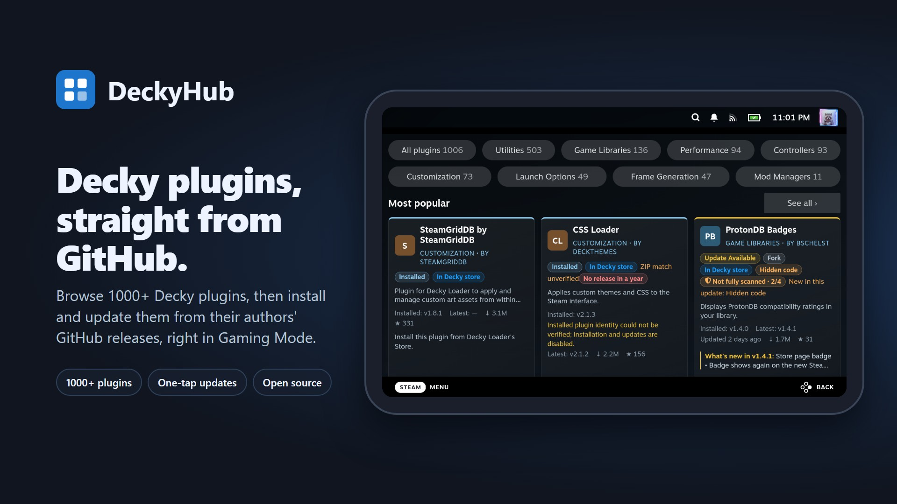

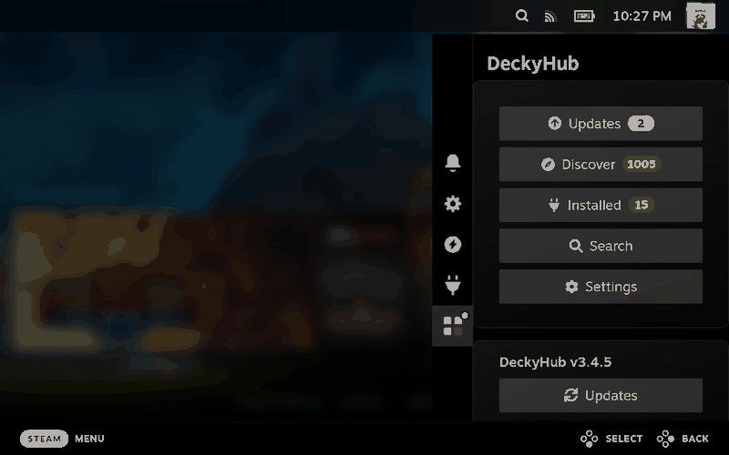

<table>
<tr>
<td align="center">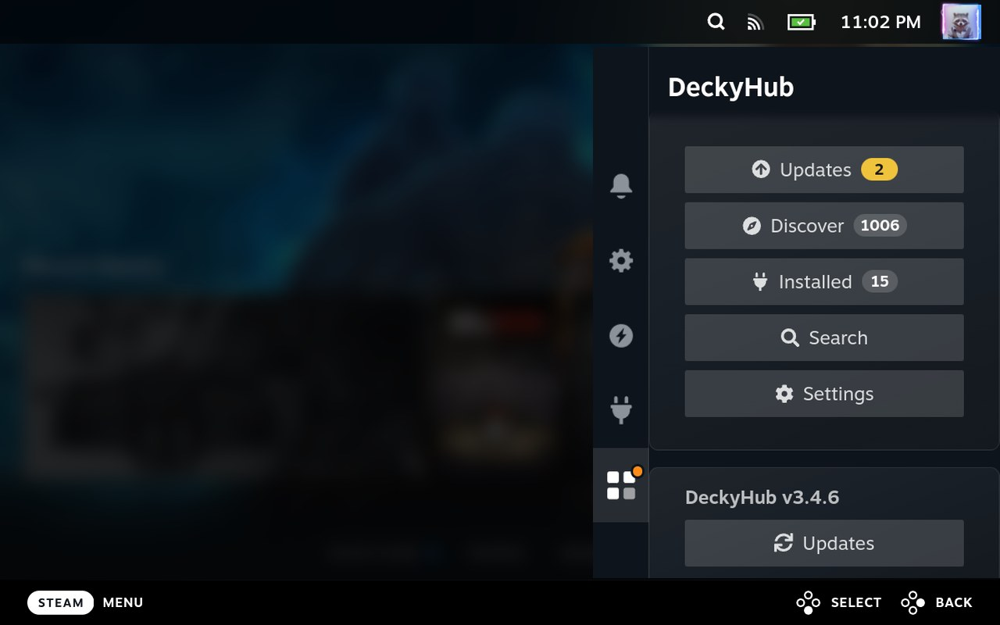 <b>Швидкий доступ</b></td>
<td align="center">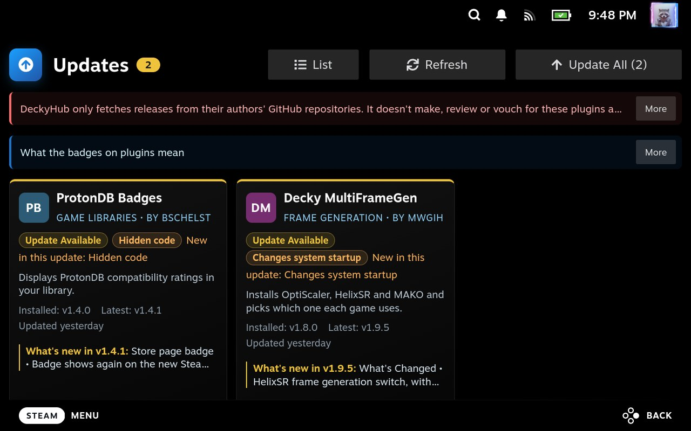 <b>Оновлення</b></td>
<td align="center">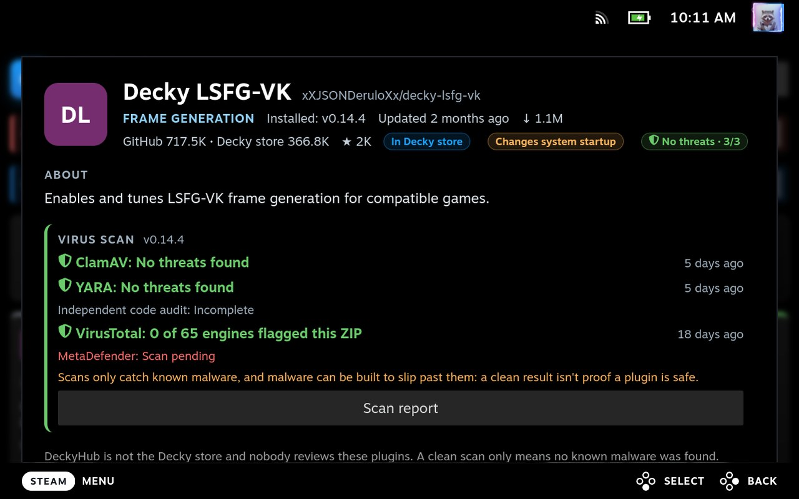 <b>Керування</b></td>
</tr>
<tr>
<td align="center">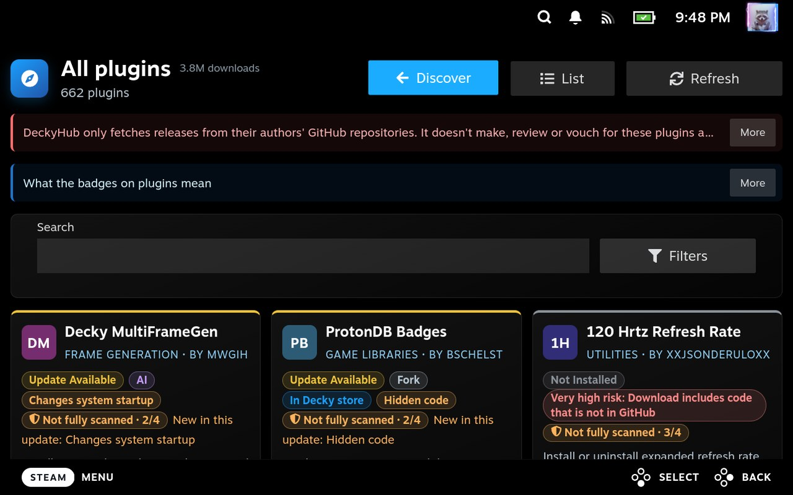 <b>Усі плагіни</b></td>
<td align="center">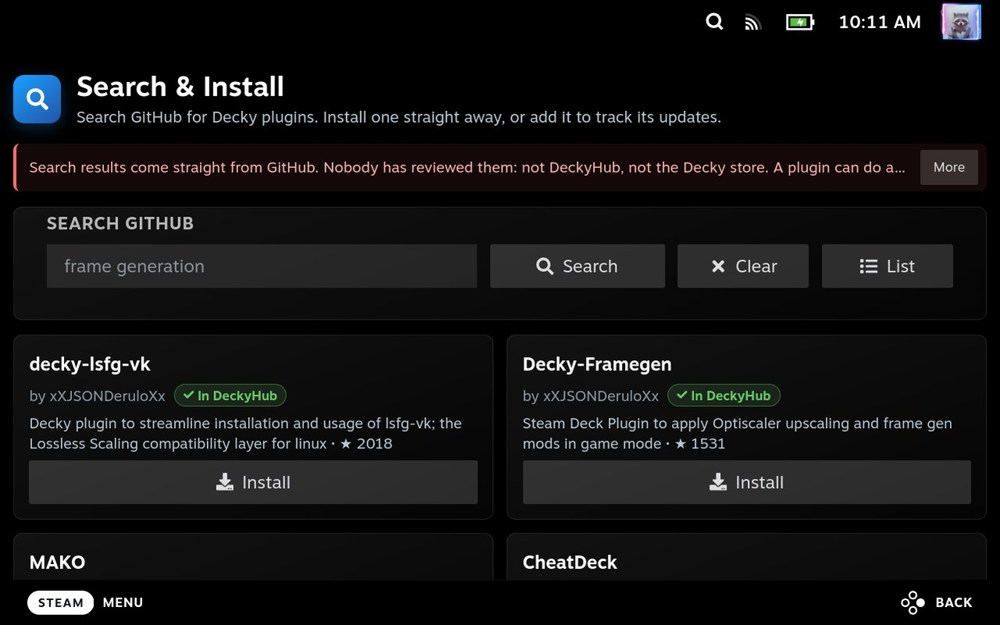 <b>Пошук</b></td>
<td align="center">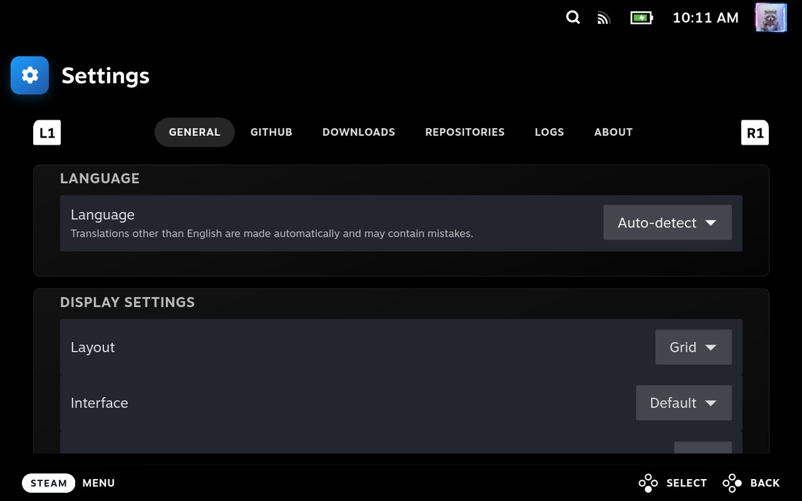 <b>Налаштування</b></td>
</tr>
<tr>
<td align="center">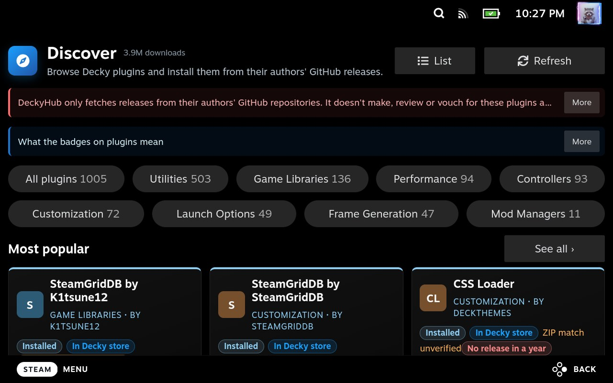 <b>Огляд</b></td>
<td align="center">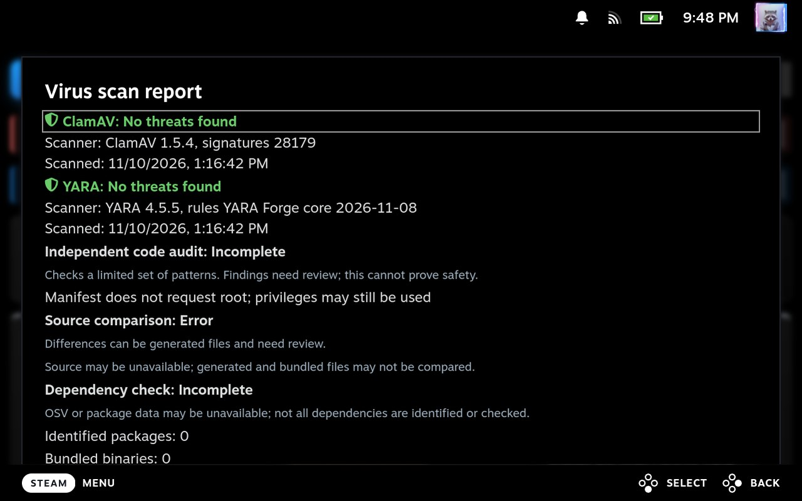 <b>Звіт про перевірку на віруси</b></td>
<td align="center">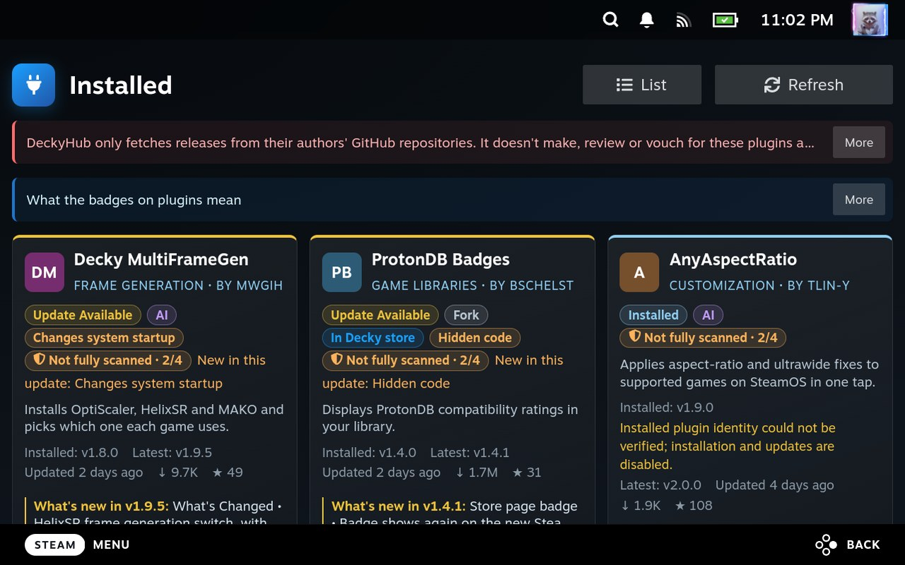 <b>Встановлені</b></td>
</tr>
</table>

> [!CAUTION]
> **DeckyHub лише отримує релізи з GitHub-репозиторіїв їхніх авторів. Він не створює ці плагіни, не перевіряє їх і не ручається за них та не відповідає за те, що вони роблять із вашим пристроєм чи даними. Встановлюйте на власний ризик.**

Набридло перемикатися в режим робочого столу, шукати релізи на GitHub і щоразу вручну завантажувати ZIP, коли плагін оновлюється? DeckyHub приносить пошук плагінів і їх оновлення прямо до вашого геймпада. Переглядайте каталог із понад 500 плагінів Decky, шукайте на GitHub будь-який інший плагін Decky й одразу встановлюйте його та отримуйте сповіщення, коли виходить оновлення — і все це не вставаючи з дивана. Це перший і останній плагін, який вам доведеться встановлювати з ZIP.

> **Про те, як це зроблено.** Більшість коду DeckyHub написано за допомогою інструментів ШІ (Claude і Codex). Це не означає, що він випускається неперевіреним — кожен реліз перевіряється на справжньому пристрої до виходу. Кажу про це одразу, щоб ви точно знали, що встановлюєте і як це було створено.

**Зміст:** [Чим він сподобається](#чим-він-сподобається) · [Що він вміє](#що-він-вміє) · [Список плагінів](#список-плагінів) · [Вимоги](#вимоги) · [Встановлення](#встановлення-deckyhub) · [Користування](#користування-deckyhub) · [Видалення](#видалення-deckyhub) · [Усунення неполадок](#усунення-неполадок) · [Якість](https://deckyhub.com/uk/about.html#як-deckyhub-контролює-якість) · [Приватність](#приватність) · [Відмова від відповідальності](#відмова-від-відповідальності) · [Допомога](#допомога)

## Чим він сподобається

- **Будь-який плагін з GitHub — одним пошуком** — **Пошук і встановлення** знаходить плагіни Decky, яких немає в магазині Decky чи списку DeckyHub, і встановлює їх прямо з ігрового режиму. Без режиму робочого столу, без браузера, без вставляння посилань у режимі розробника.
- **Жодне оновлення не пропущено** — DeckyHub кілька разів на день звіряє ваші встановлені плагіни з їхніми останніми релізами на GitHub і сповіщає, коли з'являється щось нове.
- **Створено для дивана** — повне керування геймпадом, кольорові статуси, які видно одразу, і завантаження одним дотиком, створені для ігрового режиму, а не для настільного браузера, стиснутого на малому екрані.
- **Ви все контролюєте** — DeckyHub ніколи нічого не встановлює й не запускає самостійно. Ніщо не торкається вашої системи, доки ви цього не дозволите, а встановлення йдуть через власний інсталятор Decky Loader та його вікно підтвердження (див. [Керування](https://deckyhub.com/uk/guide.html#керування)).

## Що він вміє

- **[Огляд](https://deckyhub.com/uk/guide.html#огляд)** — переглядайте список плагінів і засобів Decky від DeckyHub, фільтруйте за пошуком або станом встановлення й одразу бачте дані про реліз, позначені кольором за станом.
- **[Пошук і встановлення](https://deckyhub.com/uk/guide.html#пошук-і-встановлення)** — шукайте плагіни Decky на GitHub і встановлюйте їх одним дотиком або додавайте, щоб стежити за їхніми оновленнями.
- **[Оновлення](https://deckyhub.com/uk/guide.html#оновлення)** — дивіться, які з відстежуваних встановлених засобів мають новіший реліз і що приносить кожен, а плагіни Decky серед них оновлюйте одним махом кнопкою **Оновити все**. DeckyHub перевіряє оновлення у фоні кілька разів на день, тож крапка на його значку та сповіщення повідомляють про нові оновлення, а кожна картка показує **Встановлення…**, доки Decky не закінчить, після чого сповіщення це підтверджує.
- **[Налаштування](https://deckyhub.com/uk/guide.html#налаштування)** — мова, вигляд, необов'язковий токен GitHub, завантаження, відстежувані репозиторії та власні реєстри, експорт журналів.
- **Меню швидкого доступу** — DeckyHub має власну вкладку (значок із чотирьох квадратів, із крапкою, коли чекають оновлення) у рядку вкладок швидкого доступу поруч із вкладкою Decky і відкривається також зі списку плагінів Decky. Вимкнути її можна в **Налаштування → Загальні → Вкладка DeckyHub у швидкому доступі**. Якщо Decky Loader повторює значки вкладок плагінів у рядку ([decky-loader#1014](https://github.com/SteamDeckHomebrew/decky-loader/issues/1014)), вимкніть вкладку. Вона показує **Огляд**, **Пошук** і **Налаштування**, а також **Оновлення** з кількістю, коли є що оновлювати. Нижче: версія самого DeckyHub із перевіркою оновлень і розділ **Очищення** (показується, коли в теці завантажень є файли), який після підтвердження очищає її.

Якщо ви волієте встановити плагін самі, **Завантажити ZIP** зберігає реліз, а встановлюєте ви його так само, як сам DeckyHub (див. [Варіант 2: ZIP вручну](#варіант-2-zip-вручну)).

## Список плагінів

Жодного налаштування — список плагінів з'являється в «Огляді» одразу після встановлення DeckyHub. Він зберігається в [mazillka/deckyhub-registry](https://github.com/mazillka/deckyhub-registry) і оновлюється при кожному запуску DeckyHub, тож нові програми з'являються без оновлення DeckyHub. DeckyHub зберігає останній завантажений список для роботи офлайн; після свіжого встановлення потрібно один раз підключитися до GitHub.

**Звідки беруться плагіни:**

- **Запропоновані:** плагіни, які люди пропонують через issues та pull request-и реєстру.
- **[Decky Extended Plugins](https://decky-extended-plugins.beallio.com/)** від [beallio](https://github.com/beallio): каталог спільноти з магазину Decky та плагінів спільноти, із [перевіркою безпеки](https://decky-extended-plugins.beallio.com/audit).
- **[Decky Plugins Explorer](https://safetzahirovic.github.io/decky-plugins-explorer/)** від [SafetZahirovic](https://github.com/SafetZahirovic): нічний обхід усіх публічних репозиторіїв GitHub з файлом Decky `plugin.json`.

Щоденне завдання перевіряє обидва каталоги, а також власний пошук на GitHub за репозиторіями з тегами чи назвами, схожими на плагіни Decky, на наявність плагінів, яких ще немає у списку, пропускає ті, що виглядають незавершеними (зовсім нові, якими ще ніхто не користується, із версією-заглушкою), і відкриває pull request з тими, що підходять. Кожен плагін, як би його не знайшли, повинен мати стабільний реліз на GitHub рівно з одним ZIP плагіна, ім'я в `plugin.json` якого збігається. Це автоматичні перевірки того, що реліз працює: самі плагіни ніхто не переглядає — ні на безпеку, ні на щось інше; [каталог](https://deckyhub.com/plugins/) та «Огляд» позначають плагіни, що працюють від імені root, не мали релізу понад рік або отримали попередження від [перевірки безпеки](https://decky-extended-plugins.beallio.com/audit) (див. [Значки](https://deckyhub.com/uk/guide.html#значки)).

- **Подяка:** кількість завантажень із магазину Decky, яку показано біля плагінів, надходить із [магазину плагінів Decky](https://plugins.deckbrew.xyz/plugins) (plugins.deckbrew.xyz).
- **Перегляньте його:** [каталог плагінів](https://deckyhub.com/plugins/) містить усі плагіни з пошуком і категоріями, кількістю завантажень та зірок.
- **Запропонуйте плагін:** відкрийте [issue](https://github.com/mazillka/deckyhub-registry/issues/new) або pull request у репозиторії реєстру.
- **Хочете більше?** Знайдіть будь-який інший плагін Decky на GitHub за допомогою **[Пошуку і встановлення](https://deckyhub.com/uk/guide.html#пошук-і-встановлення)**.

## Вимоги

- Будь-який пристрій із встановленим [Decky Loader](https://decky.xyz/) 3.x.
- Інтернет-з'єднання з доступом до GitHub. Обліковий запис GitHub не потрібен.

## Встановлення DeckyHub

DeckyHub можна встановити двома способами. Оберіть один:

| | **Інсталятор для робочого столу** (рекомендовано) | **ZIP вручну** |
| --- | --- | --- |
| Де | Режим робочого столу | Ігровий режим |
| Decky Loader | Перевіряється і встановлюється, якщо його немає | Має бути вже встановлений |
| Пароль адміністратора | Потрібен | Не потрібен |
| Що робити | Завантажити один файл і виконати показані кроки | Завантажити ZIP і додати його в налаштуваннях розробника Decky або вставити посилання |
| Налаштування Decky Loader | Не потрібне: Decky Loader і DeckyHub налаштовуються за один раз | Спершу встановіть Decky Loader |

Після цього DeckyHub зможе встановлювати й оновлювати плагіни з ігрового режиму.

### Варіант 1: інсталятор для робочого столу (рекомендовано)

Один файл налаштовує **і Decky Loader, і DeckyHub**: спершу перевіряє [Decky Loader](https://decky.xyz/) і встановлює його, якщо на вашому пристрої його ще немає, а потім встановлює DeckyHub. Це заощаджує окреме встановлення Decky Loader і зайві дії та команди, які для цього потрібні. Не хочете його використовувати? [Варіант 2](#варіант-2-zip-вручну) не потребує пароля.

1. Перемкніться в режим робочого столу (**Steam** → **Живлення** → **Перейти на робочий стіл**).
2. Ярлик `Install-DeckyHub.desktop` має лежати **на робочому столі**. Покладіть його туди одним із двох способів: <!-- choose --> **Завантажте його:** завантажте [`Install-DeckyHub.desktop`](https://github.com/mazillka/deckyhub-plugin/releases/latest/download/Install-DeckyHub.desktop), потім відкрийте **Завантаження** у Dolphin і перетягніть його на робочий стіл (або виріжте та вставте). Якщо браузер зберіг його як `Install-DeckyHub.desktop.download` (Firefox так робить із файлами-ярликами), спершу перейменуйте на `Install-DeckyHub.desktop`. <!-- or --> **Або через Konsole:** відкрийте **Konsole** і виконайте цю команду, яка збереже файл на робочому столі з правильною назвою: `curl -fsSL -o ~/Desktop/Install-DeckyHub.desktop https://github.com/mazillka/deckyhub-plugin/releases/latest/download/Install-DeckyHub.desktop && chmod +x ~/Desktop/Install-DeckyHub.desktop`
3. Двічі клацніть **Install DeckyHub** на робочому столі й на запит оберіть **Продовжити** (або **Виконати**).
4. Прочитайте огляд. У ньому перелічено кожен крок: спершу Decky Loader (перевіряється або встановлюється, якщо його немає) і лише після нього DeckyHub, а також пояснено, навіщо потрібен пароль адміністратора. Потім оберіть **Встановити** (або **Оновити** чи **Перевстановити**, якщо DeckyHub уже є). Інсталятор не збирає, не зберігає й не надсилає жодної інформації про вас чи ваш пристрій; він лише завантажує файли з GitHub. Він перевіряє, чи доступний GitHub, а потім просить пароль адміністратора вашого пристрою (той, що ви задали для режиму робочого столу, а не пароль Steam). Якщо ви його ніколи не задавали, він запропонує тимчасовий і прибере його після завершення, як і власний інсталятор Decky Loader.
5. За бажанням перегляньте кілька відібраних плагінів, по одному: за замовчуванням їх пропускають, а додаєте ви їх на власний ризик (див. «Необов'язкові плагіни» нижче).
6. Стежте за вікном перебігу («Крок 3 із 5: …»), доки кінцеве повідомлення не перелічить, що зроблено і що робити далі. Якщо з'явиться помилка, виконайте вказівки з повідомлення.
7. Поверніться в ігровий режим і оберіть значок DeckyHub із чотирьох квадратів у меню швидкого доступу.

Що він робить: спершу перевіряє, чи встановлено Decky Loader, а якщо ні — запускає [офіційний інсталятор Decky Loader](https://github.com/SteamDeckHomebrew/decky-installer). Лише після цього завантажує з GitHub `DeckyHub-v*.zip` цього релізу, звіряє його SHA-256 з тим, з яким створено інсталятор (і зупиняється, якщо вони різняться), кладе його в теку плагінів Decky і перезапускає Decky. Пароль потрібен, бо встановлення й перезапуск Decky Loader змінюють сам пристрій. Скрипт — [`installer/install-deckyhub.sh`](installer/install-deckyhub.sh); кожен реліз містить його із заповненими власною версією та контрольною сумою й перевіряє на шкідливе ПЗ так само, як ZIP.

Необов'язкові плагіни: після огляду інсталятор показує кілька відібраних плагінів (генерація кадрів, теми та інше) **по одному**. Кожна картка має версію, примітки (створено за допомогою ШІ, працює від root, попередження перевірки), зірки й завантаження та посилання на репозиторій GitHub і сторінку на deckyhub.com з перевірками безпеки. **Пропустити** — кнопка за замовчуванням, тож нічого не додається, доки ви не оберете **Додати цей плагін**, а інсталятор зазначає, що DeckyHub не відповідає за те, що ви встановлюєте: плагіни ви додаєте на власний ризик. Інсталятор їх не встановлює: він зберігає ваш вибір, а під час першого відкриття DeckyHub перелічує їх знову і встановлює зі звичним підтвердженням, лише якщо ви погодитесь. Пропустіть — і нічого не збережеться.

<table>
<tr>
<td align="center">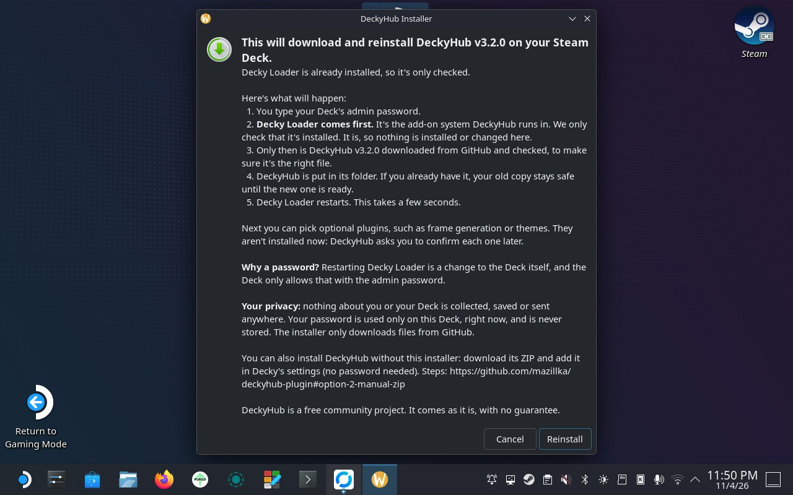 <b>Огляд</b></td>
<td align="center">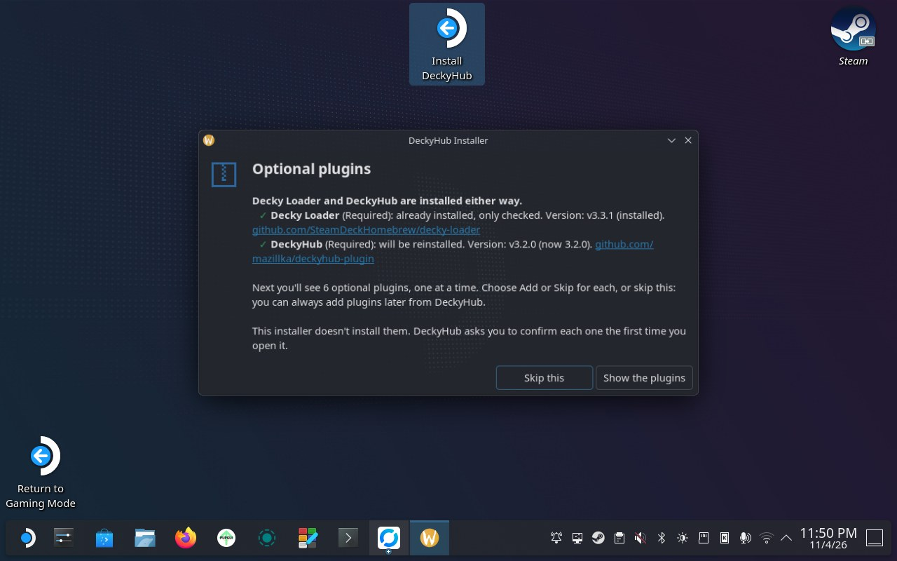 <b>Необов'язкові плагіни</b></td>
<td align="center">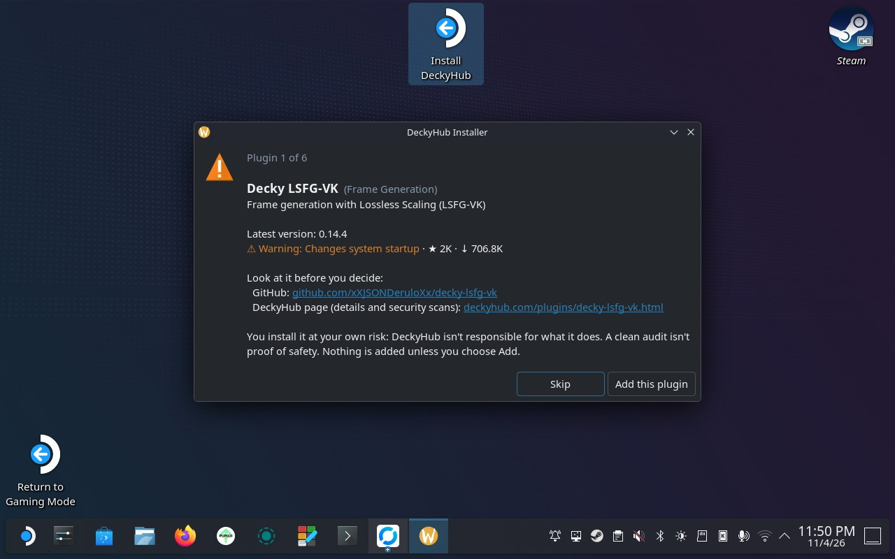 <b>Картка плагіна</b></td>
</tr>
<tr>
<td align="center">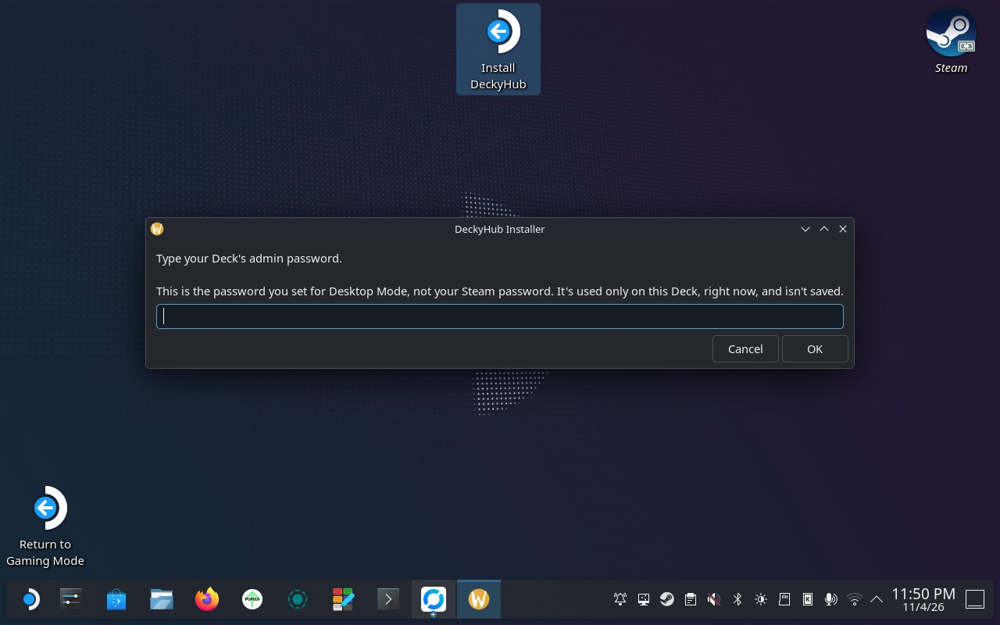 <b>Пароль</b></td>
<td align="center">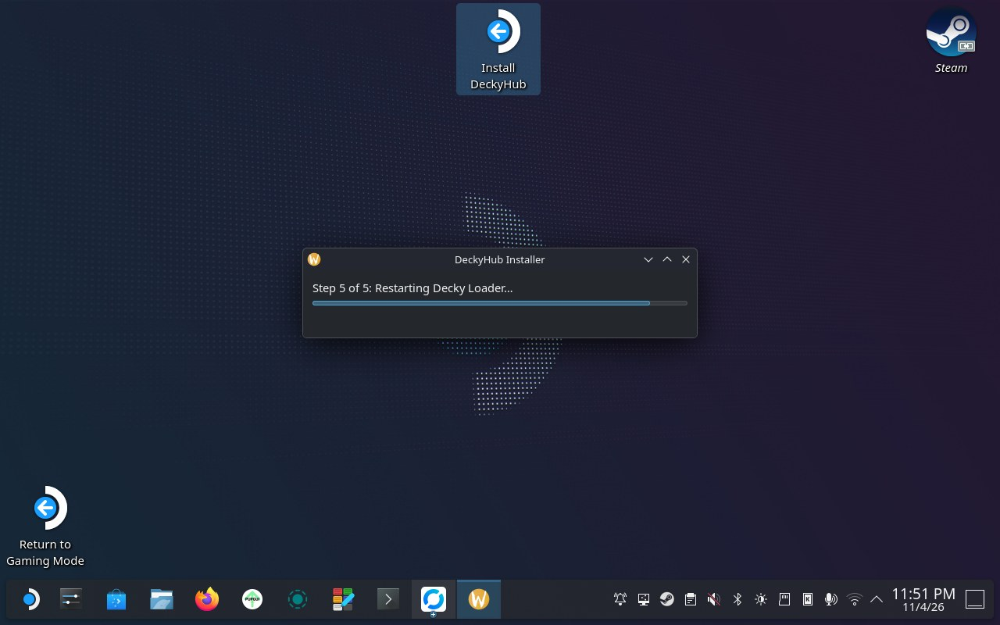 <b>Виконання</b></td>
<td align="center">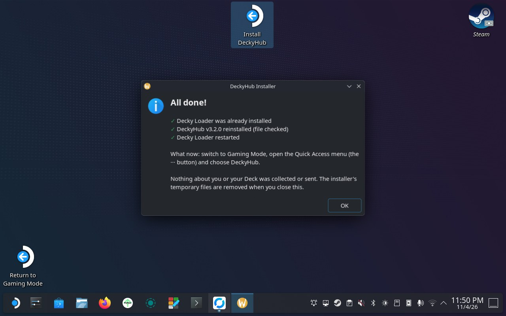 <b>Готово</b></td>
</tr>
</table>

### Варіант 2: ZIP вручну

Decky Loader має бути вже встановлений. Пароль адміністратора не потрібен.

1. Завантажте останній `DeckyHub-v*.zip` зі [сторінки релізів](https://github.com/mazillka/deckyhub-plugin/releases).
2. В ігровому режимі відкрийте меню швидкого доступу → Decky → налаштування (значок шестерні). Увімкніть **Режим розробника** в розділі «Загальні», якщо він вимкнений, потім перейдіть до **Розробник** → **Встановити плагін із ZIP** і виберіть завантажений файл.
3. Оберіть значок DeckyHub із чотирьох квадратів у меню швидкого доступу (або Decky → **DeckyHub**).

#### Альтернатива: встановлення ZIP за посиланням

Якщо Decky Loader уже встановлено:

1. Відкрийте меню швидкого доступу → **Decky** → налаштування (значок шестерні) й увімкніть **Режим розробника** в розділі **Загальні**, якщо він вимкнений.
2. Перейдіть до **Розробник** → **Встановити плагін за URL** і введіть це посилання, яке завжди веде на найновіший реліз DeckyHub:

   `https://github.com/mazillka/deckyhub-plugin/releases/latest/download/DeckyHub.zip`

   

   Відскануйте QR-код, щоб мати посилання на телефоні, поки ви його вводите.
3. Оберіть значок DeckyHub із чотирьох квадратів у меню швидкого доступу (або Decky → **DeckyHub**).

## Користування DeckyHub

Повний посібник з усіма екранами й налаштуваннями — на сайті: **[deckyhub.com/uk/guide.html](https://deckyhub.com/uk/guide.html)**. Короткі відповіді на часті запитання — на [сторінці довідки](https://deckyhub.com/uk/help.html). Коротко:

- **[Кнопки контролера](https://deckyhub.com/uk/guide.html#кнопки-контролера):** стандартне керування Steam, а на кожній кнопці «Встановити» й «Оновити» ще **X** (завантажити ZIP релізу), **Y** (прочитати нотатки до релізу) та **Меню** (відкрити сторінку плагіна на GitHub).
- **[Огляд](https://deckyhub.com/uk/guide.html#огляд):** добірки й категорії, далі пошук, фільтри та сортування, зі [значками](https://deckyhub.com/uk/guide.html#значки) про доступ root, попередження аудиту, перевірки на віруси, магазин Decky і форки.
- **[Пошук і встановлення](https://deckyhub.com/uk/guide.html#пошук-і-встановлення):** знайдіть будь-який плагін Decky на GitHub, навіть якого немає в списку.
- **[Оновлення](https://deckyhub.com/uk/guide.html#оновлення) і [Керування](https://deckyhub.com/uk/guide.html#керування):** оновіть один плагін або всі, оберіть версію чи файл, завантажте ZIP або видаліть.
- **[Налаштування](https://deckyhub.com/uk/guide.html#налаштування):** вигляд і мова, токен GitHub, завантаження, репозиторії, журнали.
- **[Віддалене встановлення (експериментально)](https://deckyhub.com/uk/guide.html#віддалене-встановлення-експериментально):** надішліть плагін із deckyhub.com на телефоні чи комп'ютері на свій пристрій і керуйте тим, що на ньому встановлено, повністю у вашій мережі.
- **[Оновлення самого DeckyHub](https://deckyhub.com/uk/guide.html#оновлення-самого-deckyhub).**

## Видалення DeckyHub

Відкрийте налаштування Decky (значок шестерні) → **Плагіни**, відкрийте меню поруч із **DeckyHub** і оберіть **Видалити**. Decky видаляє DeckyHub разом із його налаштуваннями та кешованими списками. Плагіни, які ви встановили через DeckyHub, лишаються встановленими.

Файли, які DeckyHub зберіг у «Завантаженнях», не видаляються: ZIP релізів у `~/Downloads/deckyhub` та будь-які експортовані списки репозиторіїв чи ZIP журналів у `~/Downloads`. Скористайтеся **Очищенням** → **Очистити теку** перед видаленням або видаліть їх у режимі робочого столу.

## Усунення неполадок

- **Помилки «Rate limit».** DeckyHub звертається до GitHub, не вимагаючи від вас входу. Дані про релізи зі списку DeckyHub надходять з одного файлу, який реєстр оновлює щогодини, тож перегляд не вичерпує публічний ліміт запитів GitHub (60 на годину). Пошук і репозиторії, які ви додали самі, усе ще звертаються до GitHub напряму, тож дуже інтенсивне користування може впертися в ліміт; тоді помилка приблизно скаже, скільки чекати. Щоб підняти ліміт до 5000 на годину, додайте особистий токен доступу в **Налаштування → GitHub** (права не потрібні; про те, куди він іде, див. [Приватність](#приватність)).
- **Новий реліз не з'являється.** Інформація про релізи кешується на 30 хвилин. Кожна кнопка **Перевірити оновлення** та **Оновити** обходить кеш, хоча новому релізу може знадобитися до години, щоб потрапити у файл релізів списку плагінів.
- **«Огляд» порожній після свіжого встановлення.** DeckyHub має один раз підключитися до GitHub, щоб завантажити список плагінів; після цього він працює офлайн з останньої копії.
- **Встановлення, оновлення чи власне оновлення DeckyHub не працює.** У старішій збірці Decky Loader встановлення одним дотиком може бути недоступне. Скористайтеся **Завантажити ZIP** і встановіть його в налаштуваннях розробника Decky (див. [Варіант 2: ZIP вручну](#варіант-2-zip-вручну)) або оновіть Decky Loader.
- **Щось інше.** Відкрийте issue (див. [Допомога](#допомога)) і додайте ZIP з **Експортувати журнали**.

Завантаження відбуваються лише через HTTPS.

## Продуктивність

Виміряно на справжньому Steam Deck: відкриття сторінки коштує один повільний кадр, а DeckyHub у спокої не дає довгих завдань. Цифри й спосіб виміряти на своєму пристрої — на сайті: **[Продуктивність](https://deckyhub.com/uk/about.html#продуктивність)**.

## Як DeckyHub контролює якість

DeckyHub встановлює програмне забезпечення на вашу Deck, тому кожна зміна, кожен реліз і кожен плагін у списку проходять перевірки, і все це відкрите. Що перевіряється і коли — на сайті: **[Як DeckyHub контролює якість](https://deckyhub.com/uk/about.html#як-deckyhub-контролює-якість)**.

## Приватність

DeckyHub не має облікових записів, аналітики чи телеметрії та нічого не надсилає ні своєму авторові, ні на жоден власний сервер. **Вебсайт deckyhub.com** рахує відвідування (перегляди сторінок, країну й тип браузера, без cookie) через Cloudflare Web Analytics; сам плагін зовсім чистий: він нічого не рахує й не надсилає.

- **До чого він підключається:** лише до GitHub — `raw.githubusercontent.com` і `github.com` для списку плагінів, даних про релізи, звітів про перевірки на віруси та завантажень, а `api.github.com` — для пошуку й репозиторіїв, яких немає у списку, — а також до HTTPS-адреси будь-якого власного реєстру, який ви додали. GitHub бачить ці запити так само, як запити будь-якого браузера (вашу IP-адресу й те, які репозиторії запитано), відповідно до [заяви GitHub про конфіденційність](https://docs.github.com/site-policy/privacy-policies/github-general-privacy-statement). Посилання, як-от репозиторій плагіна чи сторінка перевірки, відкриваються лише коли ви їх торкаєтеся.
- **Що лишається на вашому пристрої:** ваші налаштування, відстежувані репозиторії, власні реєстри та кешований список плагінів і дані про релізи. Файл налаштувань доступний для читання лише вашому користувачеві.
- **Ваш токен GitHub** необов'язковий, не потребує прав, надсилається лише на `api.github.com` і ніколи не потрапляє в журнали.
- **Журнали** самі ніколи не залишають пристрій. **Експортувати журнали** зберігає в теку «Завантаження» ZIP з тим, що робив DeckyHub, і помилками (назви репозиторіїв, шляхи до файлів, версії); чи додавати його до issue, вирішуєте ви.

## Підтримка DeckyHub

DeckyHub безкоштовний і залишається таким: усі функції працюють без оплати, і нічого не закрито за донатом. Якщо він вам допомагає, можна підтримати на [Ko-fi](https://ko-fi.com/mazillka) або [GitHub Sponsors](https://github.com/sponsors/mazillka). Це йде на час автора для підтримки й перевірки кожного релізу на справжньому пристрої та на домен deckyhub.com. Перевірки на віруси працюють на безкоштовних інструментах і сервісах без підписок, тож від донатів не залежать. Донат не купує місця чи вищої позиції у списку плагінів, не впливає на перевірки безпеки й нічого не відкриває, а DeckyHub ніколи не бачить, хто донатить. Докладніше на [deckyhub.com](https://deckyhub.com/about.html#support).

## Відмова від відповідальності

Не пов'язаний із Valve чи проєктом Decky Loader. DeckyHub — це інструмент пошуку й завантаження: інформація про плагіни надходить із публічних репозиторіїв GitHub, а кожен плагін належить його авторам. DeckyHub не перевіряє, не володіє й не схвалює жодного стороннього плагіна чи його вмісту і не відповідає за те, що він робить. Плагіни встановлюються на ваш власний ризик, тож перегляньте репозиторій плагіна перед встановленням, особливо знайденого через «Пошук».

## Ліцензія

Copyright © 2026 Andrii Shevchuk-Yuhanets ([mazillka](https://github.com/mazillka)).

GPL-3.0-or-later — див. [LICENSE.md](LICENSE.md).

## Публікації про DeckyHub

- [Steam Deck HQ — DeckyHub Offers An Easy Way To Get Plugins That Aren't On The Official Store](https://steamdeckhq.com/news/deckyhub-offers-an-easy-way-to-get-plugins-that-arent-on-the-official-store/)
- [Steam Deck HQ — DeckyHub Adds Virus Scans And More Transparency On Its Plugin Store](https://steamdeckhq.com/news/deckyhub-adds-virus-scans-more-transparency/)

Більше публікацій: https://deckyhub.com/press. Це незалежні видання; DeckyHub не пов’язаний із ними.

## Допомога

Маєте запитання чи ідею? Напишіть у [Discussions](https://github.com/mazillka/deckyhub-plugin/discussions). Знайшли помилку? Відкрийте issue в [репозиторії GitHub](https://github.com/mazillka/deckyhub-plugin/issues) з описом того, що сталося; допоможе ZIP з **Експортувати журнали** (**Налаштування** → **Журнали**). Відгуки та пропозиції завжди вітаються.

Хочете зібрати DeckyHub з вихідного коду або запропонувати зміну? Див. [CONTRIBUTING.md](CONTRIBUTING.md). Усі учасники дотримуються [Кодексу поведінки](CODE_OF_CONDUCT.md).
