

# DeckyHub

**Центр плагінів для вашого Steam Deck — прямо в ігровому режимі.**

Знаходьте, встановлюйте й оновлюйте плагіни Decky Loader за допомогою геймпада — зі списку DeckyHub або будь-який плагін із GitHub.

[English](README.md) · **Українська**

[**Завантажити**](https://github.com/mazillka/deckyhub-plugin/releases/latest) · [Вебсайт](https://deckyhub.com/) · [Нотатки до релізів](https://deckyhub.com/releases.html) · [Каталог плагінів](https://registry.deckyhub.com/) · [Інструкція зі встановлення](#встановлення-deckyhub) · [Повідомити про проблему](https://github.com/mazillka/deckyhub-plugin/issues)

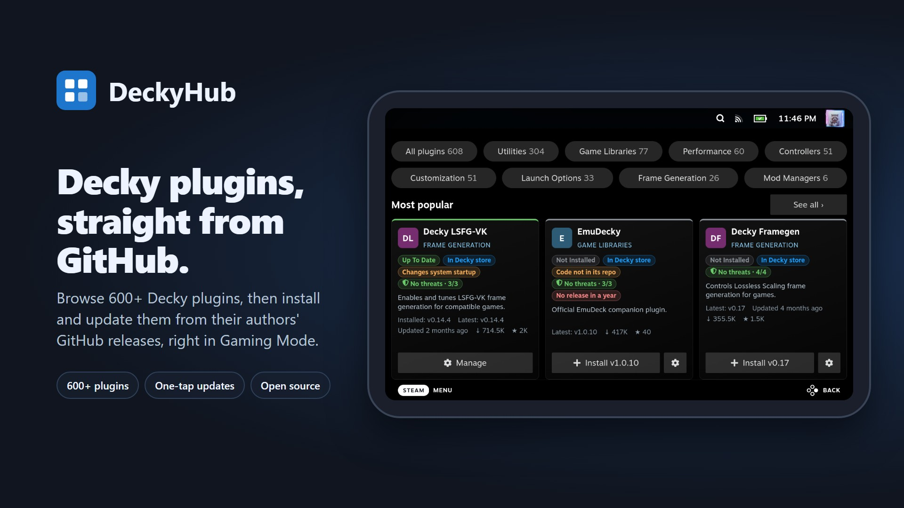

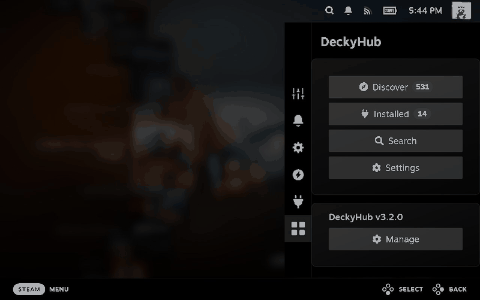

<table>
<tr>
<td align="center">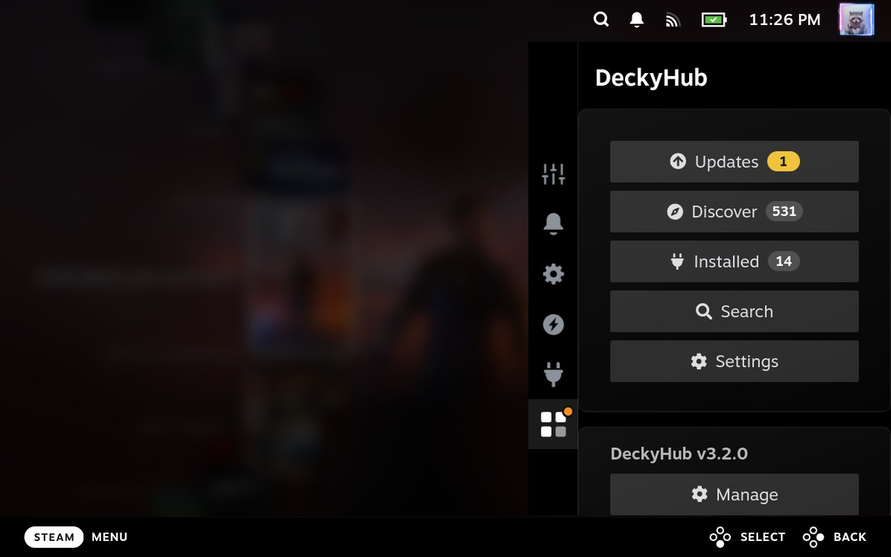 <b>Швидкий доступ</b></td>
<td align="center">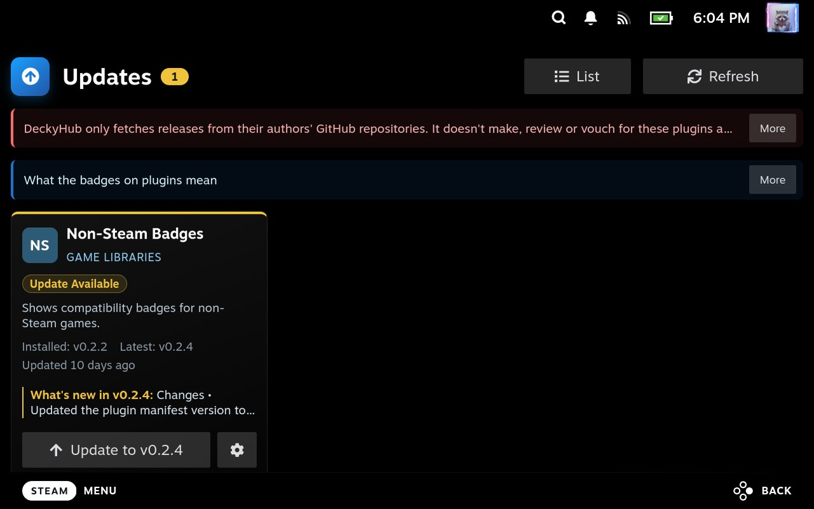 <b>Оновлення</b></td>
<td align="center">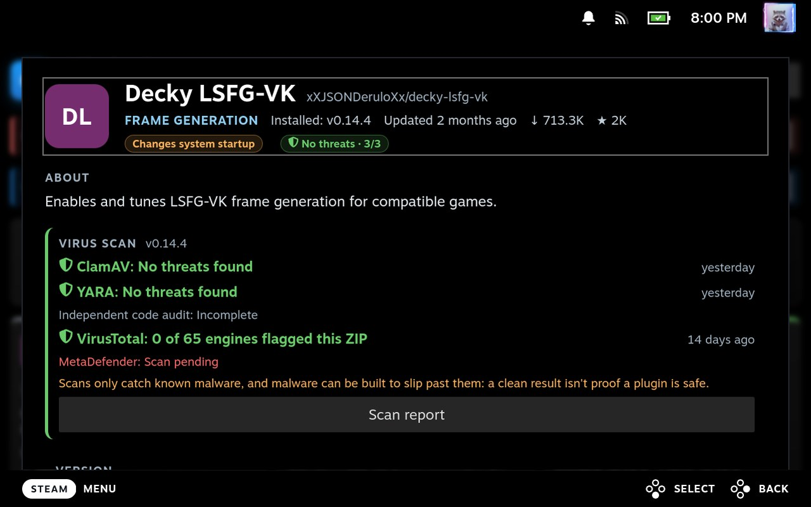 <b>Керування</b></td>
</tr>
<tr>
<td align="center">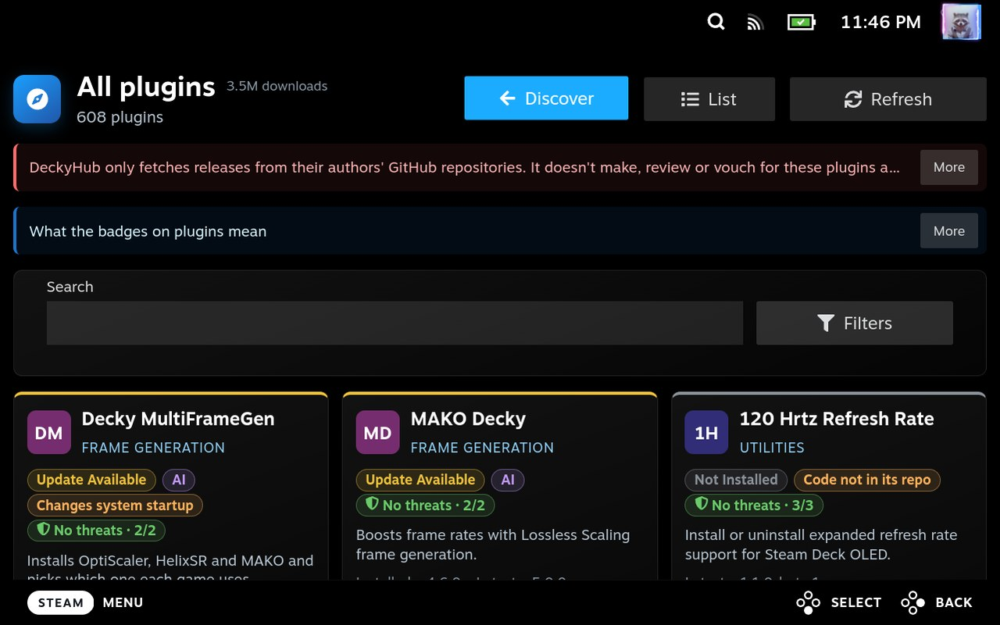 <b>Усі плагіни</b></td>
<td align="center">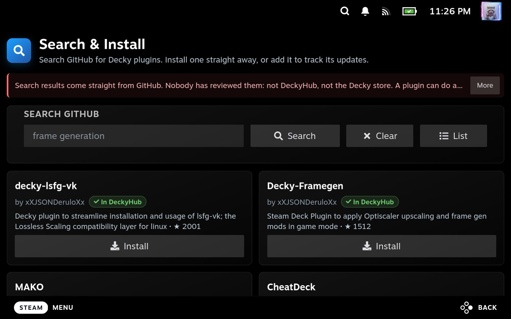 <b>Пошук</b></td>
<td align="center">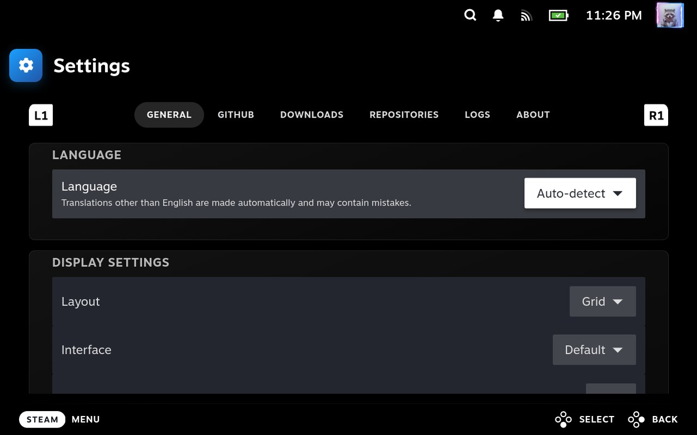 <b>Налаштування</b></td>
</tr>
<tr>
<td align="center">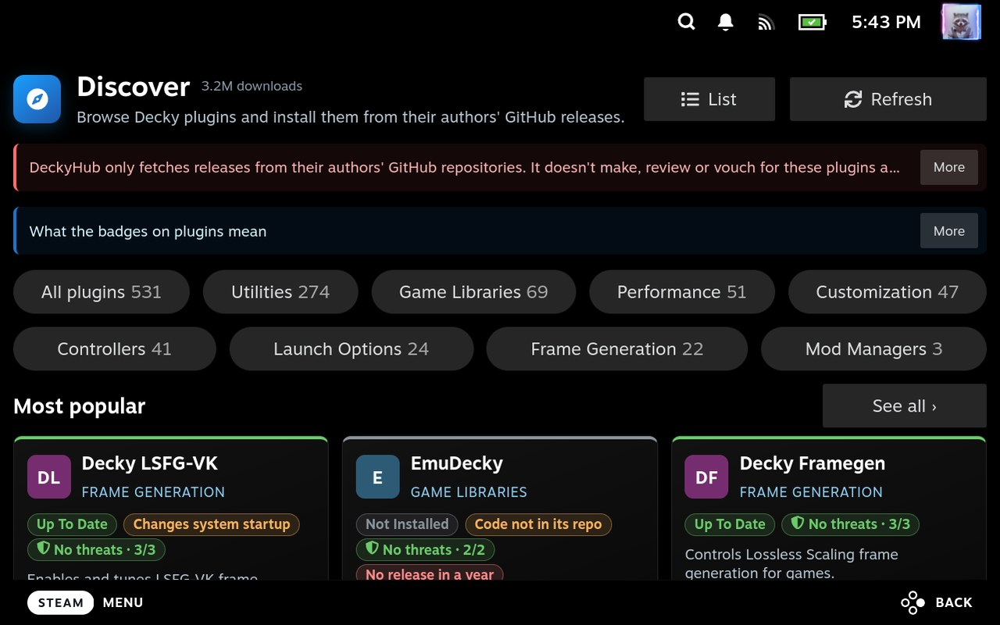 <b>Огляд</b></td>
<td align="center">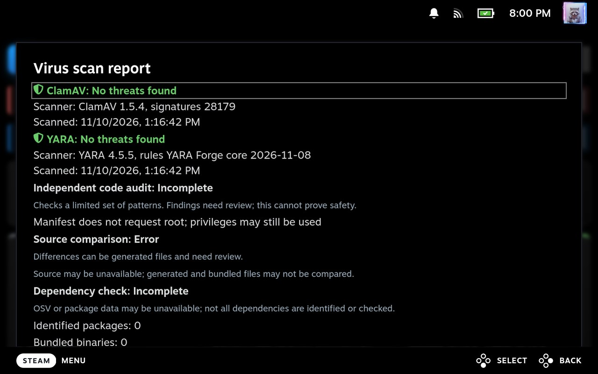 <b>Звіт про перевірку на віруси</b></td>
<td align="center">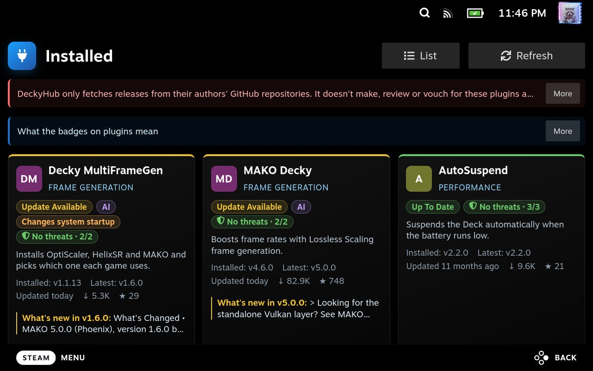 <b>Встановлені</b></td>
</tr>
</table>

> [!CAUTION]
> **DeckyHub лише отримує релізи з GitHub-репозиторіїв їхніх авторів. Він не створює ці плагіни, не перевіряє їх і не ручається за них та не відповідає за те, що вони роблять із вашим пристроєм чи даними. Встановлюйте на власний ризик.**

Набридло перемикатися в режим робочого столу, шукати релізи на GitHub і щоразу вручну завантажувати ZIP, коли плагін оновлюється? DeckyHub приносить пошук плагінів і їх оновлення прямо до вашого геймпада. Переглядайте каталог із понад 500 плагінів для Steam Deck, шукайте на GitHub будь-який інший плагін Decky й одразу встановлюйте його та отримуйте сповіщення, коли виходить оновлення — і все це не вставаючи з дивана. Це перший і останній плагін, який вам доведеться встановлювати з ZIP.

> **Про те, як це зроблено.** Більшість коду DeckyHub написано за допомогою інструментів ШІ (Claude і Codex). Це не означає, що він випускається неперевіреним — кожен реліз перевіряється на справжньому пристрої до виходу. Кажу про це одразу, щоб ви точно знали, що встановлюєте і як це було створено.

**Зміст:** [Чим він сподобається](#чим-він-сподобається) · [Що він вміє](#що-він-вміє) · [Список плагінів](#список-плагінів) · [Вимоги](#вимоги) · [Встановлення](#встановлення-deckyhub) · [Користування](#користування-deckyhub) · [Видалення](#видалення-deckyhub) · [Усунення неполадок](#усунення-неполадок) · [Якість](#як-deckyhub-контролює-якість) · [Приватність](#приватність) · [Відмова від відповідальності](#відмова-від-відповідальності) · [Допомога](#допомога)

## Чим він сподобається

- **Будь-який плагін з GitHub — одним пошуком** — **Пошук і встановлення** знаходить плагіни Decky, яких немає в магазині Decky чи списку DeckyHub, і встановлює їх прямо з ігрового режиму. Без режиму робочого столу, без браузера, без вставляння посилань у режимі розробника.
- **Жодне оновлення не пропущено** — DeckyHub кілька разів на день звіряє ваші встановлені плагіни з їхніми останніми релізами на GitHub і сповіщає, коли з'являється щось нове.
- **Створено для дивана** — повне керування геймпадом, кольорові статуси, які видно одразу, і завантаження одним дотиком, створені для ігрового режиму, а не для настільного браузера, стиснутого на малому екрані.
- **Ви все контролюєте** — DeckyHub ніколи нічого не встановлює й не запускає самостійно. Ніщо не торкається вашої системи, доки ви цього не дозволите, а встановлення йдуть через власний інсталятор Decky Loader та його вікно підтвердження (див. [Керування](#керування)).

## Що він вміє

- **[Огляд](#огляд)** — переглядайте список плагінів і засобів для Steam Deck від DeckyHub, фільтруйте за пошуком або станом встановлення й одразу бачте дані про реліз, позначені кольором за станом.
- **[Пошук і встановлення](#пошук-і-встановлення)** — шукайте плагіни Decky на GitHub і встановлюйте їх одним дотиком або додавайте, щоб стежити за їхніми оновленнями.
- **[Оновлення](#оновлення)** — дивіться, які з відстежуваних встановлених засобів мають новіший реліз і що приносить кожен, а плагіни Decky серед них оновлюйте одним махом кнопкою **Оновити все**. DeckyHub перевіряє оновлення у фоні кілька разів на день, тож крапка на його значку та сповіщення повідомляють про нові оновлення, а кожна картка показує **Встановлення…**, доки Decky не закінчить, після чого сповіщення це підтверджує.
- **[Налаштування](#налаштування)** — мова, вигляд, необов'язковий токен GitHub, завантаження, відстежувані репозиторії та власні реєстри, експорт журналів.
- **Меню швидкого доступу** — DeckyHub має власну вкладку (значок із чотирьох квадратів, із крапкою, коли чекають оновлення) у рядку вкладок швидкого доступу поруч із вкладкою Decky, а також відкривається зі списку плагінів Decky. Вона показує **Огляд**, **Пошук** і **Налаштування**, а також **Оновлення** з кількістю, коли є що оновлювати. Нижче: версія самого DeckyHub із перевіркою оновлень і розділ **Очищення** (показується, коли в теці завантажень є файли), який після підтвердження очищає її.

Якщо ви волієте встановити плагін самі, **Завантажити ZIP** зберігає реліз, а встановлюєте ви його так само, як сам DeckyHub (див. [Варіант 2: ZIP вручну](#варіант-2-zip-вручну)).

## Список плагінів

Жодного налаштування — список плагінів з'являється в «Огляді» одразу після встановлення DeckyHub. Він зберігається в [mazillka/deckyhub-registry](https://github.com/mazillka/deckyhub-registry) і оновлюється при кожному запуску DeckyHub, тож нові програми з'являються без оновлення DeckyHub. DeckyHub зберігає останній завантажений список для роботи офлайн; після свіжого встановлення потрібно один раз підключитися до GitHub.

**Звідки беруться плагіни:**

- **Запропоновані:** плагіни, які люди пропонують через issues та pull request-и реєстру.
- **[Decky Extended Plugins](https://decky-extended-plugins.beallio.com/)** від [beallio](https://github.com/beallio): каталог спільноти з магазину Decky та плагінів спільноти, із [перевіркою безпеки](https://decky-extended-plugins.beallio.com/audit).
- **[Decky Plugins Explorer](https://safetzahirovic.github.io/decky-plugins-explorer/)** від [SafetZahirovic](https://github.com/SafetZahirovic): нічний обхід усіх публічних репозиторіїв GitHub з файлом Decky `plugin.json`.

Щоденне завдання перевіряє обидва каталоги, а також власний пошук на GitHub за репозиторіями з тегами чи назвами, схожими на плагіни Decky, на наявність плагінів, яких ще немає у списку, пропускає ті, що виглядають незавершеними (зовсім нові, якими ще ніхто не користується, із версією-заглушкою), і відкриває pull request з тими, що підходять. Кожен плагін, як би його не знайшли, повинен мати стабільний реліз на GitHub рівно з одним ZIP плагіна, ім'я в `plugin.json` якого збігається. Це автоматичні перевірки того, що реліз працює: самі плагіни ніхто не переглядає — ні на безпеку, ні на щось інше; [каталог](https://registry.deckyhub.com/) та «Огляд» позначають плагіни, що працюють від імені root, не мали релізу понад рік або отримали попередження від [перевірки безпеки](https://decky-extended-plugins.beallio.com/audit) (див. [Значки](#значки)).

- **Перегляньте його:** [каталог плагінів](https://registry.deckyhub.com/) містить усі плагіни з пошуком і категоріями, кількістю завантажень та зірок.
- **Запропонуйте плагін:** відкрийте [issue](https://github.com/mazillka/deckyhub-registry/issues/new) або pull request у репозиторії реєстру.
- **Хочете більше?** Знайдіть будь-який інший плагін Decky на GitHub за допомогою **[Пошуку і встановлення](#пошук-і-встановлення)**.

## Вимоги

- Steam Deck або інший пристрій на SteamOS із встановленим [Decky Loader](https://decky.xyz/) 3.x.
- Інтернет-з'єднання з доступом до GitHub. Обліковий запис GitHub не потрібен.

## Встановлення DeckyHub

DeckyHub можна встановити двома способами. Оберіть один:

| | **Інсталятор для робочого столу** (рекомендовано) | **ZIP вручну** |
| --- | --- | --- |
| Де | Режим робочого столу | Ігровий режим |
| Decky Loader | Перевіряється і встановлюється, якщо його немає | Має бути вже встановлений |
| Пароль адміністратора | Потрібен | Не потрібен |
| Що робити | Завантажити один файл і виконати показані кроки | Завантажити ZIP і додати його в налаштуваннях розробника Decky або вставити посилання |
| Налаштування Decky Loader | Не потрібне: Decky Loader і DeckyHub налаштовуються за один раз | Спершу встановіть Decky Loader |

Після цього DeckyHub зможе встановлювати й оновлювати плагіни з ігрового режиму.

### Варіант 1: інсталятор для робочого столу (рекомендовано)

Один файл налаштовує **і Decky Loader, і DeckyHub**: спершу перевіряє [Decky Loader](https://decky.xyz/) і встановлює його, якщо на вашому Deck його ще немає, а потім встановлює DeckyHub. Це заощаджує окреме встановлення Decky Loader і зайві дії та команди, які для цього потрібні. Не хочете його використовувати? [Варіант 2](#варіант-2-zip-вручну) не потребує пароля.

1. Перемкніться в режим робочого столу (**Steam** → **Живлення** → **Перейти на робочий стіл**).
2. Завантажте [`Install-DeckyHub.desktop`](https://github.com/mazillka/deckyhub-plugin/releases/latest/download/Install-DeckyHub.desktop).
3. Ярлик має лежати **на робочому столі**. Перенесіть файл туди: відкрийте **Завантаження** у Dolphin і перетягніть `Install-DeckyHub.desktop` на робочий стіл (або виріжте та вставте). Якщо браузер зберіг його як `Install-DeckyHub.desktop.download` (Firefox так робить із файлами-ярликами), спершу перейменуйте на `Install-DeckyHub.desktop`. Або пропустіть кроки 2 і 3: відкрийте **Konsole** і виконайте `curl -fsSL -o ~/Desktop/Install-DeckyHub.desktop https://github.com/mazillka/deckyhub-plugin/releases/latest/download/Install-DeckyHub.desktop && chmod +x ~/Desktop/Install-DeckyHub.desktop`, і файл збережеться на робочому столі з правильною назвою.
4. Двічі клацніть **Install DeckyHub** на робочому столі й на запит оберіть **Продовжити** (або **Виконати**).
5. Прочитайте огляд. У ньому перелічено кожен крок: спершу Decky Loader (перевіряється або встановлюється, якщо його немає) і лише після нього DeckyHub, а також пояснено, навіщо потрібен пароль адміністратора. Потім оберіть **Встановити** (або **Оновити** чи **Перевстановити**, якщо DeckyHub уже є). Інсталятор не збирає, не зберігає й не надсилає жодної інформації про вас чи ваш Deck; він лише завантажує файли з GitHub. Він перевіряє, чи доступний GitHub, а потім просить пароль адміністратора вашого Deck (той, що ви задали для режиму робочого столу, а не пароль Steam). Якщо ви його ніколи не задавали, він запропонує тимчасовий і прибере його після завершення, як і власний інсталятор Decky Loader.
6. За бажанням перегляньте кілька відібраних плагінів, по одному: за замовчуванням їх пропускають, а додаєте ви їх на власний ризик (див. «Необов'язкові плагіни» нижче).
7. Стежте за вікном перебігу («Крок 3 із 5: …»), доки кінцеве повідомлення не перелічить, що зроблено і що робити далі. Якщо з'явиться помилка, виконайте вказівки з повідомлення.
8. Поверніться в ігровий режим і оберіть значок DeckyHub із чотирьох квадратів у меню швидкого доступу.

Що він робить: спершу перевіряє, чи встановлено Decky Loader, а якщо ні — запускає [офіційний інсталятор Decky Loader](https://github.com/SteamDeckHomebrew/decky-installer). Лише після цього завантажує з GitHub `DeckyHub-v*.zip` цього релізу, звіряє його SHA-256 з тим, з яким створено інсталятор (і зупиняється, якщо вони різняться), кладе його в теку плагінів Decky і перезапускає Decky. Пароль потрібен, бо встановлення й перезапуск Decky Loader змінюють сам Deck. Скрипт — [`installer/install-deckyhub.sh`](installer/install-deckyhub.sh); кожен реліз містить його із заповненими власною версією та контрольною сумою й перевіряє на шкідливе ПЗ так само, як ZIP.

Необов'язкові плагіни: після огляду інсталятор показує кілька відібраних плагінів (генерація кадрів, теми та інше) **по одному**. Кожна картка має версію, примітки (створено за допомогою ШІ, працює від root, попередження перевірки), зірки й завантаження та посилання на репозиторій GitHub і сторінку на deckyhub.com з перевірками безпеки. **Пропустити** — кнопка за замовчуванням, тож нічого не додається, доки ви не оберете **Додати цей плагін**, а інсталятор зазначає, що DeckyHub не відповідає за те, що ви встановлюєте: плагіни ви додаєте на власний ризик. Інсталятор їх не встановлює: він зберігає ваш вибір, а під час першого відкриття DeckyHub перелічує їх знову і встановлює зі звичним підтвердженням, лише якщо ви погодитесь. Пропустіть — і нічого не збережеться.

<table>
<tr>
<td align="center">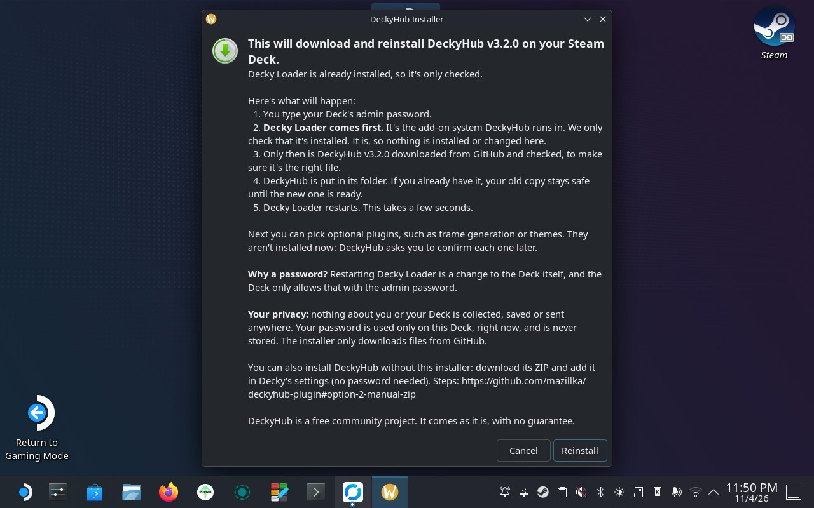 <b>Огляд</b></td>
<td align="center">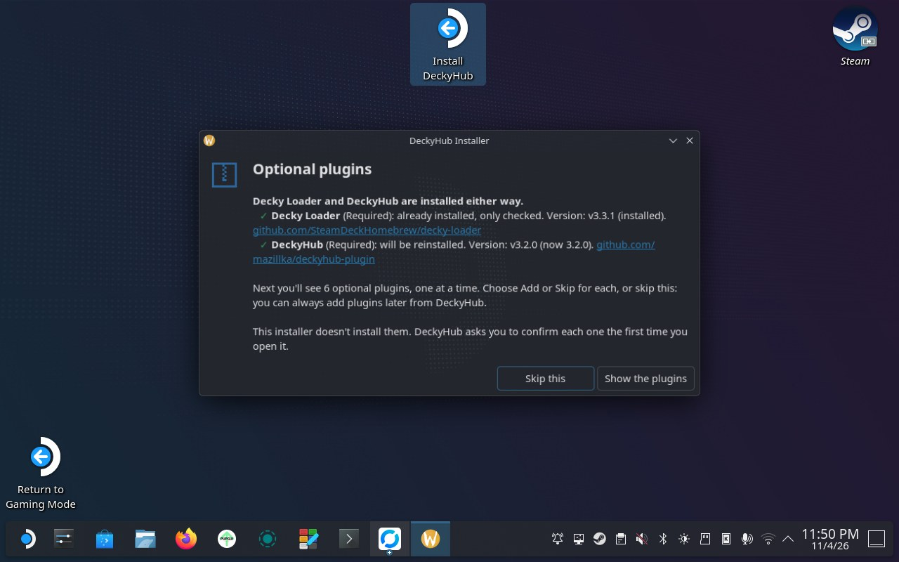 <b>Необов'язкові плагіни</b></td>
<td align="center">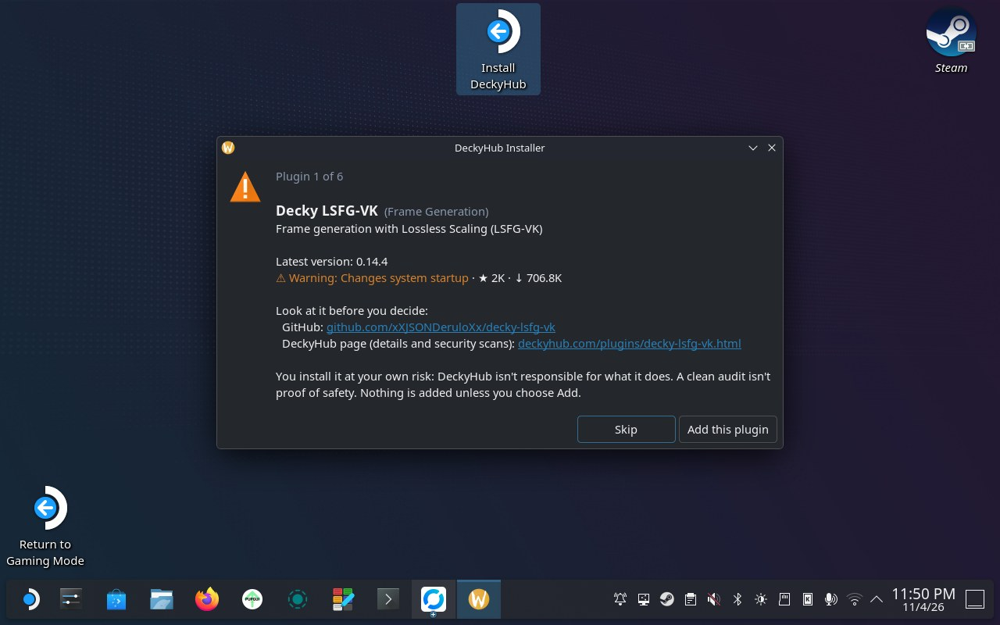 <b>Картка плагіна</b></td>
</tr>
<tr>
<td align="center">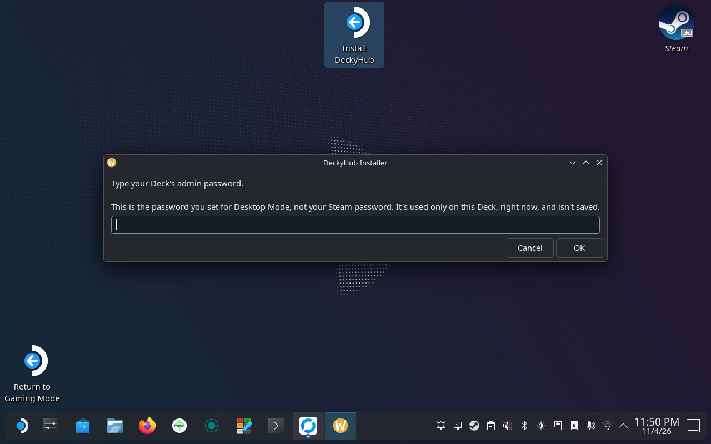 <b>Пароль</b></td>
<td align="center">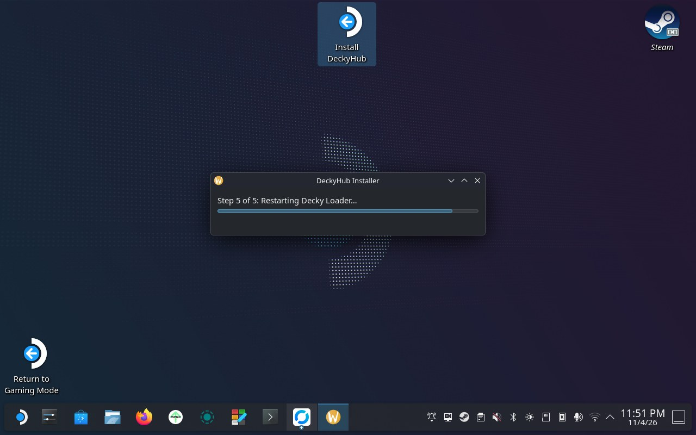 <b>Виконання</b></td>
<td align="center">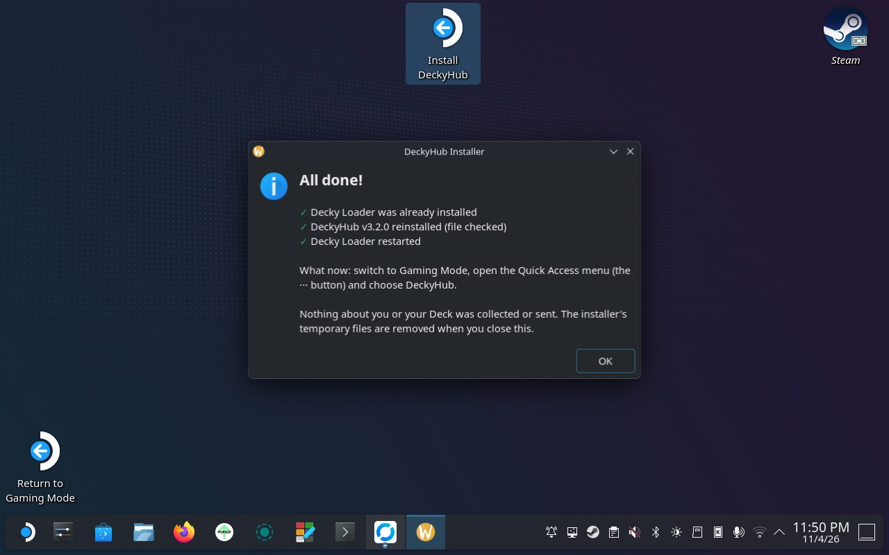 <b>Готово</b></td>
</tr>
</table>

### Варіант 2: ZIP вручну

Decky Loader має бути вже встановлений. Пароль адміністратора не потрібен.

1. Завантажте останній `DeckyHub-v*.zip` зі [сторінки релізів](https://github.com/mazillka/deckyhub-plugin/releases).
2. В ігровому режимі відкрийте меню швидкого доступу → Decky → налаштування (значок шестерні). Увімкніть **Режим розробника** в розділі «Загальні», якщо він вимкнений, потім перейдіть до **Розробник** → **Встановити плагін із ZIP** і виберіть завантажений файл.
3. Оберіть значок DeckyHub із чотирьох квадратів у меню швидкого доступу (або Decky → **DeckyHub**).

#### Альтернатива: встановлення ZIP за посиланням

Якщо Decky Loader уже встановлено:

1. Відкрийте меню швидкого доступу → **Decky** → налаштування (значок шестерні) й увімкніть **Режим розробника** в розділі **Загальні**, якщо він вимкнений.
2. Перейдіть до **Розробник** → **Встановити плагін за URL** і введіть це посилання, яке завжди веде на найновіший реліз DeckyHub:

   `https://github.com/mazillka/deckyhub-plugin/releases/latest/download/DeckyHub.zip`

   

   Відскануйте QR-код, щоб мати посилання на телефоні, поки ви його вводите.
3. Оберіть значок DeckyHub із чотирьох квадратів у меню швидкого доступу (або Decky → **DeckyHub**).

## Користування DeckyHub

### Кнопки контролера

DeckyHub використовує стандартне керування Steam Deck плюс додаткові скорочення на кожній кнопці **Встановити** / **Оновити** (на картках «Огляду» й «Оновлень», у результатах **Пошуку**, у вікні [Керування](#керування) та для оновлення самого DeckyHub):

| Кнопка | Що робить |
| --- | --- |
| **X** | Завантажує ZIP цього релізу до `/home/deck/Downloads/deckyhub` замість встановлення. Не показується, якщо в налаштуваннях приховано **Завантажити ZIP**. |
| **Y** | Показує нотатки до релізу (що він змінює), нічого не встановлюючи. |
| **Menu** (☰) | Відкриває сторінку плагіна на GitHub. Не для оновлення самого DeckyHub. |

Нижній рядок Steam показує ці дії для кнопки, на якій зараз фокус.

### Огляд

«Огляд» відкривається трьома полицями — **Найпопулярніші**, **Нещодавно оновлені** та **Нове в DeckyHub** — під рядом чипів категорій із кількістю плагінів у кожній. Торкніться чипа або **Показати всі** на полиці, щоб переглянути весь список: як компактний список усіх плагінів (за замовчуванням) або як **Сітку** карток по сторінках (**L1** / **R1** гортають сторінки). **Оновлення** й **Пошук** мають такий самий перемикач **Сітка** / **Список**, і DeckyHub запам'ятовує ваш вибір. Вперше над полицями з'являється коротке вітання з поясненням, що робить DeckyHub і як лишатися в безпеці.

Кожна картка має колір (зелений, коли все актуально, жовтий, коли є оновлення, червоний у разі помилки), щоб одразу бачити, що потребує уваги, і показує **Перевірка…**, поки шукається її останній реліз. Плагіни зі списку також показують загальну кількість завантажень, зірки на GitHub та коли їх востаннє оновлювали; у заголовку сторінки — загальна кількість завантажень. Картка з **каналом** пре-релізів це зазначає; стабільний — за замовчуванням і не підписується. Торкніться **Керувати** на будь-якій картці, щоб обрати канал і версію, а потім завантажити потрібний файл релізу.

#### Пошук, фільтри та сортування

Шукайте у списку за назвою, репозиторієм, категорією чи описом і відкрийте **Фільтри**, щоб звузити його:

- **Статус:** усі, встановлені або не встановлені.
- **Категорія:** будь-яка з категорій списку.
- **Сортування:** від А до Я, від Я до А, за кількістю завантажень, за зірками, за недавнім оновленням або за недавнім додаванням (спершу найновіші додані до списку). Плагіни з оновленням завжди йдуть першими, а **Потім за** впорядковує плагіни, які перше сортування залишило рівними.

Кожен варіант **Статусу** та **Категорії** показує, скільки плагінів він виведе.

#### Значки

Картки можуть мати такі значки. **Докладніше** у повідомленні «Що означають значки на плагінах» угорі «Огляду» пояснює їх і в застосунку.

| Значок | Що означає |
| --- | --- |
| **Працює від root** | Його бекенд працює від імені root, з повним доступом до системи. Встановлюйте, лише якщо довіряєте автору. |
| **Немає релізів понад рік** | Понад рік без нових релізів, тож він може бути закинутим. |
| **Форк** | Форк, що продовжує плагін після того, як оригінал зупинився. DeckyHub показує його, лише поки він активний. |
| **ШІ** | У його репозиторії є інструкції для ШІ-асистентів кодування (`CLAUDE.md`, `AGENTS.md`, `.cursorrules`, `.github/copilot-instructions.md` тощо), тож, імовірно, його розробляють за допомогою ШІ. Це нічого не каже про якість чи безпеку, а відсутність значка не означає, що ШІ не використовували. |
| **Загроз немає** / **Знайдено загрозу** / **Перевірено не повністю** | Перевірки на віруси релізу, який ви встановлюватимете (ClamAV і YARA; значок показує гірший з двох результатів): нічого не знайдено, щось позначено (це може бути хибне спрацювання; відкрийте **Керувати**, щоб побачити звіт і вирішити самостійно) або не вдалося перевірити все (**Керувати** пояснює чому). Без значка, доки перевірки не було. Реєстр також шукає кожен публічний ZIP на MetaDefender за SHA-256 і завантажує його туди, якщо звіту немає. Для нових, очікуваних, невдалих або непідтримуваних перевірок результату може ще не бути. Чиста перевірка не доводить безпеку. |

Ці попередження походять від автоматичної [перевірки безпеки](https://decky-extended-plugins.beallio.com/audit) релізу, який ви встановлюватимете, від Decky Extended Plugins. Звичайні знахідки на кшталт `sudo`, `mount` чи `systemctl` не показуються. Попередження не доводить шкоди, а його відсутність не доводить безпеки.

| Попередження | Що знайшла перевірка |
| --- | --- |
| **Заблоковано перевіркою** | Шкідливе ПЗ або пошкоджений архів. Встановлювати не рекомендується. |
| **Читає приватні дані** | Читає дані входу Steam, ключі SSH або секрети із середовища. |
| **Змінює запуск системи** | Редагує профілі оболонки, попередньо завантажує бібліотеки, завантажує модулі ядра або додає правила для пристроїв, які продовжують працювати поза Decky. |
| **Код поза репозиторієм** | Реліз містить скрипти чи програми, яких немає в його джерелі на GitHub, тож прочитати, що вони роблять, неможливо. |
| **Прихований код** | Містить закодований або упакований код, який важко прочитати. |
| **Пропускає перевірки HTTPS** | Вимикає перевірку сертифікатів, тож завантажене можуть підмінити. |
| **Запускає завантажені скрипти** | Завантажує скрипт і одразу його виконує. |
| **Відомі вразливості** | Містить бібліотеки з оприлюдненими вразливостями. |

Попередження про новіший пре-реліз позначається **Пре-реліз:**. Кількість завантажень, зірки й попередження надходять із реєстру, який оновлюється щогодини.

### Пошук і встановлення

Не кожен плагін Decky є в магазині Decky чи списку DeckyHub. Відкрийте **Пошук** у меню швидкого доступу, введіть, що шукаєте, і DeckyHub знайде це на GitHub прямо з ігрового режиму.

- **Лише плагіни Decky** — результати обмежено репозиторіями, які справді є плагінами Decky, тож списки «awesome», посібники й сторонні проєкти не заважатимуть.
- **Встановити** — додає репозиторій до вашого списку відстежуваних і передає його останній реліз власному інсталятору Decky Loader зі звичним підтвердженням. Відтепер він з'являється в «Огляді» з перевіркою оновлень, як і будь-який плагін зі списку.
- **Додати** (**+** поруч зі «Встановити») — лише відстежує репозиторій, щоб ви могли переглянути його в «Огляді» й встановити пізніше. Результати, які вже є в DeckyHub, мають позначку **У DeckyHub**.
- **Y** на кнопці **Встановити** результату показує нотатки до цього релізу, а **X** завантажує його ZIP замість цього.

> [!WARNING]
> Результати пошуку надходять прямо з GitHub, і їх ніхто не перевіряв: ні DeckyHub, ні магазин Decky. Плагін може робити на вашому Deck що завгодно, тож встановлюйте плагіни лише від авторів, яким довіряєте.

Відстежувані репозиторії перелічено в **Налаштування** → **Репозиторії**, де їх можна видалити або експортувати та імпортувати список.

### Оновлення

Показує кожен відстежуваний засіб, який встановлено й для якого є новіший реліз, разом із встановленою та останньою версіями. Оновлюйте плагін із його вікна [Керування](#керування) або, коли чекає більше одного плагіна Decky, торкніться **Оновити все**, щоб передати їх усі інсталятору Decky Loader з єдиним підтвердженням. Кілька плагінів неможливо оновити на місці через помилку Decky Loader: **Оновити все** їх пропускає, а їхнє вікно «Керування» пояснює, що DeckyHub видаляє встановлену версію, перш ніж Decky встановить нову. Кнопка **Оновлення** в меню швидкого доступу показує, скільки оновлень чекає.

### Керування

Торкніться **Керувати** на будь-якій картці в «Огляді» чи «Оновленнях», щоб:

- обрати **канал** релізів і конкретну **версію**. **Стабільний** показує лише стабільні релізи; **Пре-реліз** показує кожен реліз, найновіші першими, тож стабільний реліз, що вийшов після останнього пре-релізу, все одно пропонується;
- **Завантажити ZIP**, відкрити **Сторінку релізу** або **Перевірити оновлення** для цього застосунку;
- для плагіна Decky — **Встановити** (ще не встановлено) або **Оновити** (вибрана версія новіша за встановлену). DeckyHub завантажує ZIP релізу (з вікном перебігу, а потім індикатором, доки Decky не буде готовий) і передає його власному інсталятору Decky Loader — тому самому, що й кнопка магазину Decky. Decky просить підтвердити й встановлює, перевіряючи контрольну суму SHA-256, яку GitHub публікує для ZIP. Старіші релізи (файли, завантажені до середини 2025 року) не мають контрольної суми, і Decky встановлює їх без цієї перевірки;
- для встановленого плагіна Decky — **Видалити**, що просить підтвердження, а потім видаляє плагін і його налаштування через Decky Loader;
- переглянути **перевірку на віруси** ZIP вибраної версії: **Загроз не знайдено**, **Знайдено загрозу** (із тим, що збіглося), **Не вдалося перевірити** (із причиною) або **Ще не перевірено**, і коли її виконано. Кожен сканер має власний рядок: **ClamAV** і **YARA**, а також **VirusTotal** і **MetaDefender**, якщо вони вже перевірили цей файл. **Звіт перевірки** показує повний звіт: файл, його SHA-256, версію сканера, сигнатури чи правила й дату кожного. **VirusTotal** відкриває в браузері Steam сторінку [VirusTotal](https://www.virustotal.com/) для SHA-256 цього ZIP; нічого не завантажується, тож результат є, лише якщо хтось уже надсилав на VirusTotal такий самий файл. **Копіювати посилання на ZIP** кладе посилання для завантаження ZIP до буфера обміну, а **Перевірити посилання на VirusTotal** теж копіює його й відкриває сторінку перевірки URL на VirusTotal, куди його треба вставити (VirusTotal переважно оцінює саме посилання, тож може не перевіряти вміст ZIP). Перевірка ніколи не заважає встановленню: прочитайте звіт і вирішуйте самі. [Реєстр DeckyHub](https://github.com/mazillka/deckyhub-registry#repositories) кілька разів на день [перевіряє кожен ZIP плагіна, який пропонує](https://github.com/mazillka/deckyhub-registry#repositories), за допомогою [ClamAV](https://www.clamav.net/) — антивіруса з відкритим кодом, а файли всередині — за допомогою [YARA](https://virustotal.github.io/yara/) і правил спільноти [YARA Forge](https://github.com/YARAHQ/yara-forge), багато з яких написані для шкідливого ПЗ під Linux, тож для зовсім нового релізу звіту може ще не бути. Чиста перевірка не доводить безпеки.

### Налаштування

Налаштування поділено на вкладки; **L1** / **R1** перемикають між ними.

| Вкладка | Що в ній |
| --- | --- |
| **Загальні** | Мова та вигляд: **Сітка** чи **Список**, щільність **Звичайна** чи **Компактна**, елементів у рядку, вібровідгук, чи має DeckyHub власну вкладку у швидкому доступі та які кнопки вікна «Керування» приховати. |
| **GitHub** | Необов'язковий особистий токен доступу, що підвищує ліміт запитів GitHub (див. [Усунення неполадок](#усунення-неполадок)). Введіть його або завантажте з текстового файлу в «Завантаженнях». |
| **Завантаження** | Тека завантажень і перемикач **Перезаписувати наявні** (див. [Завантаження](#завантаження)). |
| **Репозиторії** | Ваші відстежувані репозиторії, експорт та імпорт і **власні реєстри** (див. [Репозиторії](#репозиторії)). |
| **Журнали** | **Експортувати журнали** для звітів про помилки. |
| **Про програму** | Що таке DeckyHub і на яких каталогах він побудований. |

DeckyHub доступний англійською, українською, російською, іспанською, німецькою, французькою, португальською (Бразилія та Португалія), італійською, польською, турецькою, нідерландською, чеською, японською, корейською та китайською (спрощеною й традиційною). Переклади, окрім англійського, зроблено автоматично, тож у них можуть бути помилки; виправлення вітаються.

Канал релізів відстежуваного застосунку тут не задається: скористайтеся його вікном [Керування](#керування).

### Завантаження

Усі завантаження зберігаються в `/home/deck/Downloads/deckyhub`. **Очищення** → **Очистити теку** в меню швидкого доступу очищає цю теку після підтвердження. Початок завантаження відкриває вікно перебігу з кнопкою **Скасувати**; коли воно завершується, те саме вікно показує, куди збережено ZIP і як його встановити. Якщо завантаження переривається, часткового файлу не лишається.

Коли GitHub надає контрольну суму файлу релізу, DeckyHub завжди перевіряє її перед тим, як залишити завантажене. За замовчуванням повторне завантаження файлу перезаписує попередню копію; вимкніть **Перезаписувати наявні** в налаштуваннях, якщо хочете зберегти обидві.

### Репозиторії

«Репозиторії» — вкладка в **Налаштуваннях**. Додавайте репозиторій із **Пошуку** кнопкою **+** поруч зі **Встановити** результату (результати, які вже є в DeckyHub, мають позначку **У DeckyHub**). Експортуйте власні репозиторії до `DeckyHub-repositories.json` у `/home/deck/Downloads`, щоб зберегти їх чи поділитися ними, або імпортуйте цей файл назад. Будь-який доданий вами репозиторій можна тут видалити; плагіни зі списку самого DeckyHub лишаються доступними й не видаляються. Бажаєте більший екран? [Редактор реєстру](https://registry.deckyhub.com/editor.html) — інструмент у браузері для створення чи редагування файлу списку репозиторіїв перед імпортом.

У розділі **Власні реєстри** додавайте чужий список застосунків за його `owner/repo` на GitHub (DeckyHub читає його `registry/apps.json`) або за будь-якою HTTPS-адресою `.json`. Його застосунки з'являються в «Огляді» поруч зі списком DeckyHub; дозволено до 10 реєстрів, а **Оновити реєстри** завантажує їх усі заново. Доданий реєстр може лише додавати застосунки: він не може змінити чи замінити той, що DeckyHub уже показує, зокрема плагіни, які ви встановили.

### Оновлення самого DeckyHub

Меню швидкого доступу показує встановлену версію (**DeckyHub vX.Y.Z**) і у фоні перевіряє, чи є новіший реліз DeckyHub, надсилаючи сповіщення, коли такий вперше з'являється; примітка називає нову версію, а кнопка **Оновити** одразу встановлює її, як і на картці застосунку. **Керувати** відкриває вікно оновлення DeckyHub, де ви обираєте канал (**Стабільні релізи** або **Пре-релізи** для всіх релізів) і версію, а потім:

- **Оновити до / Перевстановити / Повернутися до vX.Y.Z** — завантажує цей реліз (із вікном перебігу) і передає його власному інсталятору Decky Loader (тому самому, що й магазин Decky), який перевіряє його контрольну суму SHA-256 і встановлює на місці. Пропонуються лише релізи з опублікованою контрольною сумою.
- **Завантажити ZIP** — класичний шлях: зберігає ZIP релізу в `/home/deck/Downloads/deckyhub`, який ви потім встановлюєте самі (див. [Варіант 2: ZIP вручну](#варіант-2-zip-вручну)).

Вікно оновлення також показує звіт **перевірки на віруси** вибраного релізу. Кожен реліз DeckyHub перевіряється ClamAV перед публікацією; результат зазначено в його нотатках, а звіт про перевірку додається до [релізу](https://github.com/mazillka/deckyhub-plugin/releases); його код на Python і TypeScript під час кожної зміни перевіряє GitHub [CodeQL](https://github.com/mazillka/deckyhub-plugin/actions/workflows/codeql.yml).

**Канал реєстру** у власному вікні **Керувати** DeckyHub (швидкий доступ → DeckyHub → **Керувати**) обирає, яку версію власного списку плагінів DeckyHub ви бачите. **Стабільний** (за замовчуванням) — те, що отримують усі. **Пре-реліз** показує плагіни та зміни списку, які ще тестуються, а «Оновлення» й «Огляд» пишуть **Пре-релізний реєстр**, поки його ввімкнено; якщо цей список не вдається завантажити, DeckyHub використовує стабільний. Перемикання одразу перезавантажує список.

## Видалення DeckyHub

Відкрийте налаштування Decky (значок шестерні) → **Плагіни**, відкрийте меню поруч із **DeckyHub** і оберіть **Видалити**. Decky видаляє DeckyHub разом із його налаштуваннями та кешованими списками. Плагіни, які ви встановили через DeckyHub, лишаються встановленими.

Файли, які DeckyHub зберіг у «Завантаженнях», не видаляються: ZIP релізів у `/home/deck/Downloads/deckyhub` та будь-які експортовані списки репозиторіїв чи ZIP журналів у `/home/deck/Downloads`. Скористайтеся **Очищенням** → **Очистити теку** перед видаленням або видаліть їх у режимі робочого столу.

## Усунення неполадок

- **Помилки «Rate limit».** DeckyHub звертається до GitHub, не вимагаючи від вас входу. Дані про релізи зі списку DeckyHub надходять з одного файлу, який реєстр оновлює щогодини, тож перегляд не вичерпує публічний ліміт запитів GitHub (60 на годину). Пошук і репозиторії, які ви додали самі, усе ще звертаються до GitHub напряму, тож дуже інтенсивне користування може впертися в ліміт; тоді помилка приблизно скаже, скільки чекати. Щоб підняти ліміт до 5000 на годину, додайте особистий токен доступу в **Налаштування → GitHub** (права не потрібні; про те, куди він іде, див. [Приватність](#приватність)).
- **Новий реліз не з'являється.** Інформація про релізи кешується на 30 хвилин. Кожна кнопка **Перевірити оновлення** та **Оновити** обходить кеш, хоча новому релізу може знадобитися до години, щоб потрапити у файл релізів списку плагінів.
- **«Огляд» порожній після свіжого встановлення.** DeckyHub має один раз підключитися до GitHub, щоб завантажити список плагінів; після цього він працює офлайн з останньої копії.
- **Встановлення, оновлення чи власне оновлення DeckyHub не працює.** У старішій збірці Decky Loader встановлення одним дотиком може бути недоступне. Скористайтеся **Завантажити ZIP** і встановіть його в налаштуваннях розробника Decky (див. [Варіант 2: ZIP вручну](#варіант-2-zip-вручну)) або оновіть Decky Loader.
- **Щось інше.** Відкрийте issue (див. [Допомога](#допомога)) і додайте ZIP з **Експортувати журнали**.

Завантаження відбуваються лише через HTTPS.

## Як DeckyHub контролює якість

DeckyHub встановлює програми на ваш Deck, тож кожна зміна, кожен випуск і кожен плагін у списку проходять перевірки, перш ніж дістатися до вас. Усе це відкрито, у цьому репозиторії та в [mazillka/deckyhub-registry](https://github.com/mazillka/deckyhub-registry).

**Кожна зміна, перш ніж її злити.** Гілки `develop` і `main` захищені: напряму в них нічого не надсилається, а pull request зливається, лише коли пройдено всі ці перевірки:

| Перевірка | Що вона охоплює |
| --- | --- |
| Тести бекенду (вбудований у Python `unittest`) | Завантаження, перевірку SHA-256, перенаправлення лише через HTTPS, файл налаштувань, розбір реєстру та інсталятор для режиму робочого столу, запущений від root на заглушках |
| Модульні тести фронтенду | Порівняння версій, очищення приміток до випуску, кеш і заповнювачі в кожній мові |
| Браузерні тести (понад 140 тестів Playwright у чотирьох паралельних частинах) | Справжній інтерфейс DeckyHub у макеті ігрового режиму: перегляд, встановлення, оновлення, звіти антивірусної перевірки, «Пропустити цю версію», відомі проблеми, налаштування та фокус контролера |
| Перевірка типів | Увесь фронтенд на TypeScript (`tsc`) |
| [CodeQL](https://github.com/mazillka/deckyhub-plugin/actions/workflows/codeql.yml) | Аналіз безпеки коду на Python і TypeScript від GitHub |
| Dependency review і Dependabot | Залежності з відомими вразливостями позначаються, а оновлення безпеки надходять як pull request |

**Кожен випуск.** Спершу виходять попередні випуски (`-rc`), а стабільний випуск — це перевірений pull request з `develop` у `main`. Процес випуску відхиляє тег, що не збігається з `package.json`, знову запускає всі тести й збирає ZIP з токеном лише для читання. ZIP та інсталятор для режиму робочого столу перевіряються ClamAV, VirusTotal і MetaDefender до публікації, а результати потрапляють у примітки до випуску та значки на початку цієї сторінки. Перед стабільним випуском його пробують на справжньому Steam Deck: `devtools/deck/` встановлює збірку через налагоджувач Steam, керує ігровим режимом хрестовиною та робить знімки екрана.

**Кожен плагін у списку.** Кожну зміну списку плагінів звіряють з GitHub: випуск і його ZIP існують, записи не конфліктують, а версія всередині ZIP збігається з тегом випуску. Найновіші ZIP кожного плагіна кілька разів на день перевіряються ClamAV і YARA та шукаються на VirusTotal і MetaDefender за SHA-256, а попередження [аудиту Decky Extended Plugins](https://decky-extended-plugins.beallio.com/audit) показуються на його картці. Результати кожного плагіна є на його сторінці на [deckyhub.com](https://deckyhub.com/plugins/), а [Відомі проблеми](https://deckyhub.com/plugins/known-issues.html) перелічують усі плагіни із зауваженнями. Перевірки та попередження лише інформують і нічого не блокують: чиста перевірка не доводить безпечності.

**Безпечний за задумом.** Ніщо не встановлюється без вашого натискання: встановлення, оновлення та видалення проходять через власний інсталятор Decky Loader. Завантаження — лише через HTTPS, з випусків GitHub вибраного репозиторію, з перевіркою SHA-256, щойно GitHub її публікує. Бекенд використовує лише стандартну бібліотеку Python, тож на вашому Deck не працюють сторонні пакети.

## Приватність

DeckyHub не має облікових записів, аналітики чи телеметрії та нічого не надсилає ні своєму авторові, ні на жоден власний сервер.

- **До чого він підключається:** лише до GitHub — `raw.githubusercontent.com` і `github.com` для списку плагінів, даних про релізи, звітів про перевірки на віруси та завантажень, а `api.github.com` — для пошуку й репозиторіїв, яких немає у списку, — а також до HTTPS-адреси будь-якого власного реєстру, який ви додали. GitHub бачить ці запити так само, як запити будь-якого браузера (вашу IP-адресу й те, які репозиторії запитано), відповідно до [заяви GitHub про конфіденційність](https://docs.github.com/site-policy/privacy-policies/github-general-privacy-statement). Посилання, як-от репозиторій плагіна чи сторінка перевірки, відкриваються лише коли ви їх торкаєтеся.
- **Що лишається на вашому Deck:** ваші налаштування, відстежувані репозиторії, власні реєстри та кешований список плагінів і дані про релізи. Файл налаштувань доступний для читання лише вашому користувачеві.
- **Ваш токен GitHub** необов'язковий, не потребує прав, надсилається лише на `api.github.com` і ніколи не потрапляє в журнали.
- **Журнали** самі ніколи не залишають Deck. **Експортувати журнали** зберігає в теку «Завантаження» ZIP з тим, що робив DeckyHub, і помилками (назви репозиторіїв, шляхи до файлів, версії); чи додавати його до issue, вирішуєте ви.

## Відмова від відповідальності

Не пов'язаний із Valve чи проєктом Decky Loader. DeckyHub — це інструмент пошуку й завантаження: інформація про плагіни надходить із публічних репозиторіїв GitHub, а кожен плагін належить його авторам. DeckyHub не перевіряє, не володіє й не схвалює жодного стороннього плагіна чи його вмісту і не відповідає за те, що він робить. Плагіни встановлюються на ваш власний ризик, тож перегляньте репозиторій плагіна перед встановленням, особливо знайденого через «Пошук».

## Ліцензія

Copyright © 2026 Andrii Shevchuk-Yuhanets ([mazillka](https://github.com/mazillka)).

GPL-3.0-or-later — див. [LICENSE.md](LICENSE.md).

## Допомога

Знайшли помилку або маєте ідею? Відкрийте issue в [репозиторії GitHub](https://github.com/mazillka/deckyhub-plugin/issues) з описом того, що сталося; допоможе ZIP з **Експортувати журнали** (**Налаштування** → **Журнали**). Відгуки та пропозиції завжди вітаються.

Хочете зібрати DeckyHub з вихідного коду або запропонувати зміну? Див. [CONTRIBUTING.md](CONTRIBUTING.md). Усі учасники дотримуються [Кодексу поведінки](CODE_OF_CONDUCT.md).
